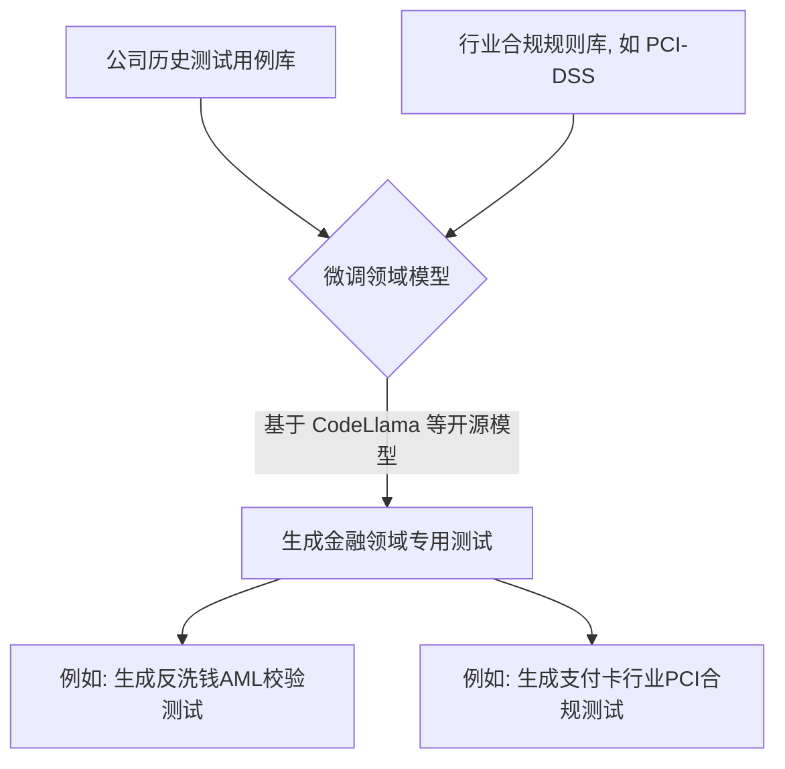
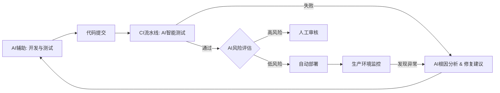

# 四、工具链与生态系统：构筑 AI-TDD 的智能基建  

AI 辅助 TDD 的潜力能否充分释放，很大程度上依赖于相关工具链和生态系统的成熟度。未来的开发工具将不再仅仅是代码编辑器和编译器，而会成为深度集成 AI 能力的智能协作平台，为 TDD 的每个环节提供无缝、智能的支持。

## 4.1 AI 原生开发工具：IDE 与测试框架的智能化升级

### 4.1.1 深度集成 AI 的 IDE 功能矩阵

现代 IDE 正在从"集成开发环境"向"智能开发伙伴"演进。以 GitHub Copilot、JetBrains AI Assistant、VS Code 内置的 AI 功能等为代表的工具，已经将 AI 能力深度嵌入到开发工作流中。

| 工具/能力 | TDD 增强点 | 典型用法 |
|---|---|---|
| **智能测试生成** | 根据代码上下文、函数签名或注释，自动生成单元测试、边界值测试和数据驱动测试。 | 右键点击函数 -> "生成测试"；或通过注释描述测试意图，AI 自动补全。 |
| **实时红灯分析** | 在编码阶段实时分析，预测即将编写或修改的代码可能导致的测试失败，并提示原因。 | `Amazon CodeGuru` 等工具可在 IDE 中高亮潜在的逻辑冲突。 |
| **智能重构** | 一键执行复杂的代码和测试解耦、提取接口、消除坏味道等重构操作，并同步更新测试用例。 | 在代码坏味道处 `Alt+Enter` -> "AI 建议重构..." |
| **TDD 过程可视化** | 将"红-绿-重构"循环以实时流程图的方式展现，帮助开发者保持节奏和纪律。 | `Symflower` 等新兴工具提供了此类可视化能力。 |

### 4.1.2 内置 AI 能力的测试框架与库

现有的测试框架（如 JUnit, PyTest, Jest）正通过扩展或新版本，原生支持 AI 辅助功能。
-   **智能测试数据生成器**：框架内置更强大的测试数据生成能力，能够根据被测代码的类型、约束和语义，自动生成高质量的、覆盖广泛的测试数据。
-   **AI 驱动的 Mocking/Stubbing 建议**：当测试需要 Mock 依赖时，AI 能够分析依赖接口和被测代码的交互，自动建议 Mock 行为的设置（如 `when(...).thenReturn(...)`）。
-   **自动化测试用例维护**：当被测代码的接口发生变化时，AI 辅助更新相关的测试用例，减少因 API 变更导致的测试维护成本。

## 4.2 领域专用 AI 模型：训练更懂业务的 TDD 助手

### 4.2.1 通用大模型的局限与微调的价值

通用大语言模型（如 GPT 系列）虽然能力强大，但在特定专业领域（如复杂的金融业务逻辑、嵌入式系统约束）或特定团队的编码规范和 TDD 实践风格方面，可能不够"懂行"。

通过使用组织自己的高质量代码库（包含遵循 TDD 原则的代码和测试）对通用模型进行**微调**，可以训练出更懂业务逻辑、更符合团队规范的专用 AI 助手，从而生成更精准、更高质量的测试和代码。

### 4.2.2 构建面向特定领域（如金融、医疗）的 TDD 模型

为特定业务领域训练的 AI 模型可以极大提升 TDD 的效率和深度。

**操作流程**:
1.  **收集语料**：整合团队内部高质量的测试用例、代码库以及特定行业的合规文档、API 规范。
2.  **模型微调**：使用这些语料对开源代码模型（如 CodeLlama, StarCoder2）进行微调。
3.  **应用集成**：将微调后的模型集成到 IDE 插件或 CI/CD 流程中，为开发者提供高度定制化的 TDD 辅助。

## 4.3 CI/CD 与 DevOps 的融合进化

TDD 本身就是 DevOps 文化中"质量左移"和"快速反馈"理念的绝佳体现。AI 的全面介入，将进一步放大和深化 TDD 在持续集成与持续部署（CI/CD）体系中的价值。

### 4.3.1 智能化的持续集成（测试选择、失败分析）

-   **智能测试选择 (Test Impact Analysis)**：AI 可以分析每次代码提交实际影响了哪些模块，从而在 CI 流程中只运行最相关的测试子集，而不是每次都全量运行。这能大幅缩短 CI 的反馈时间（节省约 70% 的测试执行时间），同时保证足够的信心。
-   **AI 根因分析**：当 CI 构建因测试失败而变红时，AI 可以辅助分析失败原因（例如，通过分析堆栈信息、关联相关代码变更），甚至提出修复建议或自动生成修复代码的初稿，从而缩短修复时间。

### 4.3.2 AI 增强的持续部署（风险评估、自动回滚）

-   **更可靠的自动化部署决策**：AI 辅助生成的更全面的测试，使得 CD 流水线中"测试通过即可部署"的决策更加可靠。
-   **AI 辅助的风险评估**：在执行蓝绿部署、金丝雀发布等渐进式部署策略时，AI 可以分析新版本的遥测数据，更智能地判断新版本是否稳定、是否可以逐步扩大发布范围，或者是否需要快速回滚。

### 4.3.3 构建分钟级快速反馈闭环

AI 增强的 TDD 与 CI/CD 深度融合，构建了一个从开发到生产的、前所未有的快速反馈闭环。

这个闭环将质量的构建和验证推到了开发流程的最前端，并在每个环节都得到了快速、智能的反馈和验证，是敏捷和 DevOps 追求的终极目标。 

---
