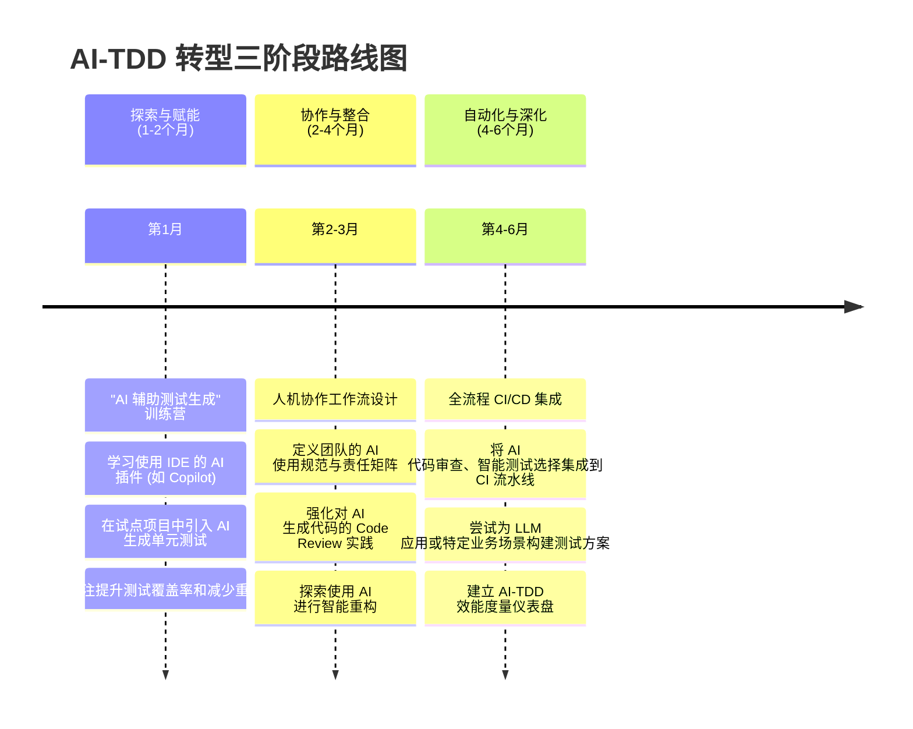

# 五、落地路线图与实践策略 

将 AI 融入 TDD 流程并非一蹴而就，它需要一个清晰的路线图、对潜在风险的认知以及一套行之有效的度量体系。本章旨在为团队提供可操作的采纳路径、反模式预警和效果评估方法。

## 5.1 团队采纳 AI-TDD 的分阶段路线图

一个循序渐进的采纳策略可以帮助团队平稳过渡，并逐步释放 AI-TDD 的潜力。

## 5.2 关键反模式预警与应对策略

在拥抱 AI 带来的便利时，必须警惕可能侵蚀 TDD 核心价值的"反模式"。

### 5.2.1 警惕"虚荣的覆盖率"与"盲目的绿灯"

-   **反模式描述**：团队过度关注由 AI 刷高的测试覆盖率数字，而忽略了测试的有效性。AI 可能生成大量只覆盖简单路径或无断言的"空洞"测试。同时，开发者可能在没有充分断言的情况下，让 AI "胡补代码"以求快速"变绿"，导致伪通过。
-   **应对策略**：
    -   **质量重于数量**：引入**变异测试 (Mutation Testing)** 来评估测试套件的健壮性，即其"杀死"代码中微小错误的能力。
    -   **人工审查关键路径**：强制要求对核心业务逻辑（如支付、权限、算法）的测试用例进行人工深度审查。
    -   **先写高质量断言**：在让 AI 生成实现代码前，确保测试用例中的断言是明确、具体且有意义的。

### 5.2.2 避免"设计退化"与"过度 Mock"

-   **反模式描述**：开发者完全委托 AI 生成代码，跳过人工思考和重构环节，导致 AI 可能采用糟糕的设计（如使用全局状态、违反单一职责原则）来"走捷径"通过测试。此外，AI 可能会过度使用 Mock 来隔离被测单元，掩盖了真实的集成问题，这种现象被称为"模拟地堡（Mocking Bunker）"。
-   **应对策略**：
    -   **守护设计驱动本质**：坚持 TDD 的重构环节不可跳过。代码评审应重点关注 AI 生成代码的设计质量，而不仅仅是功能正确性。
    -   **控制 AI 测试贡献率**：设定一个健康的度量标准，例如"AI 测试贡献率"应低于某个阈值（如 70%），以确保高价值的、需要深度思考的测试由人工设计。
    -   **平衡单元测试与集成测试**：确保测试策略中包含足够比例的集成测试，以验证组件间的真实交互。

## 5.3 度量与评估：如何衡量 AI-TDD 的成效

为了客观评估 AI-TDD 的引入效果并持续改进，团队需要建立一套覆盖效率和质量的度量体系。

| 度量维度 | 关键指标 | 描述与目标 |
|---|---|---|
| **效率指标** | **开发循环时间 (Cycle Time)** | 从编写第一个失败测试到重构完成的时间。**目标：缩短 40% 以上**。 |
| | **需求到上线周期 (Lead Time)** | 从需求提出到功能部署的端到端时间。**目标：显著缩短**。 |
| | **AI 建议采纳率** | 开发者采纳 AI 生成的测试/代码/重构建议的比例。用于评估 AI 工具的有效性。 |
| **质量指标** | **缺陷逃逸率 (Defect Escape Rate)** | 逃逸到生产环境的缺陷数量。**目标：持续降低**，是衡量 TDD 成效的最终标准。 |
| | **重构活跃度** | 代码库中重构相关的提交占比。**目标：保持在健康水平（如 >20%）**，以防止代码僵化。 |
| | **测试套件健壮性** | 通过变异测试得分来衡量。**目标：稳步提升**。 |
| | **部署失败率 (Deployment Failure Rate)** | 因质量问题导致部署失败的频率。**目标：显著降低**。 |
| | **平均修复时间 (MTTR)** | 从发现缺陷到修复完成的平均时间。**目标：显著缩短**。 |

通过持续追踪这些指标，团队可以数据驱动地优化其 AI-TDD 实践，确保技术转型带来真实的工程价值。 

---
