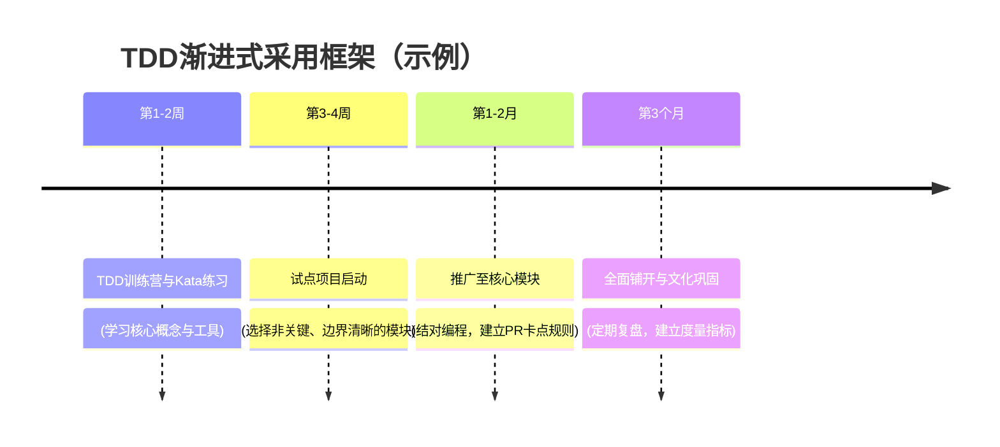

## 第5章：TDD的团队导入、文化构建与持续精进 (Team Adoption & Culture)

TDD的成功落地，50%依赖于技术，另外50%则取决于文化。它不仅仅是个体技能的掌握，更需要团队层面的共同努力、文化支持和持续改进的机制。本章将探讨如何在团队中有效导入TDD，构建支持TDD的文化，并确保实践能够持续精进。

### 5.1 成功导入TDD的前置条件

在团队中推行TDD之前，必须确保在技能、心态和组织层面做好了充分的准备。

#### 5.1.1 团队技能准备

*   **扎实的单元测试能力**：团队成员需要熟练掌握所用语言的单元测试框架（如JUnit, PyTest, Jest等）和断言库。
*   **基本的重构能力**：了解常见的代码坏味道和重构手法（如提取方法、移动类等）。
*   **Mock/Stub工具的使用**：能够熟练使用Mock框架（如Mockito, Sinon.js）来隔离依赖。
*   **理解设计原则**：对SOLID等设计原则有一定了解，能理解TDD如何促进良好设计。

#### 5.1.2 必备的心态转变

*   **拥抱反馈，视"红灯"为机遇**：将测试失败视为有价值的反馈和进步的信号，而非挫败。
*   **坚持纪律性**：严格遵守"红-绿-重构"的循环，不跳过任何步骤，尤其是重构。TDD需要自律。
*   **耐心与坚持**：认识到TDD的学习和习惯养成需要时间，愿意为长期收益而接受初期的不适或效率波动。
*   **对质量的共同承诺**：团队成员需认同高质量代码的重要性，并将TDD视为实现这一目标的内建手段。

#### 5.1.3 组织与管理层的支持

*   **管理层理解与支持**：管理层需要理解TDD的长期价值，并愿意为初期的学习成本提供支持（例如，不单纯以短期功能交付速度作为唯一考核标准）。
*   **鼓励实验与容错**：营造一个允许团队在学习TDD过程中犯错并从中学习的心理安全环境。
*   **提供时间与资源保障**：给予团队成员学习、练习（如编码道场）和讨论TDD的时间，并提供必要的培训资源或外部教练支持。

### 5.2 有效的TDD引入策略

强制性地、一刀切地推行TDD往往会失败。一个渐进、务实的引入策略至关重要。

*   **试点项目 (Pilot Project)**：选择一个风险较低、规模适中、团队成员有兴趣的新项目或模块作为试点。从试点中收集经验教训，总结出适合团队的最佳实践，然后再逐步推广。
*   **结对编程 (Pair Programming) / Mob编程**：这是学习和推广TDD的极佳方式。两个人（或多人）一起思考测试、编写代码、重构，可以相互学习，保证TDD流程的执行，并即时反馈。一个有经验的TDD实践者与一个初学者结对，能起到很好的传帮带作用。
*   **内部培训 & 编码道场 (Coding Dojo)**：由团队内有经验的成员或技术专家组织分享会、工作坊。定期举行编码道场，通过练习经典的TDD Kata（如FizzBuzz、保龄球计分等）来固化肌肉记忆。
*   **代码评审 (Code Reviews) 中关注测试**：将测试代码作为代码评审的重点之一。评审测试的质量（是否遵循FIRST原则）、覆盖的行为、可读性等，而非仅仅关注覆盖率数字。
*   **制定团队规范与共识 (Team Norms)**：团队共同讨论并制定关于TDD实践的基本规范，例如：将"通过所有相关测试"纳入"完成的定义"（Definition of Done），CI中强制测试全绿才可合并等。

### 5.3 TDD实践中的常见误区与规避

| 常见误区 | 后果与表现 | 规避与纠偏方法 |
| :--- | :--- | :--- |
| **为覆盖率而测试 (Testing for Coverage Sake)** | 过于追求100%的代码覆盖率，编写大量低价值、只为"覆盖那一行"的脆弱测试。 | **关注行为验证，而非代码行。** 使用覆盖率工具作为发现未测试区域的辅助，而不是终极目标。聚焦核心业务逻辑、边界条件和错误处理。 |
| **测试实现细节而非行为 (Testing Implementation Details)** | 测试私有方法、测试一个方法内部调用了哪些其他方法。这类测试非常脆弱，一旦实现细节改变（即使外部行为不变），测试就会失败。 | **始终从"黑盒"视角思考，测试类的公共API所暴露的行为。** 如果感觉某个内部逻辑太复杂需要单独测试，考虑是否可以将其提取到一个新的类中，然后测试那个新类的公共接口。 |
| **跳过重构步骤 (Skipping the Refactor Step)** | 只满足于"红-绿"，代码能工作就行，忽略了重构。导致技术债累积，代码质量逐渐下降，最终TDD的很多好处会丧失。 | **将重构视为与Red/Green同等重要的一等公民。** 代码评审时应特别关注是否有重构。在估时中为重构预留时间（如20%）。 |
| **测试写得太大或太慢 (Tests are Too Big or Too Slow)** | 一个测试验证了太多行为，或者测试依赖真实数据库/网络，运行缓慢，导致开发者不愿意频繁运行。 | **严格遵循FIRST原则。** 将大测试分解为多个小而专注的测试。积极使用Mock/Stub隔离外部依赖，确保单元测试快速。 |
| **过度Mock (Over-Mocking)** | Mock了过多的依赖，甚至Mock了值对象等不应被Mock的对象。导致测试与真实运行环境的行为差异过大，测试变得难以理解和维护。 | **只Mock那些代表外部系统、有副作用或难以控制的依赖。** 对于简单的内部协作对象，若其行为稳定，直接使用真实实例可能更好。谨慎评估每次Mock的必要性。 |

### 5.4 构建持续精进的TDD文化

TDD的最终成功，在于将其内化为团队的DNA，成为一种追求卓越工程的文化。

| 能力成熟度模型（示例） | 测试能力 | 文化特征 | 关键干预措施 |
| :--- | :--- | :--- | :--- |
| **混沌期** | 无单元测试 | 恐惧变更 | 引入结对编程 + 基础单元测试培训 |
| **觉醒期** | 部分后置测试 | 怀疑价值 | 技术Dojo（如红绿重构游戏），分享成功案例 |
| **规范期** | TDD基础覆盖 | 流程纪律化 | PR卡点（无测试不合并），建立CI/CD门禁 |
| **精通期** | 领域驱动测试 | 质量共同体 | 定期重构道场，关注缺陷逃逸率等健康度指标 |

#### 5.4.1 TDD不仅是技术，更是文化

*   它关乎**质量承诺、持续学习、团队协作和专业纪律**。
*   需要建立一种**心理安全**的文化，让成员敢于提问、分享经验、承认错误，并在实践中共同成长。可以设立"绿灯保障基金"（重构出错不追责）等机制来鼓励大胆优化。

#### 5.4.2 建立持续改进的反馈循环

*   **定期回顾 (Retrospectives)**：团队定期（例如，每个迭代结束）回顾TDD实践情况：哪些做得好？哪些遇到了问题？如何改进？
*   **度量与可视化**：用CI看板展示测试通过率、运行时间、代码覆盖率趋势、缺陷逃逸率等健康度指标，在数据中营造成就感并发现问题。
*   **知识共享**：常态化组织技术分享会、案例研究，共同学习TDD的高级技巧和模式，保持实践的活力。 