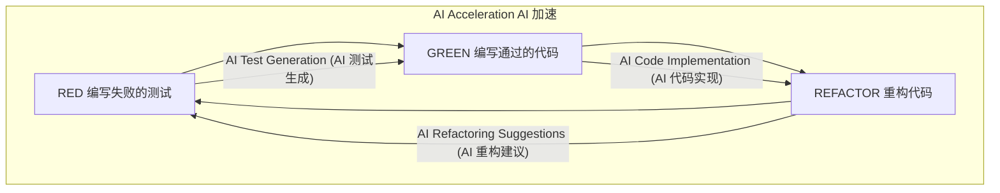
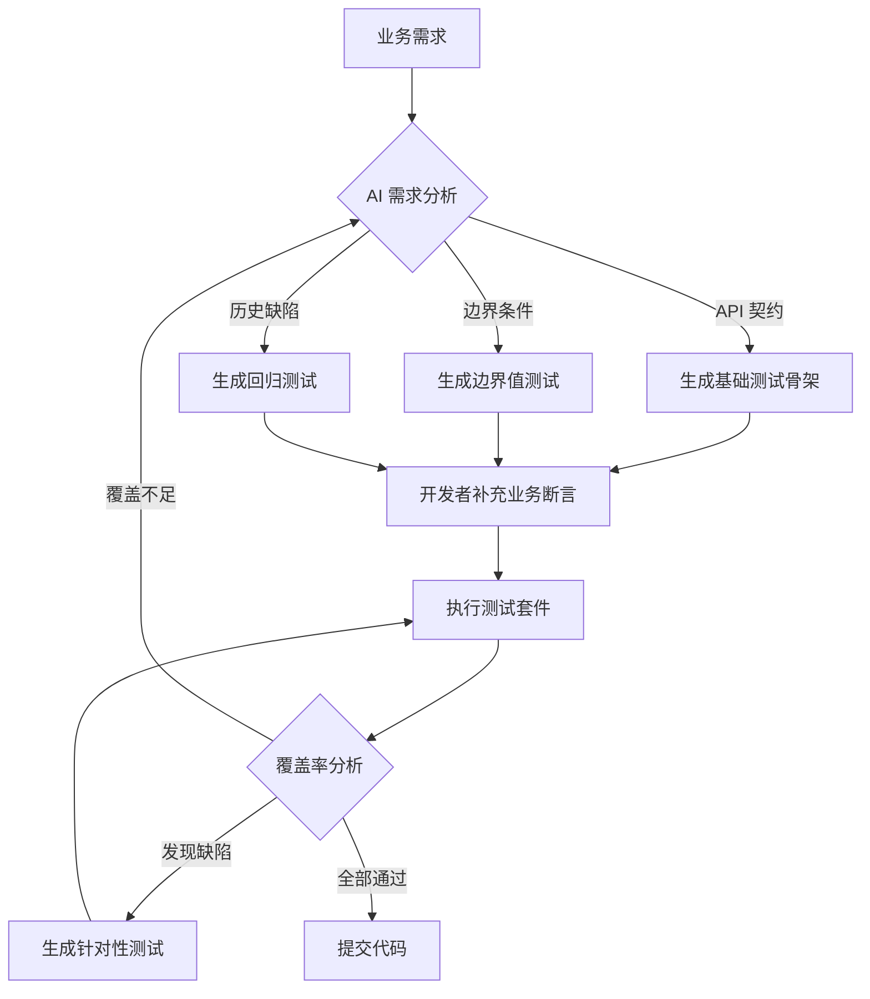
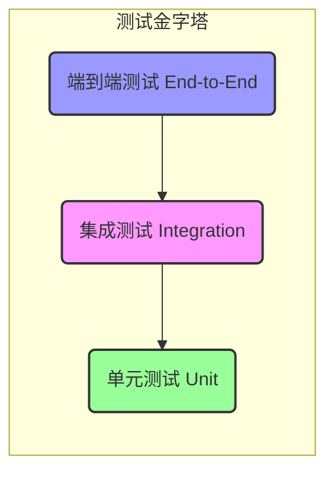

## 第 1 页: 标题页

**AI 时代的测试驱动开发 (AI-TDD)**

**驭 AI 之智，行 TDD 之道**

---
*引领软件质量新前沿的实践指南*

---

## 第 2 页: 两大变革浪潮

**TDD 的传承与 AI 的革命**

*   **TDD 的基石 (The TDD Foundation):** 二十多年来，测试驱动开发 (Test-Driven Development) 一直是高质量软件工程的基石。其"红-绿-重构" (Red-Green-Refactor) 循环是创建健壮、可维护且设计良好代码的成熟纪律，它强迫我们清晰地思考，并从一开始就内建质量。

*   **AI 的颠覆 (The AI Disruption):** 今天，生成式 AI (Generative AI) 和大型语言模型 (LLMs) 正在彻底改变软件开发的方方面面。从 GitHub Copilot 到集成的 IDE 助手，AI 不再是未来概念，而是开发者的日常现实，能够在数秒内生成代码和测试。

*   **两者的融合 (The Convergence):** 本次演讲将探讨这两种力量的强大交集。我们正在进入 AI-TDD 时代，机器的效率和人类的智慧将在此协作，重新定义软件开发。

**核心要点 (Takeaway):** TDD 的严谨方法与 AI 的颠覆性力量并非对立；它们正在融合，创造一种更强大的新开发范式。

---

## 第 3 页: 议程与核心论点

**议程与核心论点**

1.  **AI 加速的 TDD 循环:** AI 如何变革"红-绿-重构"的每一步。
2.  **扩展 TDD 的视野:** 将 TDD 原则应用于 AI 模型和 AI 生成的代码。
3.  **人机协作新范式:** 重新定义开发者的角色、技能和团队文化。
4.  **工具与战略:** 介绍生态系统和可行的采纳路线图。
5.  **总结与展望:** AI-TDD 的核心价值及其未来发展。

**我们的核心论点 (Our Core Thesis):**
AI 不是 TDD 的终结者。它是一个**催化剂**，放大了 TDD 的价值；它是一个**喷气引擎**，加速了 TDD 的实践。在 AI 生成代码的时代，TDD 的核心原则——"测试先行" (test-first) 的思维和对设计的关注——变得*愈发*重要，成为质量控制和风险缓解的主要机制。

**核心要点 (Takeaway):** 不要将 AI 视为优秀工程纪律的替代品。应将其视为一个强大的工具，在 TDD 的指引下，它可以将团队的绩效提升到前所未有的水平。

---

## 第 4 页: AI 加速的 TDD 循环

**AI 加速的 TDD 循环：更快、更智能、更高效**

经典的"红-绿-重构" (Red-Green-Refactor) 循环仍然是 TDD 的核心，但 AI 让它的心跳更快。通过自动化重复性任务，循环时间可以被显著缩短。

*   **效果承诺 (The Promise):** 研究和实践表明，AI 增强的 TDD 可以将开发循环时间缩短 **40%-70%**。一个曾经需要 15-30 分钟的循环现在可以压缩到 3-5 分钟。
*   **目标 (The Goal):** 这不仅仅是关于速度，更是关于认知减负。AI 处理繁琐的事务，让开发者能够专注于更高价值的活动：复杂的业务逻辑、架构决策和创造性的问题解决。



**核心要点 (Takeaway):** AI 将 TDD 循环从一个手动的、审慎的过程转变为一个快速的、半自动化的反馈回路，使开发者能够以更高的速度迭代设计和功能。

---

## 第 5 页: 第一步 (红灯): 智能测试生成

**第一步 (红灯): 智能测试生成**

编写全面的测试是 TDD 的基础，但这可能很费力。AI 扮演着一个不知疲倦的助手，自动化并丰富了测试创建过程。

*   **从需求到测试 (From Requirements to Tests, BDD):** AI 可以解析自然语言需求（例如，用户故事、Gherkin 规范），并自动生成测试用例的骨架，包括方法名和 Arrange-Act-Assert (AAA) 结构。

*   **遗留代码的测试补全 (Legacy Code Test Completion):** 对于测试覆盖率低的代码库，AI 可以分析其代码结构、逻辑路径和依赖关系，以建议并生成缺失的测试用例，从而快速增加你的安全网。

*   **智能测试数据合成 (Smart Test Data Synthesis):** AI 擅长生成多样化且有意义的测试数据。它会分析方法签名和约束来创建：
    *   **边界值 (Boundary Values):** `0, -1, null, MAX_INT`
    *   **等价类 (Equivalence Classes):** 有效和无效的输入。
    *   **边缘场景 (Edge Cases):** 空字符串、超长输入、特殊字符。
    *   **异常数据 (Anomalous Data):** 对于支付系统，它可能会生成模拟欺诈交易的数据。

**核心要点 (Takeaway):** AI 极大地减少了编写测试的人工投入，让开发者能够专注于定义真正重要的*行为*和*断言*，而不是样板代码。

---

## 第 6 页: 第二步 (绿灯): AI 驱动的代码实现

**第二步 (绿灯): AI 驱动的代码实现**

一旦一个失败的测试清晰地定义了目标，AI 就可以进行首次实现，体现了 TDD 编写*最简化代码*以通过测试的原则。

*   **意图驱动的生成 (Intent-Driven Generation):** AI 分析失败的测试——特别是断言和方法调用——以理解开发者的意图。然后，它会生成一段最小化的代码来满足这个特定的测试。

*   **示例 (Example): `sum` 方法**
    *   **失败的测试 (Failing Test):** `assertEquals(0, calculator.sum(Collections.emptyList()));`
    *   **AI 生成的代码 (AI-Generated Code):**
        ```java
        public int sum(List<Integer> numbers) {
            if (numbers.isEmpty()) { // AI 从测试中推断出此条件
                return 0;
            }
            return -1; // 或为下一个测试准备的其他占位符
        }
        ```

*   **人的角色 (The Human's Role):** 开发者的工作是审查这个最小化的实现，然后编写*下一个*失败的测试（例如，针对含有一个数字的列表），以驱动出一个更通用的解决方案。这可以防止 AI 对单个测试用例进行硬编码式的"过拟合"。

**核心要点 (Takeaway):** AI 为简单场景自动化了"让代码工作"的步骤，使得 TDD 循环能够顺畅快速地流动。开发者的角色转变为通过编写一系列战略性的测试来引导整个过程。

---

## 第 7 页: 第三步 (重构): 智能、上下文感知的重构

**第三步 (重构): 智能、上下文感知的重构**

重构是优秀设计的诞生之处。AI 将这一步从一项手工杂务提升为一个智能的、数据驱动的过程。

*   **上下文感知的"代码坏味"检测 (Context-Aware "Code Smell" Detection):** 传统的静态分析工具可以发现问题，但 AI 能理解*上下文*。它不仅仅是看到一个长方法，它可能会根据其包含的业务逻辑建议命名，或推荐一个特定的设计模式 (Design Pattern)，如策略模式 (Strategy Pattern)，来简化复杂的条件逻辑。

*   **自动化且经过验证的重构 (Automated and Verified Refactoring):** 对于常见的重构（例如，提取方法、引入参数、封装字段），AI 不仅能建议变更，还能自动执行。关键是，它会在执行后运行相关测试以*证明*重构没有破坏任何东西，从而创建一个安全的自动化闭环。

*   **提升可测试性 (Improving Testability):** AI 可以识别那些导致代码难以测试的设计缺陷，例如硬编码的依赖。然后，它会建议并执行像**依赖注入 (Dependency Injection)** 这样的重构来解耦，使代码更容易测试。

**核心要点 (Takeaway):** AI 如同"代码质量守护者"，主动识别设计问题并自动化重构过程，确保代码库保持整洁、可维护且易于演进。

---

## 第 8 页: 实践中的 AI-TDD 工作流

**实践中的 AI-TDD 工作流**

此图展示了 AI 如何集成到一个完整的、闭环的测试工作流中，从业者个人电脑延伸至整个团队的流程。



**核心要点 (Takeaway):** AI-TDD 创建了一个良性循环：需求自动生成测试，开发者用业务逻辑丰富它们，测试结果持续反馈以改进测试套件，从而确保全面且有针对性的质量控制。

---

## 第 9 页: AI-TDD 循环总结：收益、风险与对策

**收益、风险与对策**

| 加速方面 | 核心收益 | 主要风险 | 关键对策 |
| :--- | :--- | :--- | :--- |
| **测试编写** | 5-10 倍人效提升 | 生成无效测试、过度模拟 (Mock) | 由领域专家审查首轮生成 |
| **代码实现** | 快速从"红灯"到"绿灯" | 为通过测试而"过度拟合" | 先编写高质量断言，严控行为 |
| **自动重构** | 持续保持代码整洁 | 改动范围大，难以审计 | 分步提交，确保每步测试通过 |

**核心要点 (Takeaway):** AI-TDD 不是银弹。理解每个环节的潜在风险，并采取相应的策略来管理它们，是成功实施的关键。

---

## 第 10 页: 扩展视野: 为 AI 系统引入 TDD

**扩展视野: 为 AI 系统引入 TDD**

TDD 的原则非常强大，其应用已超越传统代码。在 AI 时代，它们被调整以将质量和可预测性构建到 AI 系统自身中。

*   **挑战 (The Challenge):** AI 模型，特别是大型语言模型 (LLMs)，常被视为"黑箱"。它们的行为可能不确定且难以预测。
*   **TDD 解决方案 (The TDD Solution):** 我们可以应用"测试先行"的思维模式，在 AI 系统开发*之前*和*期间*定义并验证其预期行为。

这种范式转变涉及两个关键领域：
1.  **面向 AI 模型的 TDD (TDD for AI Models):** 将 TDD 循环应用于 AI 模型的开发和微调。
2.  **作为防火墙的 TDD (TDD as a Firewall):** 使用测试作为抵御 AI 生成代码中错误和"幻觉"的主要防线。

**核心要点 (Takeaway):** TDD 提供了方法论框架，将工程纪律引入到通常混乱的 AI 开发世界中，将"黑箱"转变为具有已定义、可验证行为的系统。

---

## 第 11 页: 为 AI 模型引入 TDD: 测试"黑箱"

**为 AI 模型引入 TDD: 测试"黑箱"**

我们可以将"红-绿-重构"循环应用于 MLOps 生命周期，以构建更可靠、更健壮的模型。

*   **定义"测试" (Defining the "Tests"):** 我们不再使用简单的单元测试，而是为模型定义一套行为测试：
    *   **功能测试 (Functional Tests):** 模型是否为已知输入提供正确答案？（例如，猫的图片 -> "猫"标签）。
    *   **鲁棒性测试 (Robustness Tests):** 如果输入略有扰动（例如，图像中增加噪点），模型是否保持稳定？
    *   **公平性与偏见测试 (Fairness & Bias Tests):** 模型在不同人群中的表现是否一致？
    *   **安全性（对抗性）测试 (Security/Adversarial Tests):** 模型是否会被旨在误导它的输入所欺骗？

*   **模型的 TDD 循环 (The TDD Cycle for Models):**
    *   **红灯 (RED):** 定义一个模型当前未通过的行为测试（例如，在某个数据切片上准确率低）。
    *   **绿灯 (GREEN):** 通过调整数据、超参数或模型架构使测试通过。
    *   **重构 (REFACTOR):** 在测试通过后，优化模型效率（例如，模型剪枝、知识蒸馏），同时不影响其行为。

**核心要点 (Takeaway):** TDD 为模型开发提供了一种结构化的、目标驱动的方法，用定义、验证和优化模型行为的严谨过程取代了漫无目的的"炼丹调参"。

---

## 第 12 页: TDD 应用特例：验证 RAG 与 Agent

**TDD 应用特例：验证 RAG 与 Agent**

对于基于大型语言模型 (LLM) 的高级应用，TDD 的焦点从代码转向了信息处理和决策逻辑的正确性。

*   **RAG 管道验证 (Testing RAG Pipelines):**
    *   **目标:** 验证知识检索的准确性和回答的忠实度。
    *   **方法:** AI 自动生成"问题-预期答案-来源"三元组，转化为可执行测试，断言答案的语义相似度和引用来源的正确性。
    *   ```mermaid
      graph LR
        A[用户提问] --> B{AI生成测试三元组};
        B --> C[问题];
        B --> D[预期答案];
        B --> E[预期来源];
        C --> F[RAG 系统] --> G[实际输出];
        G --> H{断言验证};
        H -- 答案对比 --> D;
        H -- 来源检查 --> E;
      ```

*   **Agent 行为验证 (Testing Agent Behavior):**
    *   **目标:** 确保 Agent 的决策逻辑符合预设的业务规则。
    *   **方法:** 测试用例通常以模拟多轮对话的形式出现，验证 Agent 在交互中的反应和最终决策是否符合预期。

**核心要点 (Takeaway):** TDD 的思想可以被创造性地应用于验证现代 AI 应用的核心逻辑，确保其行为可靠且符合预期。

---

## 第 13 页: 测试驱动学习 (Test-Driven Learning)

**测试驱动学习 (Test-Driven Learning - TDL)**

TDD 不仅是开发方法，也是一种强大的学习工具，尤其是在面对 AI 生成的复杂代码时。

*   **AI 作为 TDD 教练 (AI as TDD Coach):** 对于初学者，AI 工具可以引导他们遵循"红-绿-重构"流程，并对不规范的实践给出即时反馈，扮演陪练的角色。

*   **用测试"白箱化"AI 代码 (Making AI Code Transparent):**
    *   **场景:** 当 AI 生成了一段你并不完全理解的复杂代码（例如，使用了不熟悉的 API 或算法）。
    *   **方法:** 为其编写单元测试是最高效的学习方式。为了写测试，你必须深入研究代码，思考其输入、输出、边界和异常，这个过程能将"黑箱"代码转化为你深度理解的"白箱"代码。
    *   **示例:**
        ```typescript
        // 开发者通过为 AI 生成的复杂函数编写测试，来反向推导和验证其行为
        test("VIP 用户应享有 20% 折扣", () => {
          expect(calculateDiscount(100, "VIP")).toBe(80);
        });
        ```

**核心要点 (Takeaway):** 不要只把 AI 当作代码生成器。把它当作一个学习催化剂，通过为它的输出编写测试，你可以更快、更深入地掌握新的技术和逻辑。

---

## 第 14 页: 作为 AI 代码防火墙的 TDD

**作为 AI 代码防火墙的 TDD**

AI 可能生成看似合理但实际错误、不安全或无意义的代码——这种现象被称为"AI 幻觉"。TDD 是最有效的安全网。

*   **黄金法则 (The Golden Rule):** **测试先行，AI 殿后 (Test First, AI Second)。** 在要求 AI 生成任何功能之前，开发者必须先编写定义其预期行为的测试。
    *   测试是给 AI 的一份**清晰无歧义的契约**或"规格说明"。
    -   测试为 AI 的输出提供了**即时验证**。

*   **被证实的有效性 (Proven Effectiveness):** 实验表明，与仅使用自然语言提示相比，对 GPT-4 采用测试先行的方法可将生成代码的正确率提高 **37%** 以上。

*   **人为最终裁决者 (The Human is the Arbiter):** 即使代码由机器编写，其质量和正确性仍由人编写的测试来定义和控制。

**核心要点 (Takeaway):** 在 AI 编程助手的时代，TDD 的"测试先行"纪律不仅是优秀设计的实践，更是确保质量、安全和风险管理的必要手段。

---

## 第 15 页: 全新协作模式: 人机责任矩阵

**全新协作模式: 人机责任矩阵**

有效的 AI-TDD 需要清晰界定人类开发者和 AI 助手之间的角色与职责。开发者永远是船长。

| 任务 | AI 的主要角色 (划桨手) | 开发者的主要角色 (船长) |
| :--- | :--- | :--- |
| **需求** | 识别模糊点，建议边缘场景 | **定义验收标准**，理解业务价值 |
| **测试生成** | 创建样板代码，生成边界值 | **设计关键业务场景**，编写复杂断言 |
| **代码实现** | 提供最小化的、模式化的代码 | **设计可扩展的架构**，确保可维护性 |
| **重构** | 检测代码坏味，执行安全重构 | **决定战略性重构**，进行架构级改进 |

**最终原则 (The Ultimate Principle):** **人类开发者永远对最终产品负责**。AI 是一个工具，而不是一个承担责任的队友。对 AI 生成代码的审查应*更*严格，而非更宽松。

**核心要点 (Takeaway):** 建立清晰的协作框架。利用 AI 在速度和模式识别方面的优势，但将战略、架构和业务关键决策保留给人类智慧。

---

## 第 16 页: 开发者的进化

**开发者的进化：从代码编写者到系统架构师**

随着 AI 接管更多底层实现任务，定义高级开发者的技能正在发生变化。

*   **必备技能升级 (Required Skill Upgrades):**
    1.  **精确的需求工程 (Precise Requirements Engineering):** 将模糊的业务需求转化为人类和 AI 都能理解的清晰、无歧义的规范。你的新工作是成为一个优秀的"问题定义者"。
    2.  **高级测试设计 (Advanced Test Design):** 精通边界值分析、等价类划分等技术，以设计能揭示 AI 常常忽略的深层逻辑缺陷的测试。你现在是"质量设计师"。
    3.  **面向 TDD 的提示工程 (Prompt Engineering for TDD):** 掌握引导 AI 生成符合 TDD 原则（例如，要求*最小化*代码而非*完整*方案）的提示艺术。
    4.  **批判性思维与 AI 调试 (Critical Thinking & AI Debugging):** 能够批判性地评估 AI 输出，发现潜在风险，并调试人机交互中出现的问题。

**核心要点 (Takeaway):** 开发者的价值正在"上移"——从编写代码行到设计系统、定义质量，并战略性地指导 AI 实现业务目标。

---

## 第 17 页: 守护文化：AI 时代的 TDD 灵魂

**守护文化：AI 时代的 TDD 灵魂**

AI 最大的风险并非其失败，而是其便利性可能导致我们放弃保证质量的工程纪律。

*   **风险 1: 过度依赖与技能退化**
    *   **表现:** 开发者被动接受 AI 输出，导致解决问题和设计能力的下降。
    *   **对策:** "AI 是副驾，你是机长"。强制对 AI 输出进行严格的代码审查，并定期举行"无 AI"编程练习。

*   **风险 2: 设计退化**
    *   **表现:** 开发者跳过"测试先行"的思考，直接让 AI 生成代码，导致设计糟糕。
    *   **对策:** **顺序不容协商：测试必须先行。** 这确保设计由行为需求驱动，而非 AI 的"捷径"。

*   **风险 3: 知识孤岛**
    *   **表现:** 个人效率提升，但团队知识共享减少。
    *   **对策:** 加强**结对编程 (Pair Programming)**（人与人，或人与 AI + 观察者）。这被证明能将 AI 引入的错误减少 50%。

**核心要点 (Takeaway):** TDD 是一种文化，而非仅仅一种技术。团队必须积极保护其核心原则——测试先行、重构和协作——不被 AI 的便利所侵蚀。

---

## 第 18 页: AI-TDD 工具链

**AI-TDD 工具链**

AI-TDD 的潜力通过新一代深度集成智能的开发工具得以实现。

*   **AI 原生 IDE (AI-Native IDEs):** 你的集成开发环境正在成为"智能开发伙伴"。
    *   **工具:** GitHub Copilot, JetBrains AI Assistant, VS Code AI 工具。
    *   **能力:** 一键生成测试、实时预测测试失败、AI 建议重构，甚至 TDD 周期可视化。

*   **智能 CI/CD 流水线 (Intelligent CI/CD Pipelines):** DevOps 循环的智商正在飙升。
    *   **测试影响分析 (Test Impact Analysis):** AI 分析代码提交，仅运行相关的测试子集，将 CI 反馈时间缩短高达 70%。
    *   **AI 驱动的失败分析 (AI-Powered Failure Analysis):** 构建失败时，AI 分析日志以定位根本原因，并常常建议修复方案。
    *   **更智能的部署 (Smarter Deployments):** AI 在部署期间分析遥测数据以提供风险评分，从而实现更自信的自动化发布或回滚。

**核心要点 (Takeaway):** 整个开发工具链正在以 AI 为核心进行重构，创建一个从想法到生产的无缝、智能、快速的反馈闭环。

---

## 第 19 页: AI-TDD 与测试金字塔：构建高效反馈

**AI-TDD 与测试金字塔：构建高效反馈**

您说得对，测试分层策略是 DevOps 成功的关键，而 AI-TDD 在其中扮演着至关重要的角色。

**测试金字塔 (The Testing Pyramid)** 是一种经典的测试策略，它强调不同类型测试的最佳比例，以实现速度、成本和置信度之间的平衡。



*   **单元测试 (Unit Tests):** 构成金字塔的宽阔底部。它们快速、廉价且隔离地验证单个组件。
*   **集成测试 (Integration Tests):** 位于中间层，验证多个组件之间的交互。
*   **端到端测试 (E2E Tests):** 位于顶部，通过完整的用户界面模拟真实用户场景，验证整个系统的功能。

**AI-TDD 如何重塑金字塔:**
*   **巩固基础:** AI 尤其擅长大规模生成单元测试和数据驱动的集成测试，这使得构建和维护一个宽阔、坚实的金字塔底座变得前所未有的容易。
*   **解放人力:** 通过自动化大部分的单元和集成测试，AI 将宝贵的开发者和 QA 时间解放出来，让他们可以专注于设计更少但更关键、更复杂的端到端测试场景。

**与 DevOps 的协同作用 (Synergy with DevOps):**
一个健康的金字塔是实现快速、可靠的 CI/CD 的前提。AI-TDD 通过确保快速、全面的底层测试，使得 CI 流程可以在几分钟内提供反馈，而不是几小时，从而完美地支持了 DevOps 对快速迭代和持续反馈的核心要求。

**核心要点 (Takeaway):** AI-TDD 并非要取代测试金字塔，而是其最强大的促成者。它通过自动化繁重的底层测试，帮助团队维持一个健康的测试组合，从而为高效的 DevOps 实践奠定坚实的基础。

---

## 第 20 页: 分阶段采纳路线图

**分阶段采纳路线图**

采纳 AI-TDD 是一个旅程，而非一次性的跳跃。分阶段的方法可以帮助团队平稳过渡。

```mermaid
timeline
    title AI-TDD 转型路线图
    section 阶段一: 探索与赋能 (1-2 个月)
        : **焦点:** 个人生产力
        : **行动:**
        : - 团队学习 IDE 的 AI 插件 (如 Copilot)
        : - 在试点项目中使用 AI 生成单元测试
        : - **目标:** 减少重复性测试工作，提高覆盖率
    section 阶段二: 协作与整合 (2-4 个月)
        : **焦点:** 团队工作流
        : **行动:**
        : - 定义团队的 AI 使用规范和代码审查标准
        : - 在流程中引入 AI 建议的重构
        : - **目标:** 规范人机交互，提高代码质量
    section 阶段三: 自动化与深化 (4-6+ 个月)
        : **焦点:** 全生命周期自动化
        : **行动:**
        : - 将 AI 工具集成到 CI/CD 流水线 (如智能测试选择)
        : - 开始为 AI 原生应用构建 TDD 测试套件
        : - **目标:** 创建一个完全自动化的智能质量反馈循环
```

**核心要点 (Takeaway):** 从小处着手，专注于明确的胜利，随着团队技能和信心的增长逐步扩大 AI 的使用。结构化的方法可以最大限度地减少干扰，并最大化成功转型的机会。

---

## 第 21 页: 反模式：需要避免的陷阱

**反模式：需要避免的陷阱**

AI 的强大功能很容易让团队陷入破坏 TDD 目标的陷阱。警惕这些常见的反模式。

*   **反模式 1: "虚荣的覆盖率"与"盲目的绿灯"**
    *   **表现:** 使用 AI 生成大量简单的、低价值的测试，将覆盖率推高到 99%，但并未真正验证复杂的业务逻辑。开发者因此信任无意义的"绿灯"。
    *   **对策:** 不要只度量覆盖率，用**突变测试 (Mutation Testing)** 来度量**测试质量**。它检查你的测试是否足够智能，能够在代码被故意破坏时失败。

*   **反模式 2: "设计退化"与"Mock 泛滥"**
    *   **表现:** 开发者让 AI 在没有"测试先行"设计的情况下生成代码，导致结构糟糕。或者，AI 过度使用 Mock，导致单元测试通过但系统集成时失败。
    *   **对策:** **重构 (Refactoring)** 环节不可跳过，且需要人的监督。通过真实的**集成测试 (Integration Tests)** 来平衡单元测试，验证组件间的交互。

**核心要点 (Takeaway):** 使用衡量真实质量的指标和实践，而不仅仅是表面数字。TDD 的目标是信心和优秀的设计，而不仅仅是高覆盖率。

---

## 第 22 页: 度量成功：AI-TDD 仪表盘

**度量成功：AI-TDD 仪表盘**

为了客观评估并指导你的 AI-TDD 采纳，你需要追踪反映效率和质量的指标。

| 维度 | 关键指标 | 衡量内容 | 目标 |
| :--- | :--- | :--- | :--- |
| **效率** | **开发周期 (Cycle Time)** | 从写下第一个失败测试到完成重构的时间 | **↓ 40% 以上** |
| | **交付周期 (Lead Time)** | 从需求提出到生产部署的时间 | **↓ 显著下降** |
| | **AI 建议采纳率** | AI 是否提供了有用的建议？ | **追踪趋势** |
| **质量** | **缺陷逃逸率 (Defect Escape Rate)** | 多少缺陷流入生产环境？(终极指标) | **↓ 持续降低** |
| | **突变测试得分** | 测试套件的健壮性如何？ | **↑ 稳步提升** |
| | **平均修复时间 (MTTR)**| 修复生产故障需要多长时间？ | **↓ 显著缩短** |

**核心要点 (Takeaway):** 数据驱动的方法至关重要。使用一套平衡的指标来全面了解 AI-TDD 如何影响团队的速度、产品质量和系统稳定性。

---

## 第 23 页: 结论: AI 为桨，TDD 为舵

**结论: AI 为桨，TDD 为舵**

我们探讨了 AI 如何改变 TDD 流程，扩展其应用，并重塑开发者角色。它们之间的协同作用带来了三个深远的好处：

1.  **测试即契约 (Tests as the Contract):** 测试不再仅仅是验证；它们是我们向 AI 伙伴传达意图的主要、无歧义的语言。

2.  **分钟级反馈循环 (The Minute-Scale Feedback Loop):** "红-绿-重构"成为一个高频循环，将持续的质量反馈节奏直接嵌入开发者的工作流中。

3.  **开发者即架构师 (The Developer as Architect):** 通过自动化繁琐的工作，AI 解放了开发者，让他们能专注于真正重要的事情：理解客户需求、设计优雅的系统和解决复杂的业务问题。

**一个比喻:** 如果你在软件开发的大海中航行，**AI 是强大的引擎 (桨)**，以极快的速度推动你前进。但没有方向的速度是混乱的。**TDD 则是舵**，让你能精确地驾驭那股力量，规避风险，安全抵达目的地。

**核心要点 (Takeaway):** AI-TDD 不是未来的梦想；它是高性能软件开发的新兴标准。

---

## 第 24 页: 未来展望: Agentic DevOps

**未来展望: Agentic DevOps**

旅程并未止于 AI 助手。下一个进化步骤是 **Agentic DevOps**。

*   **愿景 (The Vision):** 想象一下 AI Agent 能够在整个开发生命周期中自主运作。
    *   一个用户请求进来。
    *   一个 AI Agent 创建工单，根据验收标准编写失败的测试，生成代码以通过测试，进行重构，运行完整的 CI/CD 流水线，分析部署风险，并管理生产环境的灰度发布。
    *   另一个 Agent 监控生产，检测到异常，创建一个新的失败测试以复现错误，并将其分配给另一个 Agent 进行修复。

*   **TDD 的角色 (The Role of TDD):** 在这个未来，由人类精心策划的、全面的测试套件不仅是一个安全网；它成为这些自主 Agent 的**核心指令和主要控制机制**。它是"完成"和"正确"的程序化定义。

**核心要点 (Takeaway):** 你今天通过 AI-TDD 建立的技能和实践，是未来自主开发系统的直接基础。测试套件正在演变为 AI 驱动的软件创建的"总蓝图"。

