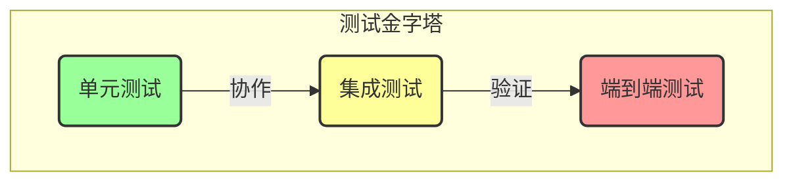
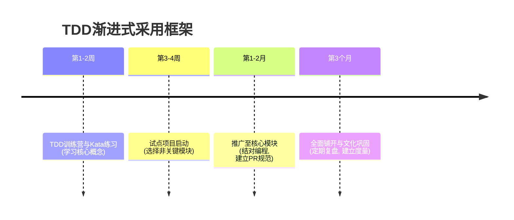

## 封面页：测试驱动开发(TDD)的工程哲学与实践 (1/19)
- **副标题**: 从核心理念到团队文化构建的全方位指南
- **适用场景**: 技术分享、团队内训、个人学习
- **核心理念**: 通过测试驱动设计与重构，构建高质量、可维护的卓越软件。

---

## 议程：TDD探索之旅 (2/19)
1.  **核心理念 (What & Why)**: TDD的定义、核心循环与价值主张。
2.  **工程实践 (How)**: TDD的完整操作流程、关键技能与必备工具。
3.  **务实考量 (Pros & Cons)**: TDD的优势、挑战与真实适用场景。
4.  **团队与文化 (Adoption & Culture)**: TDD的团队导入策略与文化构建。
5.  **结论 (Conclusion)**: 总结TDD的核心价值，展望工程卓越之路。

---

## 什么是TDD？核心循环与三大支柱 (3/19)
- **定义**: 一种演进式的开发过程，在编写功能代码前，先编写一个失败的测试，然后用最少的代码让测试通过，最后重构。
- **三大支柱**:
    1.  **测试先行 (Test-First)**: 测试是设计的起点，而非验证的终点。
    2.  **短迭代循环 (Short Cycles)**: 在分钟级的"红-绿-重构"循环中前进。
    3.  **演进式设计 (Emergent Design)**: 优秀的设计在重构中逐步浮现。
- **核心循环: 红-绿-重构 (Red-Green-Refactor)**
    - **红 (Red)**: 写一个失败的测试，精确化需求。
    - **绿 (Green)**: 写最简单的代码通过测试，快速验证功能。
    - **重构 (Refactor)**: 在测试保护下，清理代码、优化设计。
- **Takeaway**: TDD的本质是"用测试来驱动和设计代码"，其心跳就是"红-绿-重构"循环。

---

## TDD的根本思想与思维变革 (4/19)
- **测试即"活的"需求文档**: TDD的测试集是一份与代码永不脱节、可执行的精确规范。
- **测试驱动设计 (Test-Driven Design)**: "如何测试"这个问题，会从根本上驱动出更小、更专注、低耦合的模块化设计。
- **vs. 传统开发**: TDD将质量保证和设计活动从流程末端前提至起点，将"后期发现Bug"的高昂成本，转变为"即时反馈"的零成本。
- **思维变革**: 从"我如何实现功能？"转变为"我如何验证功能已正确实现？"。
- **Takeaway**: TDD首先是一种设计活动，其次才是一种测试活动；它代表了从被动验证到主动设计的思维转变。

---

## TDD的价值主张：解决痛点与投资回报 (5/19)
| 典型痛点 | TDD解决方案 |
| :--- | :--- |
| **代码质量低下、Bug频出** | Bug在萌芽状态即被消灭，设计被驱动得更优。 |
| **需求理解偏差** | 编写测试的过程就是将抽象需求转化为具体例子的过程。 |
| **系统设计僵化、难以变更** | 促进模块化和解耦，持续重构避免技术债累积。 |
| **对修改代码缺乏信心** | 全面的自动化测试套件提供了强大的"安全网"。 |
- **投资回报 (ROI)**:
    - **初期投入**: 开发时长增加约 **15-35%**。
    - **长期回报**: 预发布缺陷密度降低 **40%-90%**，显著降低长期维护成本。
- **Takeaway**: TDD是一项高回报的长期投资，它通过系统性地解决研发痛点，有效降低软件全生命周期的总成本。

---

## 操作流程: 编写有效的失败测试 (Red) (6/19)
- **核心原则**: 使用 **Arrange-Act-Assert (AAA)** 结构组织测试，也称为 **Given-When-Then**。
    1.  **Arrange (准备)**: 设置测试所需的前提条件（创建对象、准备Mock等）。
    2.  **Act (行动)**: 调用被测试的方法，这是测试的核心。
    3.  **Assert (断言)**: 验证方法的行为是否符合预期（检查返回值、状态变化等）。
- **编写要点**:
    -   **清晰命名**: `test_deposit_increases_balance_by_amount()`
    -   **单一关注点**: 一个测试只验证一个行为。
    -   **确保失败**: 运行测试，看到预期的"红色"是成功的第一步。
- **Takeaway**: 一个好的失败测试就是一个精确、无歧义的需求定义。

---

## 操作流程: 最小实现与安全重构 (Green & Refactor) (7/19)
- **最小化实现 (Green)**:
    -   **目标**: 用最少的代码、最快的速度让红灯变绿。
    -   **策略**: 允许使用"假实现"(Fake It 'Til You Make It)，比如直接返回硬编码值。抵制实现测试未覆盖功能的诱惑。
- **安全地重构 (Refactor)**:
    -   **时机**: 当所有测试都通过时 (绿灯)。
    -   **目标**: 消除重复(DRY)、提高可读性、改进设计。
    -   **安全保障**: 每次小的重构后，立即运行所有测试。测试是重构的"安全网"。
- **Takeaway**: "先让它工作(Green)，再让它变好(Refactor)" — TDD将这一古老智慧流程化、纪律化。

---

## 关键工具链: 测试框架与测试替身 (8/19)
- **单元测试框架**: 提供编写和运行测试的基础结构。
    -   **Java**: JUnit 5, TestNG
    -   **Python**: PyTest, `unittest`
    -   **JavaScript**: Jest, Vitest, Mocha
- **测试替身 (Test Doubles)**: 隔离被测单元与外部依赖的关键。
    -   **Stub (桩)**: 提供固定的返回值，用于 **状态验证**。
    -   **Mock (模拟对象)**: 记录和验证交互行为，用于 **行为验证**。
    -   **常用工具**: Mockito (Java), `unittest.mock` (Python), Jest Mocks / Sinon.JS (JS)。
- **Takeaway**: 工欲善其事，必先利其器。熟练掌握测试框架和Mock工具是高效实践TDD的前提。

---

## 高质量测试的FIRST原则 (9/19)
- **F - Fast (快速)**: 测试运行要快（毫秒级），否则开发者会不愿意频繁运行。
- **I - Independent (独立)**: 测试之间无依赖，可独立、以任意顺序运行。
- **R - Repeatable (可重复)**: 在任何环境、任何时间运行，结果都应相同。
- **S - Self-Validating (自我验证)**: 测试结果必须是明确的布尔值（通过/失败），无需人工检查。
- **T - Timely/Thorough (及时/全面)**: 测试要及时编写（编码前），并全面覆盖重要行为路径。
- **Takeaway**: FIRST原则是单元测试的"代码规范"，遵循它能有效避免测试代码本身成为技术债。

---

## TDD如何驱动出优秀设计 (SOLID) (10/19)
- **TDD天然融合SOLID原则**:
    -   **S (单一职责)**: 复杂的类难以测试，会促使你拆分它。
    -   **O (开闭原则)**: 通过"红-绿-重构"循环，在不修改旧代码的情况下添加新功能。
    -   **L (里氏替换)**: 子类的破坏性行为会导致基类测试失败。
    -   **I (接口隔离)**: 为了方便Mock，会倾向于定义更小的接口。
    -   **D (依赖倒置)**: 这是最直接的体现。为了替换依赖进行测试，代码必须依赖于抽象（接口），而非具体实现。这必然会导向 **依赖注入(DI)** 的使用。
- **Takeaway**: TDD不仅是测试方法，更是强大的设计工具。优秀的设计是在TDD过程中逐步"涌现"出来的。

---

## 高级技巧: TDD分层架构的Mock策略 (11/20)
- **核心思想**: 并非所有代码都需Mock。测试策略应根据代码在架构中的层次而变化。
- **底层/工具层 (Low-Level: Utilities, Algorithms)**
    - **策略**: **几乎不用Mock**。直接使用真实输入和输出来验证其正确性。
    - **目标**: 验证算法的**状态转换**和计算结果是否100%正确。
    - **示例**: 测试一个排序函数，或一个字符串工具类。
- **中层/业务逻辑层 (Mid-Level: Services)**
    - **策略**: **大量使用Mock**。这是Mock的主要应用场景。
    - **目标**: 隔离业务逻辑，验证其**行为和交互**是否正确。测试它是否正确地调用了其依赖（如Repository、外部API）。
    - **示例**: 测试`OrderService`在调用`placeOrder`时，是否正确调用了`PaymentGateway`的`charge`方法和`OrderRepository`的`save`方法。
- **高层/门面层 (High-Level: Controllers, Facades)**
    - **策略**: **适度使用Mock**。Mock其直接依赖的业务服务(Service)。
    - **目标**: 验证它作为"胶水"的**编排逻辑**是否正确。测试它是否根据输入（如HTTP请求）正确地调用了相应的服务，并返回了正确格式的响应。
- **Takeaway**: 对底层代码测"状态"，对中高层代码测"行为"。Mock是验证交互、隔离复杂度的关键武器。

---

## TDD面临的挑战与应对策略 (12/20)
| 挑战与局限性 | 应对策略 |
| :--- | :--- |
| **陡峭的学习曲线** | 系统性培训、编码道场(Coding Dojo)、结对编程、导师辅导。 |
| **初期开发效率感知下降** | 强调长期回报(ROI)，通过练习提升熟练度。 |
| **测试代码的维护成本** | 遵循FIRST原则，将测试代码与生产代码同等对待，持续重构。 |
| **组织层面的认知障碍** | 量化价值(缺陷率、维护成本)，争取管理层对"质量文化"的认同。 |
- **Takeaway**: TDD并非银弹。预见挑战并主动制定应对策略，是成功应用TDD的必经之路。

---

## TDD的适用性探讨：务实而非教条 (13/20)

- **高适用性场景**:
    -   业务规则复杂、需求明确的领域（如金融核心、算法实现）。
    -   长期维护、频繁迭代的核心系统。
- **谨慎使用场景**:
    -   **探索性编程/原型开发**: 可适当放宽，一旦方向明确应立即补上测试。
    -   **GUI开发**: 采用MVVM/MVP模式，对ViewModel/Presenter进行TDD，UI层由少量E2E测试覆盖。
- **Takeaway**: TDD不是必须僵化遵守的教条。关键在于理解其精髓——快速反馈与持续改进，并根据场景务实地应用。

---

## 遗留系统的TDD渗透策略 (14/20)
- **核心思想**: 不求一步到位，而是渐进式地建立"安全区"。
- **关键步骤**:
    1.  **从新功能或Bug修复开始**：这是引入测试的最佳时机。
    2.  **建立测试安全网**: 在修改前，为现有代码编写 **特征化测试 (Characterization Tests)** 来锁定其当前行为。
    3.  **寻找接缝 (Seams)**: 找到可以引入测试点而无需修改代码的地方。
    4.  **小范围重构**: 在测试保护下，微重构以提高代码的可测试性。
- **Takeaway**: 在遗留代码中引入TDD如同一场外科手术，需要耐心、策略和精确操作。"勒死模式(Strangler Fig Pattern)"是大型遗留系统改造的有效模式。

---

## 平衡测试粒度：测试金字塔 (15/20)

- **单元测试 (Unit Tests)**: **TDD主要阵地**。数量最多，速度最快，成本最低。
- **集成测试 (Integration Tests)**: 测试模块间的协作。
- **端到端测试 (E2E Tests)**: 模拟用户完整流程。数量最少，速度最慢，成本最高。
- **策略**: 编写大量的单元测试，适量的集成测试，和少量的端到端测试。
- **实践指南**:
    - **多写单元测试**: 它们是TDD的主要阵地，快速、稳定、成本低。
    - **少写E2E测试**: 只覆盖核心用户场景，因为它们慢、脆弱、维护成本高。
    - **避免过度测试**:
        - **不测试简单的getters/setters**。
        - **不直接测试私有方法** (如果私有方法逻辑复杂，应考虑重构提取新类来测试)。
        - **不测试第三方库** (信任你的依赖)。
- **Takeaway**: 构建健康的测试组合策略，将成本和收益最大化。TDD是坚实的地基，但完整的建筑还需要梁柱和屋顶。

---

## 团队成功导入TDD的前提 (16/20)
- **技能准备**:
    -   熟练掌握单元测试框架、Mock工具。
    -   具备基本的重构能力。
- **心态转变**:
    -   拥抱反馈，视"红灯"为机遇。
    -   坚持纪律，不跳过任何步骤。
    -   对高质量的共同承诺。
- **组织支持**:
    -   管理层理解并支持长期价值。
    -   营造允许犯错和学习的心理安全环境。
- **Takeaway**: TDD的成功，技术能力和文化氛围各占半壁江山。

---

## 有效的TDD引入策略 (17/20)

- **关键策略**:
    -   **试点项目 (Pilot Project)**: 从小范围成功开始，积累经验。
    -   **结对编程 (Pair Programming)**: 最佳的学习和推广方式。
    -   **编码道场 (Coding Dojo)**: 通过刻意练习固化肌肉记忆。
    -   **代码评审 (Code Reviews)**: 将测试代码作为评审的重点。
- **Takeaway**: 渐进式、有策略的引入（拉动）远胜于强制性的一刀切（推动）。

---

## TDD实践的常见误区与规避 (18/20)
| 常见误区 | 规避与纠偏方法 |
| :--- | :--- |
| **为覆盖率而测试** | 关注行为验证，而非代码行。覆盖率是辅助发现，不是目标。 |
| **测试实现细节而非行为** | 始终从"黑盒"视角测试公共API。若内部逻辑复杂，应考虑提取新类。 |
| **跳过重构步骤** | 将重构视为与Red/Green同等重要的一等公民。在估时中预留时间。 |
| **测试写得太大或太慢** | 严格遵循FIRST原则。将大测试分解，积极使用Mock/Stub。 |
| **过度Mock** | 只Mock那些代表外部系统、有副作用或难以控制的依赖。 |
- **Takeaway**: 识别并主动规避这些常见误区，能让TDD实践事半功倍，避免其沦为形式主义。

---

## 构建持续精进的TDD文化 (19/20)
- **TDD不仅是技术，更是文化**: 它关乎 **质量承诺、持续学习、团队协作和专业纪律**。
- **建立持续改进的反馈循环**:
    -   **定期回顾 (Retrospectives)**: 定期复盘TDD实践中的问题与收获。
    -   **度量与可视化**: 展示测试通过率、代码覆盖率趋势、缺陷逃逸率等健康度指标。
    -   **知识共享**: 常态化组织技术分享会、案例研究。
- **文化特征**:
    -   从"恐惧变更"到"拥抱变更"。
    -   从"流程纪律化"到"质量共同体"。
- **Takeaway**: TDD的最高境界，是将其内化为团队追求卓越工程的文化DNA。

---

## 结论：TDD的核心价值 (20/20)
- **信心的基石**: 全面的测试套件是敢于重构、乐于迭代的"安全网"。
- **设计的驱动力**: 自然引导出简单、解耦、符合SOLID原则的高质量代码。
- **需求的澄清器**: 将抽象需求转化为具体、可执行的例子，确保构建正确的产品。
- **效率的催化剂**: 显著提升软件全生命周期的开发效率，实现"欲速则达"。
- **Takeaway**: TDD是一套完整的、将质量内建于开发过程始终的、高度纪律性的专业软件开发哲学与实践方法论。

