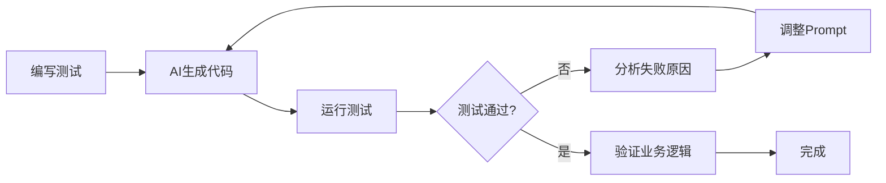
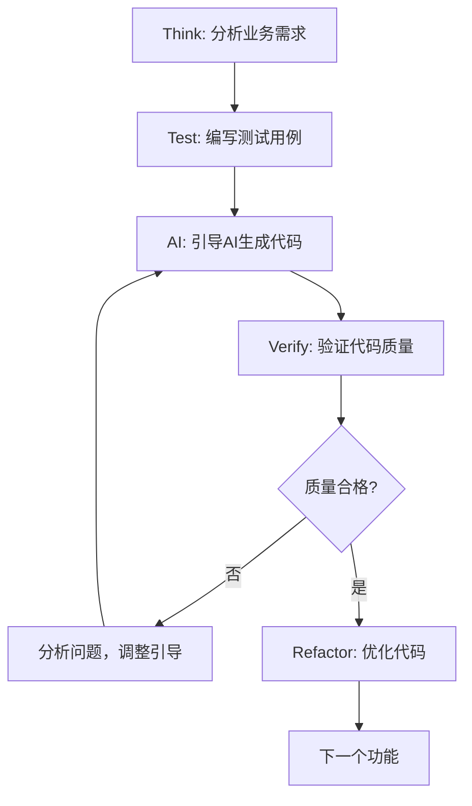

# AI+TDD实战指南 - 核心版本

> **目标受众**：熟练使用CURSOR、WindSurf、Claude Code等AI开发工具的程序员
> **核心目标**：快速掌握用测试资产驾驭AI写出高质量代码的技能

## 第一部分：AI+TDD核心理念（1000字）

### 1.1 为什么测试能"驾驭"AI的机制原理

#### 测试作为AI的"控制杆"

AI在代码生成中表现出强大的模式匹配能力，但缺乏对业务意图的深层理解。测试恰恰填补了这个关键空白：

**机制1：意图明确化**
```java
// 没有测试时，AI只能基于函数名猜测
public BigDecimal calculatePrice(User user, Product product) {
    // AI不知道：价格计算规则是什么？有折扣吗？税费如何计算？
}

// 有测试时，业务意图变得明确
@Test
void should_apply_10_percent_discount_when_vip_user_buys_electronics() {
    // 现在AI知道：VIP用户购买电子产品有10%折扣
    // 这个测试就是业务需求的可执行规格说明
}
```

**机制2：边界约束化**
测试定义了代码行为的精确边界，防止AI"过度创造"：

```java
@Test
void should_throw_exception_when_discount_exceeds_50_percent() {
    // AI现在知道：折扣不能超过50%，这是业务边界
    IllegalArgumentException exception = assertThrows(
        IllegalArgumentException.class,
        () -> discountService.applyDiscount(user, new BigDecimal("0.6"))
    );
    assertEquals("Discount cannot exceed 50%", exception.getMessage());
}
```

**机制3：质量反馈化**
测试提供即时的正确性反馈，形成"测试→代码→验证"的闭环：



#### AI的能力边界和思维模式特点

**能力优势**：
- **模式识别**：快速识别代码结构和常见实现模式
- **语法精确**：生成语法正确、编译通过的代码
- **效率提升**：大幅减少样板代码的编写时间

**关键局限**：
- **业务理解缺失**：无法理解隐含的业务规则和约束
- **边界感知不足**：难以主动考虑异常和边界条件
- **质量标准模糊**：倾向于"能运行"而非"高质量"

**思维模式特点**：
```
AI思维：函数名称 + 参数类型 → 推测实现 → 生成最可能的代码
人类思维：业务需求 → 设计测试 → 实现代码 → 验证正确性
```

**驾驭策略核心**：通过测试将人类的"业务思维"注入到AI的"技术生成"过程中。

### 1.2 测试资产作为"控制杆"的价值

#### 价值1：精确的业务规格书

测试用例是最精确的业务需求表达方式：

```java
// 传统需求文档：模糊且易过时
"VIP用户享受折扣优惠"

// 测试用例：精确且可执行
@Test
void should_apply_vip_discount_based_on_membership_level() {
    // 金卡VIP：5%折扣
    assertEquals(new BigDecimal("95.00"), 
        discountService.calculate(goldVipUser, new BigDecimal("100.00")));
    
    // 白金VIP：10%折扣
    assertEquals(new BigDecimal("90.00"),
        discountService.calculate(platinumVipUser, new BigDecimal("100.00")));
    
    // 钻石VIP：15%折扣，但最高优惠50元
    assertEquals(new BigDecimal("50.00"),
        discountService.calculate(diamondVipUser, new BigDecimal("1000.00")));
}
```

#### 价值2：AI行为的约束边界

测试定义了AI生成代码的"可接受范围"：

```java
@Test
void should_reject_negative_quantities() {
    // 这个测试告诉AI：负数数量是不被允许的
    assertThrows(IllegalArgumentException.class,
        () -> orderService.addItem(product, -1));
}

@Test  
void should_handle_concurrent_inventory_updates() {
    // 这个测试告诉AI：需要考虑并发安全性
    // AI会生成包含锁机制或原子操作的代码
}
```

#### 价值3：质量标准的具体化

通过测试展示什么是"高质量代码"：

```java
@Test
void should_maintain_audit_trail_for_price_changes() {
    // 告诉AI：价格变更需要审计日志
    BigDecimal newPrice = new BigDecimal("99.99");
    
    priceService.updatePrice(product.getId(), newPrice, adminUser);
    
    // 验证审计记录
    List<AuditLog> logs = auditService.getLogsForProduct(product.getId());
    assertEquals(1, logs.size());
    assertEquals("PRICE_UPDATED", logs.get(0).getAction());
    assertEquals(adminUser.getId(), logs.get(0).getUserId());
}
```

## 第二部分：基本操作流程（2000字）

### 2.1 TDD+AI协作的标准循环

#### 核心循环：Think → Test → AI → Verify

**传统TDD**：Red → Green → Refactor
**AI时代TDD**：Think → Test → AI → Verify → Refactor



#### 阶段详解

**Think阶段：业务分析与场景设计**

```markdown
# 业务分析模板
功能：用户下单功能
核心流程：选择商品 → 确认数量 → 计算价格 → 生成订单

关键场景识别：
- Happy Path: 正常用户，有库存，价格计算正确
- Sad Path: 库存不足，用户被限制，支付失败
- Boundary: 库存恰好耗尽，价格为0，数量为最大值
- Exception: 网络超时，数据库异常，并发冲突

业务规则：
- VIP用户享受折扣
- 单次订单不超过100件商品
- 库存不足时提供替代商品建议
```

**Test阶段：测试先行设计**

```java
// 步骤1：设计核心业务测试
@Test
void should_create_order_successfully_when_valid_request() {
    // Arrange
    User user = TestDataFactory.createRegularUser();
    Product product = TestDataFactory.createProductWithStock(10);
    OrderRequest request = new OrderRequest(product.getId(), 2);
    
    // Act
    Order order = orderService.createOrder(user.getId(), request);
    
    // Assert
    assertEquals(OrderStatus.CREATED, order.getStatus());
    assertEquals(2, order.getQuantity());
    assertEquals(product.getPrice().multiply(BigDecimal.valueOf(2)), 
                order.getTotalAmount());
}

// 步骤2：设计边界和异常测试
@Test
void should_throw_exception_when_insufficient_stock() {
    Product product = TestDataFactory.createProductWithStock(1);
    OrderRequest request = new OrderRequest(product.getId(), 2);
    
    InsufficientStockException exception = assertThrows(
        InsufficientStockException.class,
        () -> orderService.createOrder(user.getId(), request)
    );
    
    assertEquals("Requested quantity exceeds available stock", 
                exception.getMessage());
}
```

**AI阶段：结构化引导生成**

```markdown
# AI引导Prompt模板

【上下文】
我正在实现订单服务的createOrder方法，已经写好了测试用例。

【业务需求】
- 创建订单时需要验证库存
- VIP用户享受折扣
- 需要更新库存数量
- 创建订单历史记录

【技术约束】
- 使用Spring Boot + JPA
- 服务层不直接操作数据库，通过Repository
- 所有外部依赖需要通过构造函数注入
- 异常处理要明确区分业务异常和技术异常

【代码风格】
- 遵循Clean Code原则
- 方法职责单一
- 使用Builder模式创建复杂对象
- 有意义的变量命名

【期望输出】
请实现OrderService.createOrder方法，确保通过所有测试用例。
```

**Verify阶段：多维度质量验证**

```java
// 验证1：功能正确性
@Test
void verify_order_creation_updates_inventory() {
    // 执行订单创建
    orderService.createOrder(userId, orderRequest);
    
    // 验证库存减少
    Product updatedProduct = productRepository.findById(productId);
    assertEquals(originalStock - orderQuantity, updatedProduct.getStock());
}

// 验证2：异常安全性
@Test
void verify_order_creation_is_atomic() {
    // 模拟数据库异常
    when(orderRepository.save(any())).thenThrow(new DataAccessException("DB Error"));
    
    // 执行操作
    assertThrows(OrderCreationException.class, 
        () -> orderService.createOrder(userId, orderRequest));
    
    // 验证库存未被修改（事务回滚）
    Product product = productRepository.findById(productId);
    assertEquals(originalStock, product.getStock());
}

// 验证3：代码质量
@Test
void verify_code_maintainability() {
    // 通过静态分析工具或手工检查：
    // - 方法复杂度是否过高
    // - 是否有重复代码
    // - 命名是否清晰
    // - 是否遵循SOLID原则
}
```

### 2.2 第一个完整实例演示

#### 实战案例：实现用户积分计算功能

**业务需求**：
- 普通用户：1元=1积分
- VIP用户：1元=2积分  
- 单笔订单最高获得1000积分
- 退货时扣减相应积分

**Step 1: Think - 业务分析**

```markdown
核心业务规则：
1. 积分计算基于订单金额
2. 用户等级影响积分倍率
3. 存在积分上限约束
4. 支持积分扣减（退货场景）

场景矩阵：
| 用户类型 | 订单金额 | 期望积分 | 场景类型 |
|---------|---------|---------|---------|
| 普通用户 | 100元 | 100积分 | Happy |
| VIP用户 | 100元 | 200积分 | Happy |  
| VIP用户 | 600元 | 1000积分 | Boundary(上限) |
| 普通用户 | 0元 | 0积分 | Boundary(下限) |
| null用户 | 100元 | Exception | Sad |
```

**Step 2: Test - 测试先行**

```java
@ExtendWith(MockitoExtension.class)
class PointsServiceTest {
    
    @Mock private UserRepository userRepository;
    @Mock private PointsRepository pointsRepository;
    @InjectMocks private PointsService pointsService;
    
    @Test
    void should_calculate_basic_points_for_regular_user() {
        // Arrange
        User regularUser = TestDataFactory.createRegularUser();
        BigDecimal orderAmount = new BigDecimal("100.00");
        
        // Act
        int points = pointsService.calculatePoints(regularUser, orderAmount);
        
        // Assert
        assertEquals(100, points);
    }
    
    @Test
    void should_calculate_double_points_for_vip_user() {
        // Arrange
        User vipUser = TestDataFactory.createVipUser();
        BigDecimal orderAmount = new BigDecimal("100.00");
        
        // Act
        int points = pointsService.calculatePoints(vipUser, orderAmount);
        
        // Assert
        assertEquals(200, points);
    }
    
    @Test
    void should_cap_points_at_maximum_limit() {
        // Arrange
        User vipUser = TestDataFactory.createVipUser();
        BigDecimal orderAmount = new BigDecimal("600.00"); // 应得1200积分
        
        // Act
        int points = pointsService.calculatePoints(vipUser, orderAmount);
        
        // Assert
        assertEquals(1000, points); // 被限制在1000积分
    }
    
    @Test
    void should_throw_exception_for_null_user() {
        // Arrange
        BigDecimal orderAmount = new BigDecimal("100.00");
        
        // Act & Assert
        IllegalArgumentException exception = assertThrows(
            IllegalArgumentException.class,
            () -> pointsService.calculatePoints(null, orderAmount)
        );
        assertEquals("User cannot be null", exception.getMessage());
    }
}
```

**Step 3: AI - 结构化引导**

```markdown
【上下文注入】
我需要实现PointsService.calculatePoints方法，已经准备好了完整的测试用例。

【业务规则明确】
1. 普通用户：orderAmount * 1 = points
2. VIP用户：orderAmount * 2 = points  
3. 积分上限：最多1000积分/单笔订单
4. 输入验证：user不能为null，orderAmount必须≥0

【技术要求】
- 使用Java + Spring Boot
- 遵循Clean Code原则
- 方法要有适当的输入验证
- 使用enum定义用户类型
- 积分计算逻辑要清晰易读

【期望代码结构】
public class PointsService {
    private static final int MAX_POINTS_PER_ORDER = 1000;
    
    public int calculatePoints(User user, BigDecimal orderAmount) {
        // 1. 输入验证
        // 2. 根据用户类型确定倍率
        // 3. 计算积分
        // 4. 应用上限约束
        // 5. 返回结果
    }
}

请实现这个方法，确保通过所有测试。
```

**Step 4: AI生成的代码（预期输出）**

```java
@Service
public class PointsService {
    
    private static final int MAX_POINTS_PER_ORDER = 1000;
    private static final BigDecimal REGULAR_RATE = BigDecimal.ONE;
    private static final BigDecimal VIP_RATE = BigDecimal.valueOf(2);
    
    public int calculatePoints(User user, BigDecimal orderAmount) {
        // 输入验证
        validateInput(user, orderAmount);
        
        // 确定积分倍率
        BigDecimal rate = determinePointsRate(user);
        
        // 计算原始积分
        BigDecimal calculatedPoints = orderAmount.multiply(rate);
        int points = calculatedPoints.intValue();
        
        // 应用上限约束
        return Math.min(points, MAX_POINTS_PER_ORDER);
    }
    
    private void validateInput(User user, BigDecimal orderAmount) {
        if (user == null) {
            throw new IllegalArgumentException("User cannot be null");
        }
        if (orderAmount == null || orderAmount.compareTo(BigDecimal.ZERO) < 0) {
            throw new IllegalArgumentException("Order amount must be non-negative");
        }
    }
    
    private BigDecimal determinePointsRate(User user) {
        return user.getUserType() == UserType.VIP ? VIP_RATE : REGULAR_RATE;
    }
}
```

**Step 5: Verify - 质量验证**

```java
// 运行测试验证功能正确性
mvn test

// 验证代码质量要点：
// ✓ 方法职责单一
// ✓ 输入验证完善  
// ✓ 业务逻辑清晰
// ✓ 常量提取合理
// ✓ 异常处理恰当
// ✓ 测试覆盖完整
```

### 2.3 基础Prompt设计原则

#### 原则1：结构化信息传递

```markdown
# 标准Prompt模板

【功能描述】
[简洁描述要实现的功能]

【业务规则】  
[列出所有业务规则，用数字编号]

【技术约束】
[框架、工具、模式要求]

【质量标准】
[代码风格、异常处理、性能要求]

【测试用例】
[贴出关键测试用例代码]

【期望输出】
[明确说明期望AI生成什么]
```

#### 原则2：渐进式细化

```markdown
# 第一轮：生成基础框架
"请为积分计算功能生成基础代码框架"

# 第二轮：补充业务逻辑
"现在请实现具体的积分计算逻辑，确保处理VIP用户的双倍积分"

# 第三轮：完善异常处理
"请添加完整的输入验证和异常处理逻辑"

# 第四轮：优化代码质量
"请检查代码是否符合Clean Code原则，优化命名和结构"
```

#### 原则3：约束条件明确

```markdown
【必须遵循】
✓ 所有public方法必须有输入验证
✓ 使用BigDecimal处理金额计算
✓ 异常消息要有具体描述
✓ 常量要提取为类变量

【严禁使用】
✗ float/double用于金额计算
✗ 魔法数字
✗ 空的catch块
✗ 过长的方法（>20行）
```

---

通过这个标准循环和完整实例，程序员可以建立有效的AI+TDD协作模式，确保生成高质量、可维护的代码。

## 第三部分：质量把关要点与驾驭原理（2500字）

> **核心目标**：让程序员理解AI思维模式，掌握通过测试精确引导AI输出的驾驭技巧

### 3.1 核心要素深度解析：I-C-A-I-R与AI对应弱点

AI生成测试的质量评审需要系统化方法。业界总结的I-C-A-I-R五要素不仅是评审清单，更重要的是，每个要素都对应AI的特定弱点，理解这些弱点是驾驭AI的关键。

#### Intent（意图）- 对抗AI的"模式匹配"局限

**AI的弱点**：AI擅长模式匹配，会生成语法正确但业务意图模糊的测试名称。

**典型问题**：
```java
// AI典型输出
@Test
void testCalculateDiscount() { ... }

@Test  
void testCalculateDiscount2() { ... }

@Test
void testUser() { ... }
```

**为什么会这样**：AI基于代码模式生成，无法理解业务背景。它看到`calculateDiscount`方法，就生成`testCalculateDiscount`，然后为了避免重名加数字后缀。

**驾驭技巧**：
```java
// 通过Prompt明确要求业务意图
"请为每个测试用例命名体现具体业务场景，格式：should_[期望行为]_when_[条件]"

// 期望输出
@Test
void should_apply_5_percent_discount_when_vip_user_orders_over_100() { ... }

@Test  
void should_return_original_price_when_non_vip_user() { ... }

@Test
void should_return_original_price_when_order_amount_below_threshold() { ... }
```

**评审要点**：测试名称是否像"可执行的需求文档"？新人看到测试名称能否立即理解业务规则？

#### Coverage（场景覆盖）- 对抗AI的"Happy Path偏好"

**AI的弱点**：AI倾向于生成"最可能"的场景，即正常流程，因为训练数据中Happy Path占主导。

**统计证据**：根据实际项目观察，AI首次生成的测试中，约80%只覆盖Happy Path，15%覆盖简单异常，仅5%覆盖边界条件。

**为什么会这样**：
1. **概率生成特性**：AI生成"最常见"的代码模式
2. **训练数据偏向**：开源代码中Happy Path测试更多
3. **缺乏业务理解**：无法推断隐含的业务风险

**驾驭技巧 - 场景矩阵法**：
```markdown
# Prompt设计模板
请为[功能名称]设计测试，必须覆盖以下场景矩阵：

| 场景类型 | 具体条件 | 期望结果 | 优先级 |
|---------|---------|---------|--------|
| Happy Path | VIP用户，订单≥100元 | 95%价格 | P0 |
| Sad Path | 非VIP用户 | 100%价格 | P0 |
| Boundary | 订单=99.99元 | 100%价格 | P1 |
| Boundary | 订单=100.00元 | 95%价格 | P1 |
| Exception | 用户被风控拦截 | 抛出SecurityException | P1 |
| Edge Case | 订单金额为0 | 抛出IllegalArgumentException | P2 |
```

**驾驭原理**：通过结构化的场景要求，强制AI覆盖完整的业务路径。这就像给AI一个"必做清单"，而不是让它自由发挥。

#### Assertion（断言强度）- 对抗AI的"弱验证"倾向

**AI的弱点**：AI倾向于生成"安全"的断言，避免测试失败，导致验证不充分。

**典型问题演进**：
```java
// Level 1: AI最容易生成（最"安全"）
assertNotNull(result);

// Level 2: 稍好一些，但仍然不够
assertTrue(result instanceof Order);

// Level 3: 类型+状态检查
assertEquals("CREATED", result.getStatus());

// Level 4: 完整业务验证（需要人类引导）
assertEquals(new BigDecimal("95.00"), result.getTotalAmount());
assertEquals("VIP_DISCOUNT_APPLIED", result.getDiscountType()); 
assertEquals(userId, result.getUserId());
```

**为什么AI偏好弱断言**：
1. **风险规避**：弱断言不容易失败，符合AI的"保守"生成策略
2. **缺乏业务上下文**：不知道哪些字段是关键业务结果
3. **模式匹配局限**：训练数据中也有大量弱断言的测试代码

**驾驭技巧 - 断言金字塔**：
```java
// 在Prompt中明确断言层次要求
"断言必须验证所有关键业务结果，按以下优先级：
1. 核心业务值：金额、状态、ID等
2. 业务规则验证：折扣类型、权限检查等  
3. 边界行为：异常类型、错误消息等
禁止使用assertNotNull、assertTrue等弱断言"

// 期望的强断言示例
@Test
void should_apply_vip_discount_when_qualified_order() {
    // Arrange
    User vipUser = createVipUser("test@example.com");
    Order order = createOrder(new BigDecimal("100.00"));
    
    // Act
    Order result = discountService.applyDiscount(order, vipUser);
    
    // Assert - 验证所有关键业务结果
    assertThat(result.getTotalAmount()).isEqualTo(new BigDecimal("95.00"));
    assertThat(result.getDiscountType()).isEqualTo(DiscountType.VIP_DISCOUNT);
    assertThat(result.getDiscountAmount()).isEqualTo(new BigDecimal("5.00"));
    assertThat(result.getOriginalAmount()).isEqualTo(new BigDecimal("100.00"));
}
```

#### Isolation（隔离性）- 对抗AI的"真实依赖"倾向

**AI的弱点**：AI容易生成依赖真实外部系统的测试，因为这样"更容易"通过。

**为什么AI不喜欢Mock**：
1. **复杂性回避**：Mock设置比真实调用复杂
2. **训练数据影响**：一些示例代码确实使用真实依赖
3. **缺乏测试理论**：不理解单元测试的隔离性原则

**驾驭技巧 - Mock声明式设计**：
```java
// Prompt中明确Mock策略
"所有外部依赖必须Mock，包括：
- 数据库调用 → 使用@MockBean
- HTTP请求 → 使用WireMock或MockWebServer  
- 时间依赖 → 使用Clock.fixed()
- 随机性 → 使用固定种子或Mock"

// 期望的隔离性设计
@ExtendWith(MockitoExtension.class)
class DiscountServiceTest {
    @Mock
    private UserRepository userRepository;
    
    @Mock  
    private OrderRepository orderRepository;
    
    @Mock
    private Clock clock;
    
    @InjectMocks
    private DiscountService discountService;
    
    @Test
    void should_apply_time_limited_discount() {
        // Arrange - 控制时间依赖
        when(clock.instant()).thenReturn(Instant.parse("2024-01-15T10:00:00Z"));
        when(userRepository.findById(1L)).thenReturn(createVipUser());
        
        // Act & Assert
        // 测试完全可预测和可重复
    }
}
```

#### Readability（可读性）- 对抗AI的"结构混乱"问题

**AI的弱点**：AI可能在单个测试中混合多个操作或使用魔法值，影响可读性。

**常见问题**：
```java
// AI生成的结构混乱示例
@Test
void testComplexScenario() {
    User user = new User("test", "VIP"); // 魔法值
    Order order1 = new Order(100); // Act混在Arrange中
    Order result1 = service.process(order1, user);
    assertEquals(95, result1.getAmount()); // Assert
    
    Order order2 = new Order(50); // 又一个Act
    Order result2 = service.process(order2, user); // 混合操作
    assertEquals(50, result2.getAmount()); // 多个断言目标
}
```

**驾驭技巧 - AAA模式强制执行**：
```java
// Prompt中要求严格结构
"每个测试必须严格遵循AAA模式：
- Arrange: 所有准备工作，包括Mock设置和测试数据
- Act: 只有一个操作调用
- Assert: 验证这一个操作的结果
- 禁止魔法值，使用有意义的常量或工厂方法"

// 期望的清晰结构
@Test
void should_apply_vip_discount_when_order_meets_threshold() {
    // Arrange
    User vipUser = TestDataFactory.createVipUser();
    Order order = TestDataFactory.createOrder(DISCOUNT_THRESHOLD_AMOUNT);
    
    // Act
    Order processedOrder = discountService.applyDiscount(order, vipUser);
    
    // Assert
    assertThat(processedOrder.getFinalAmount())
        .isEqualTo(DISCOUNT_THRESHOLD_AMOUNT.multiply(VIP_DISCOUNT_RATE));
}
```

### 3.2 AI思维模式分析：理解AI"思考"测试的内在逻辑

#### AI测试生成的内在机制

理解AI如何"思考"测试生成，是驾驭它的基础。AI的测试生成遵循以下模式：

**1. 模式匹配阶段**
```
输入代码 → 识别函数签名 → 匹配相似代码模式 → 套用测试模板
```

**2. 概率生成阶段**  
```
常见场景(80%) → 简单异常(15%) → 边界条件(5%)
```

**3. 安全性考虑**
```
避免测试失败 → 倾向于弱断言 → 使用简单输入
```

#### AI的认知局限性深度分析

**局限1：无法理解隐含的业务规则**

```java
// 代码中的隐含规则：VIP用户在黑五期间享受双倍折扣
public BigDecimal calculateDiscount(User user, Order order, LocalDate orderDate) {
    if (user.isVip() && order.getAmount().compareTo(MIN_AMOUNT) >= 0) {
        BigDecimal discount = STANDARD_DISCOUNT;
        // 隐含规则：黑五期间双倍折扣
        if (isBlackFriday(orderDate)) {
            discount = discount.multiply(BigDecimal.valueOf(2));
        }
        return discount;
    }
    return BigDecimal.ZERO;
}

// AI无法理解的隐含规则
// 1. 什么是"黑五"？
// 2. 为什么要双倍折扣？
// 3. 是否有上限限制？
// 4. 与其他促销活动的冲突处理？
```

**驾驭策略**：在Prompt中显式说明所有业务规则，不要假设AI能"推断"。

**局限2：缺乏错误场景的想象力**

AI难以想象真实业务中的错误场景：
- 网络超时导致的重试逻辑
- 并发访问引起的数据竞争
- 恶意输入的安全性检查
- 系统资源耗尽的降级处理

**驾驭策略**：使用"失败故事"模板引导AI生成异常测试。

#### AI输出的可预测性模式

**模式1：命名的递增策略**
```java
testMethod()
testMethod2() 
testMethod3()
testMethodWithValidInput()
testMethodWithInvalidInput()
```

**模式2：断言的保守策略**
```java
assertNotNull() → assertTrue() → assertEquals(expected, actual)
```

**模式3：数据的简单化倾向**
```java
// AI偏好
User user = new User("test", "password");
Order order = new Order(100);

// 真实测试需要
User user = UserTestDataBuilder
    .aVipUser()
    .withEmail("test@example.com")
    .withRegistrationDate(LAST_YEAR)
    .build();
```

### 3.3 驾驭技巧核心：通过测试设计精确引导AI输出

#### 3.3.1 上下文注入技巧

**原理**：AI的输出质量与输入上下文的丰富程度成正比。

**三层上下文设计**：

```markdown
# Level 1: 基础上下文（必需）
【被测功能】: VIP用户折扣计算
【函数签名】: BigDecimal calculateVipDiscount(User user, Order order)
【基本要求】: JUnit 5 + Mockito

# Level 2: 业务上下文（重要）
【业务规则】:
- VIP用户订单≥100元享受5%折扣
- 非VIP用户无折扣
- 订单金额<100元无折扣
- 被风控拦截的用户抛出SecurityException

# Level 3: 质量上下文（关键）
【测试要求】:
- 覆盖Happy/Sad/Boundary三类场景
- 每个测试验证具体业务值，禁用assertNotNull
- 所有外部依赖Mock
- 测试名称格式：should_[期望行为]_when_[条件]
```

#### 3.3.2 渐进式引导策略

**阶段1：框架生成**
```markdown
"请为calculateVipDiscount方法生成基础测试框架，
包含Happy Path、一个异常场景和一个边界条件"
```

**阶段2：细节补充**
```markdown  
"现在补充以下具体场景：
1. 订单金额正好等于100.00元的边界测试
2. 用户被风控拦截时的异常处理测试
3. 用户类型为null时的防御性测试"
```

**阶段3：质量强化**
```markdown
"请检查并强化断言：
1. 验证折扣后的具体金额，而不只是折扣率
2. 验证订单状态的变化
3. 确保所有计算过程的中间结果正确"
```

#### 3.3.3 约束条件精确控制

**技巧1：使用"必须"和"禁止"**
```markdown
【必须要求】:
✓ 每个测试只验证一个业务规则
✓ 断言包含具体的业务结果值
✓ 异常测试验证异常类型和消息
✓ 使用Builder模式创建测试数据

【明确禁止】:
✗ 使用assertNotNull、assertTrue等弱断言
✗ 在测试中调用真实的数据库或网络
✗ 使用Thread.sleep或依赖系统时间
✗ 在一个测试中验证多个不相关的行为
```

**技巧2：提供具体的反例**
```markdown
"避免生成以下类型的测试："

// ❌ 错误示例
@Test
void testDiscount() {
    // 不清楚测试什么场景
    Object result = service.calculate(user, order);
    assertNotNull(result); // 弱断言
}

// ✅ 期望示例  
@Test
void should_apply_5_percent_discount_when_vip_user_orders_100_dollars() {
    // 清晰的业务场景
    // 具体的业务断言
}
```

### 3.4 反馈循环机制：建立有效的人-AI协作改进循环

#### 反馈循环的四个阶段

**阶段1：生成（AI主导）**
- AI根据Prompt生成初版测试
- 目标：快速覆盖基础场景，建立框架

**阶段2：评审（人类主导）**  
- 使用I-C-A-I-R五要素系统性评审
- 目标：识别问题，明确改进方向

**阶段3：引导（人类设计，AI执行）**
- 基于评审结果，设计针对性的改进Prompt
- 目标：让AI理解期望，按要求优化

**阶段4：验证（人类判断）**
- 验证改进效果，决定是否需要下一轮循环
- 目标：确保最终输出符合质量标准

#### 高效反馈的技巧

**技巧1：具体化问题描述**
```markdown
# ❌ 模糊反馈
"这个测试不够好，请改进"

# ✅ 具体反馈  
"当前测试的问题：
1. 测试名称'testCalculate'无法体现业务场景
2. 断言'assertNotNull(result)'太弱，无法验证计算正确性
3. 缺少边界条件：订单金额=99.99的测试
4. User对象未Mock，违反隔离性原则

请针对以上4个问题进行改进"
```

**技巧2：使用对比式引导**
```markdown
"当前生成的测试：
[粘贴当前代码]

期望的改进方向：
[提供具体的期望示例]

请按照期望方向重新生成"
```

**技巧3：增量式改进**
```markdown
"保持当前测试的整体结构，只需要改进：
1. 将断言从assertNotNull改为assertEquals(expected, actual)
2. 添加一个测试用例验证非VIP用户场景
3. 为User和Order对象添加Mock设置"
```

### 3.5 根因分析能力：诊断AI输出问题的底层原因

#### 常见问题的根因分析

**问题1：AI总是生成弱断言**

**症状**：
```java
assertNotNull(result);
assertTrue(result.isValid());
assertFalse(result.hasError());
```

**根因分析**：
- **直接原因**：AI倾向于"安全"的断言，避免测试失败
- **深层原因**：AI的训练目标是生成"可运行"的代码，而不是"有效"的测试
- **机制原因**：AI无法理解"测试的目的是发现缺陷"

**驾驭策略**：
```markdown
"断言的目的是验证业务正确性，不是确保测试通过。
如果业务逻辑有bug，测试应该失败。
请生成能够发现bug的强断言，验证具体的业务结果值。"
```

**问题2：AI忽略边界条件**

**症状**：只生成明显的正常和异常场景，缺少边界测试

**根因分析**：
- **直接原因**：训练数据中边界测试相对较少
- **深层原因**：AI缺乏"边界思维"，无法推断隐含的边界
- **机制原因**：AI基于概率生成，倾向于"最常见"的场景

**驾驭策略**：
```markdown
"边界条件是bug的高发区域，必须重点测试。
请为以下边界条件生成测试：
- 数值边界：0, 1, -1, MAX_VALUE, MIN_VALUE
- 集合边界：空集合, 单元素, 大集合
- 时间边界：开始时间, 结束时间, 跨日边界
- 权限边界：恰好满足条件, 恰好不满足条件"
```

**问题3：AI混淆单元测试和集成测试**

**症状**：
```java
@SpringBootTest // 不应该在单元测试中出现
@Autowired
private SomeService service; // 引入了Spring容器
```

**根因分析**：
- **直接原因**：AI看到Spring相关代码，就使用Spring测试模式
- **深层原因**：AI不理解测试分层的概念和目的
- **机制原因**：模式匹配导致的错误关联

**驾驭策略**：
```markdown
"这是单元测试，目标是测试单个类的逻辑，不能依赖Spring容器。
规则：
- 使用@ExtendWith(MockitoExtension.class)而不是@SpringBootTest
- 使用@Mock/@InjectMocks而不是@Autowired
- 所有依赖都要Mock，确保测试只关注被测类的逻辑"
```

#### 建立问题诊断的系统化方法

**第一步：症状识别**
- 快速扫描生成的测试代码
- 使用I-C-A-I-R清单进行系统检查
- 标记所有不符合标准的地方

**第二步：根因分析**
- 分析AI为什么会产生这种输出
- 识别是技术问题还是理解问题
- 确定需要在Prompt中补充什么信息

**第三步：精准引导**
- 设计针对性的改进指令
- 提供具体的期望示例
- 设置明确的约束条件

**第四步：效果验证**
- 检验AI的改进输出
- 如果问题仍然存在，调整引导策略
- 建立问题解决方案的知识库

#### 持续改进的策略

**个人层面**：
- 建立自己的Prompt模板库
- 记录常见问题和解决方案
- 不断优化人-AI协作的workflow

**团队层面**：
- 分享有效的Prompt模式
- 建立团队的测试质量标准
- 定期回顾和改进协作方式

---

**小结**：质量把关的核心是理解AI的思维模式和局限性，通过精确的引导和系统化的反馈，将AI从"代码生成器"转变为"可控制的测试伙伴"。掌握这些原理，程序员就能像掌握任何其他工具一样，熟练地驾驭AI进行高质量的测试开发。

## 第四部分：快速应用工具思路（500字）

> **设计原则**：提供思路和框架，供具备AI开发工具使用经验的程序员自主实现和定制

### 4.1 核心概念速查手册设计思路

#### 一页纸参考卡片设计

**布局思路**：
```
┌─────────────────────────────────┐
│ AI+TDD 驾驭要点速查卡           │
├─────────────────────────────────┤
│ I-C-A-I-R 五要素               │
│ [I] Intent: 业务意图清晰        │
│ [C] Coverage: 三类场景完整      │
│ [A] Assertion: 强断言验证       │
│ [I] Isolation: 外部依赖Mock     │
│ [R] Readability: AAA结构清晰    │
├─────────────────────────────────┤
│ 标准Prompt模板                  │
│ 【上下文】→【业务规则】→【约束】 │
├─────────────────────────────────┤
│ 常见陷阱快速识别                │
│ ❌ assertNotNull               │
│ ❌ test1, test2命名            │
│ ❌ @SpringBootTest单元测试      │
│ ❌ 缺少边界条件测试              │
└─────────────────────────────────┘
```

**实现建议**：
- 使用Markdown制作，便于团队共享和修改
- 可集成到IDE插件中，一键调出
- 支持自定义模板，适应不同技术栈

#### 知识库结构设计

**分层组织思路**：
```
AI+TDD知识库/
├── 快速参考/
│   ├── 五要素检查清单
│   ├── Prompt模板库
│   └── 常见问题FAQ
├── 实战案例/
│   ├── 电商场景示例
│   ├── 金融场景示例
│   └── 游戏场景示例
└── 深度原理/
    ├── AI思维模式分析
    ├── 测试设计理论
    └── 质量评审方法
```

### 4.2 关键模板设计原则

#### Prompt模板库设计思路

**模板分类**：
```yaml
基础模板:
  - 单元测试生成模板
  - 集成测试生成模板
  - 异常测试生成模板

场景模板:
  - 业务规则验证模板
  - 边界条件测试模板
  - 并发安全测试模板

优化模板:
  - 代码质量改进模板
  - 测试重构模板
  - 性能优化模板
```

**模板参数化设计**：
```markdown
# 模板示例：业务规则验证
【功能】：{功能名称}
【规则】：{业务规则列表}
【约束】：{技术约束}
【框架】：{测试框架选择}

# 使用时替换占位符
功能：用户积分计算
规则：VIP用户双倍积分，上限1000分
约束：BigDecimal金额计算，输入验证
框架：JUnit5 + Mockito
```

#### 个人定制化配置思路

**配置文件结构**：
```json
{
  "aiTddConfig": {
    "defaultFramework": "junit5",
    "preferredAssertions": "assertj",
    "mockStrategy": "mockito",
    "namingConvention": "should_when_format",
    "qualityGates": {
      "maxMethodLength": 20,
      "minAssertionStrength": "specific_value",
      "requiredCoverage": ["happy", "sad", "boundary"]
    },
    "customPrompts": {
      "unitTest": "path/to/unit-test-template.md",
      "integration": "path/to/integration-template.md"
    }
  }
}
```

**集成方式建议**：
- VS Code扩展配置
- IntelliJ插件设置
- Git hooks集成
- CI/CD工具链配置

### 4.3 工具实现思路指南

#### IDE插件开发方向

**核心功能设计**：
1. **智能Prompt生成器**
   - 分析当前代码上下文
   - 自动生成结构化Prompt
   - 支持自定义模板

2. **测试质量检查器**
   - I-C-A-I-R五要素自动检查
   - 实时质量评分
   - 改进建议提示

3. **AI协作助手**
   - 测试用例生成向导
   - 代码quality反馈循环
   - 最佳实践提示

#### 自动化工具集成思路

**Git Hooks应用**：
```bash
# pre-commit hook示例思路
#!/bin/bash
# 检查新增测试的质量
python check_test_quality.py --files=$(git diff --cached --name-only)

# 验证AI生成代码的规范性
eslint --rule-config=ai-generated-rules $(git diff --cached --name-only "*.js")
```

**CI/CD集成点**：
- Pull Request质量门禁
- 测试覆盖率验证
- AI生成代码的静态分析
- 质量趋势报告生成

#### 团队协作工具思路

**知识共享机制**：
```markdown
# 团队Prompt库维护
1. 标准化模板定义
2. 最佳实践案例收集
3. 问题解决方案沉淀
4. 定期review和更新

# 质量标准协同
1. 团队质量baseline定义
2. Review标准统一
3. 经验分享机制
4. 持续改进流程
```

### 4.4 持续改进机制设计

#### 效果度量思路

**关键指标定义**：
- **代码质量提升率**：AI生成代码经过review后的改进程度
- **开发效率提升**：TDD+AI协作vs传统开发的时间对比
- **缺陷发现率**：AI生成测试的实际缺陷捕获能力
- **知识转移效果**：团队成员技能提升的量化指标

#### 工具演进策略

**版本迭代思路**：
```
V1.0: 基础模板和清单
V2.0: 智能化推荐和自动检查
V3.0: 个性化学习和团队协作
V4.0: 深度集成和生态化
```

**反馈收集机制**：
- 使用体验调查
- 质量问题统计
- 效率提升测量
- 最佳实践发现

---

**总结**：通过系统化的工具思路和模板设计，程序员可以构建适合自己团队的AI+TDD协作环境。重点是理解核心原理，然后根据具体需求进行工具化实现，形成持续改进的良性循环。