# AI时代自动化测试资产建设技术研究报告（2025+）

## 第一章：范式转移 — AI作为编码副驾驶的新现实

### 1.1 AI是“快手”，不是“大脑”
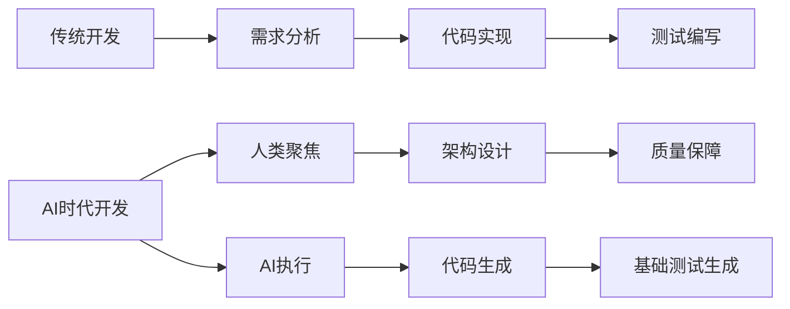

**关键转变**：
- 人类价值点迁移案例：某电商团队使用Copilot生成80%的测试代码后，测试工程师工作重心变化：
  ```python
  # 旧模式：手工编写测试
  def test_checkout():
      # 人工编写20行测试逻辑
  
  # AI时代：人类提供测试场景描述
  """
  测试场景：用户使用过期优惠券结算时应阻止支付并返回错误码 401
  边界条件：优惠券过期时间临界值（UTC+0）
  依赖项：Mock支付网关返回超时异常
  """
  # AI生成测试代码框架（人类补充断言细节）
  ```

### 1.2 “全绿”测试报告的陷阱
**典型反例**：AI生成的虚假高覆盖率测试
```java
// 被测试类：购物车计算器
class CartCalculator {
    public double calculateTotal(List<Item> items) {
        return items.stream().mapToDouble(Item::getPrice).sum();
    }
}

// AI生成的低价值测试（覆盖率100%）
@Test
void testCalculateTotal() {
    List<Item> items = Arrays.asList(new Item(10.0), new Item(20.0));
    double result = new CartCalculator().calculateTotal(items);
    assertNotNull(result); // 弱断言！未验证具体值
}
```
*图表：测试覆盖率 vs 缺陷捕获率对比折线图（显示覆盖率85%但缺陷检出率不足30%的情况）*

### 1.3 测试资产的“三重价值”重构
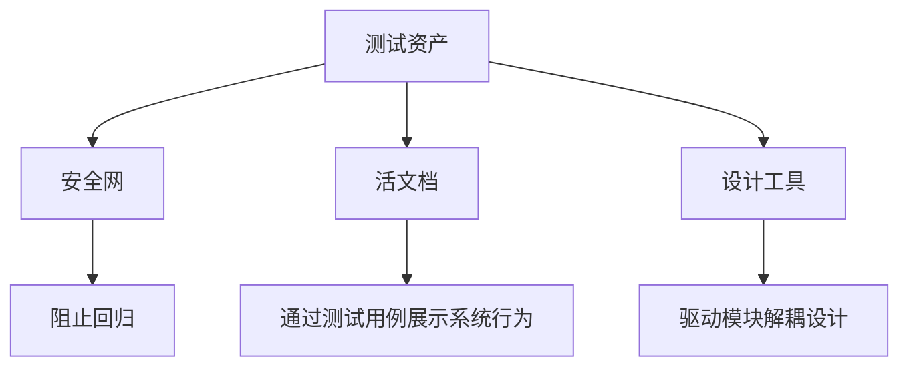

**真实收益**：某银行支付系统通过测试资产化：
- 新成员入职阅读测试用例代替文档，理解效率提升40%
- 重构核心清算模块时测试捕获17处接口兼容问题

---

## 第二章：目标设定 — “有价值的”测试资产通用标准

### 2.1 FIRST原则深度实践
| 原则       | AI时代挑战                  | 解决方案案例                 |
|------------|----------------------------|------------------------------|
| **Fast**   | AI易生成慢速集成测试       | 强制单元测试<100ms（CI门禁）|
| **Independent** | 测试间隐性依赖          | 使用JUnit 5的`@TestInstance(Lifecycle.PER_CLASS)` |
| **Repeatable** | 环境差异导致失败       | Testcontainers固定数据库版本|
```java
// Self-Validating示例：自动化结果校验
@Test
void should_apply_discount_when_user_is_vip() {
    // Arrange
    User vipUser = UserFactory.vipUser();
    
    // Act
    Order order = checkoutService.process(vipUser, cart);
    
    // Assert 
    assertThat(order.getDiscount()).isEqualTo(0.2); // 精确值断言
}
```

### 2.2 AAA模式的可维护性价值
**AI生成代码的典型缺陷**：
```javascript
// 不良结构（Act-Assert-Arrange混合）
test('login fail', () => {
    const error = login('wrong', 'pass'); // Act
    expect(error).not.toBeNull(); // Assert
    // Arrange被分散到多行中间
    render(<Login />);
    fireEvent.input(usernameField, 'wrong');
});
```

**人类优化后**：
```javascript
test('should show error when login with invalid credential', () => {
    // Arrange
    const { usernameField, submitButton } = render(<Login />);
    fireEvent.change(usernameField, { target: { value: 'wrong' } });
    
    // Act
    fireEvent.click(submitButton);
    
    // Assert
    expect(screen.getByText('Invalid credential')).toBeVisible();
});
```

### 2.3 场景覆盖的思维模型
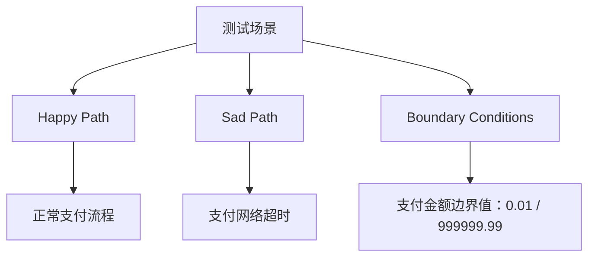

**AI指令示例**：
```
> “为PaymentService.createPayment()方法生成测试，需覆盖：
> - Happy Path: 正常支付成功返回交易号
> - Sad Path: 余额不足返回code 102
> - Boundary: 支付金额0元（非法）、单笔支付上限100万（边界）”
```


---


## 第三章：单元测试精要 — 指挥AI构建逻辑安全网

### 3.1 单元测试的边界重定义
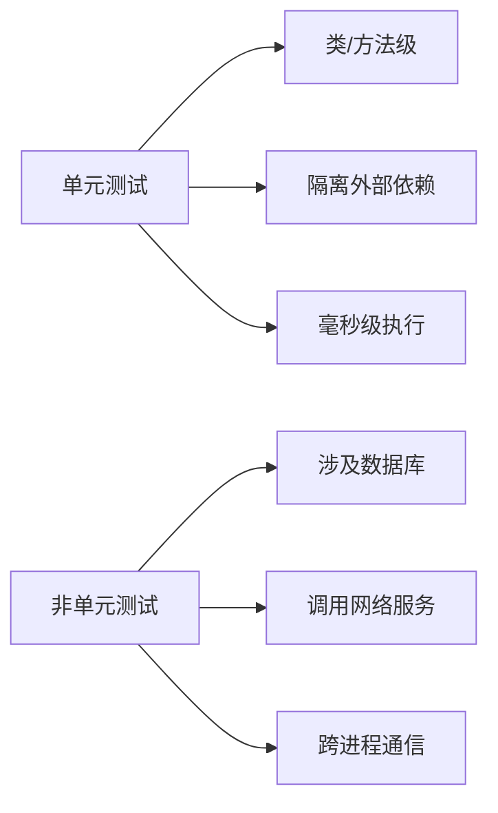

**AI时代典型误区**：
```java
// 错误示例：集成测试伪装成单元测试（Spring Boot）
@Test
@SpringBootTest // 加载整个容器！
void testUserService() {
    User user = userService.create("test@mail.com");
    assertNotNull(user.getId()); // 实际测试了数据库交互
}
```

### 3.2 指挥AI生成单元测试的三步法

#### 上下文注入（关键！）
```python
# 被测试类：优惠券验证器
class CouponValidator:
    def validate(self, coupon: Coupon, user: User) -> bool:
        """验证规则：
        1. 优惠券在有效期内
        2. 用户所在地区可用
        3. 满足最低消费金额
        """

# 给AI的提示：
"""
请为validate方法编写单元测试，要求：
- 使用pytest框架
- 覆盖场景：有效券/过期券/地区不符/金额不足
- 使用unittest.mock模拟Coupon和User对象
"""
```

#### 指令精细化（含Mock规范）
```typescript
// 被测试服务：支付服务（依赖外部网关）
class PaymentService {
    constructor(private paymentGateway: PaymentGateway) {}
    
    async pay(amount: number): Promise<PaymentResult> {
        // 调用支付网关
    }
}

// 给AI的指令：
"为pay方法编写单元测试：
1. 使用Jest Mock模拟paymentGateway
2. 场景1：支付成功返回{ status: 'success' }
3. 场景2：网关超时抛出PaymentTimeoutError
4. 验证网关被调用且参数匹配"
```

#### 迭代式优化对话
```
开发者：增加边界值测试：金额为0.01和999999.99
AI：生成 test_pay_with_min_amount() 和 test_pay_with_max_amount()
开发者：金额为负数时应该抛出InvalidAmountError
AI：补充 test_pay_negative_amount_throws_exception()
```

### 3.3 Mock/Stub框架深度应用

**AI不擅长的依赖隔离**：
```java
// 正确使用Mockito隔离数据库依赖
@Test
void testOrderProcessor() {
    // Arrange
    OrderRepository mockRepo = mock(OrderRepository.class);
    when(mockRepo.save(any())).thenReturn(new Order("123"));
    
    OrderProcessor processor = new OrderProcessor(mockRepo);
    
    // Act
    Order result = processor.createOrder(new Cart());
    
    // Assert
    verify(mockRepo).save(any()); // 验证交互
    assertEquals("123", result.getId());
}
```

**Mock与Stub的选择矩阵**：
| 场景                | 技术选择      | 示例                          |
|---------------------|---------------|-------------------------------|
| 验证方法调用        | Mock          | `verify(mock, times(1)).call()` |
| 返回预设值          | Stub          | `when(repo.findById()).thenReturn(obj)` |
| 模拟异常行为        | Stub+Exception| `when(service.call()).thenThrow(new TimeoutException())` |
| 参数捕获            | ArgumentCaptor| 验证传入对象的内部状态        |

---

## 第四章：严格把关 — Review AI生成单元测试的系统化清单

### 4.1 审查清单五要素实战

#### 1. 意图审查（Intent）
```python
# 不良示例：无业务含义的测试名
def test_case_1(): 
    ...

# 优化后：BDD风格命名
def test_should_throw_validation_error_when_email_format_invalid():
    ...
```

#### 2. 场景覆盖度（Coverage）
**AI常见缺失场景**：
```typescript
// 只测试了Happy Path
test('user login', () => {
  const result = login('valid@mail.com', 'pass123');
  expect(result.success).toBe(true);
});

// 人工补充Sad Path
test('should lock account after 5 failed attempts', () => {
  // 模拟连续5次失败登录
  for(let i=0; i<5; i++) {
    login('valid@mail.com', 'wrong');
  }
  const result = login('valid@mail.com', 'pass123');
  expect(result.error).toBe('ACCOUNT_LOCKED');
});
```

#### 3. 断言审查（Assertion）
```java
// 弱断言：只验证非空
assertNotNull(response.getData());

// 强断言：精确验证业务规则
assertThat(response)
  .hasFieldOrPropertyWithValue("status", "APPROVED")
  .hasFieldOrProperty("transactionId")
  .satisfies(res -> assertThat(res.getAmount()).isEqualByComparingTo("100.00"));
```

#### 4. 隔离性审查（Isolation）
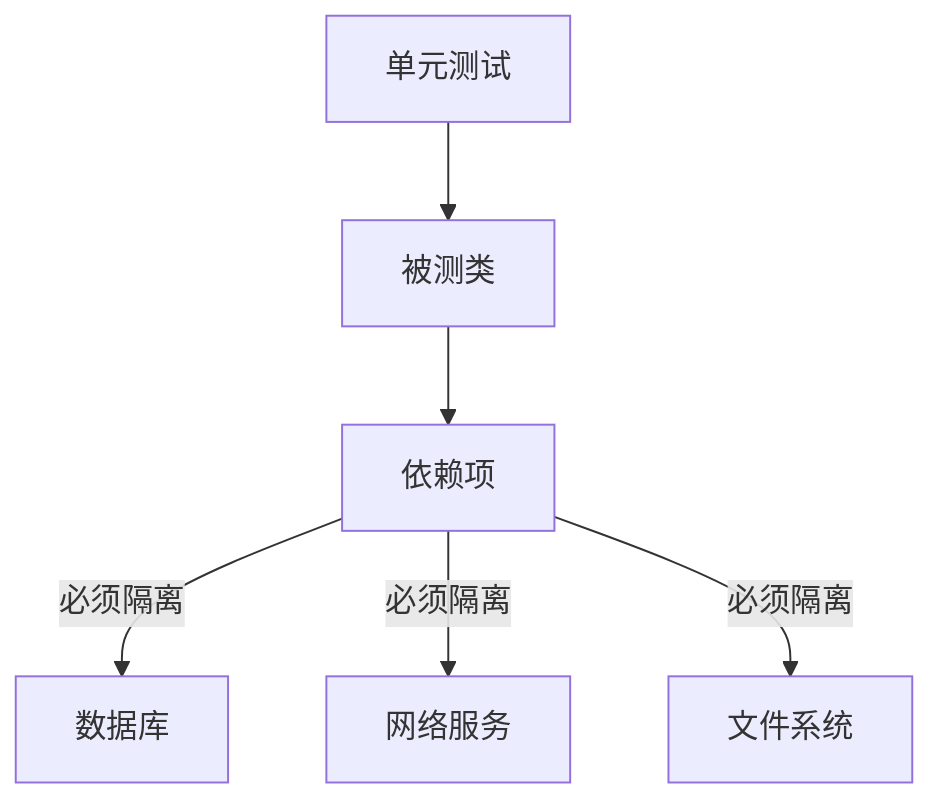

**常见泄露点检测**：
- 测试执行后遗留文件
- 未清理的内存数据库
- 修改全局静态变量

#### 5. 可读性审查（Readability）
```python
# 坏味道：魔法数字+复杂逻辑
def test_commission():
    result = calculate(10000, 0.15)
    assert result == 1500

# 优化：提取常量+工厂方法
BASE_SALES = 10000
STANDARD_RATE = 0.15

def test_commission_calculation():
    # Arrange
    sales = Sales.create(BASE_SALES, Currency.USD)
    
    # Act
    commission = Calculator.commission(sales, STANDARD_RATE)
    
    # Assert
    assert commission == Money(1500, Currency.USD)
```

### 4.2 真实MR审查演练

**AI生成的Pull Request**：
```java
// 被测试类：库存服务
public class InventoryService {
    public void reduceStock(String itemId, int quantity) {
        // 减少库存逻辑
    }
}

// AI生成的测试
@Test
void testReduceStock() {
    InventoryService service = new InventoryService();
    service.reduceStock("item1", 5);
    // 缺少断言！
}
```

**审查过程记录**：
```markdown
| 审查项       | 问题描述                     | 修复建议                     |
|--------------|------------------------------|------------------------------|
| 意图         | 测试名未描述场景             | 重命名为`should_reduce_item_quantity_when_valid` |
| 场景覆盖     | 缺少边界值测试               | 增加`quantity=0`和负数测试   |
| 断言         | **致命：无断言**             | 添加库存减少量的验证         |
| 隔离性       | 可能操作真实数据库           | 注入Mock库存仓库             |
| 可读性       | 魔法值"item1"                | 定义常量TEST_ITEM_ID         |
```

**修复后测试**：
```java
@Test
void should_reduce_item_quantity_when_valid() {
    // Arrange
    InventoryRepository mockRepo = mock(InventoryRepository.class);
    when(mockRepo.getStock("item_1")).thenReturn(10);
    InventoryService service = new InventoryService(mockRepo);
    
    // Act
    service.reduceStock("item_1", 3);
    
    // Assert
    verify(mockRepo).updateStock("item_1", 7);
}
```

### 第四章附录：AI测试审查清单速查表
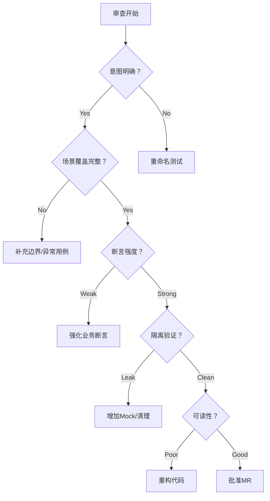


---

## 第五章：后端集成测试 — 验证服务间的协同

### 5.1 集成测试的范畴与层级
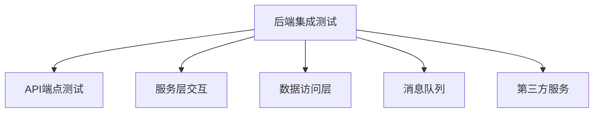

**测试金字塔中的定位**：


### 5.2 关键挑战与核心策略

#### 测试数据管理（最大痛点）
**AI辅助方案**：
```java
// 使用AI生成测试数据工厂
public class TestDataFactory {
    
    // AI生成：基于JPA实体注解自动创建测试对象
    public static Order createValidOrder() {
        return Order.builder()
            .id(UUID.randomUUID())
            .items(List.of(
                new LineItem("prod_123", 2),
                new LineItem("prod_456", 1)
            ))
            .total(new BigDecimal("299.98"))
            .status(OrderStatus.PENDING)
            .build();
    }
    
    // 人类补充：复杂关联数据
    public static Order createOrderWithDiscount(User user) {
        Order order = createValidOrder();
        order.applyDiscount(user.getDiscountRate());
        return order;
    }
}
```

#### 环境管理最佳实践
**Testcontainers + AI 工作流**：
```java
public class PaymentIntegrationTest {

    // AI生成基础容器配置
    @Container
    static PostgreSQLContainer<?> postgres = new PostgreSQLContainer<>("postgres:15");
    
    @Container
    static RabbitMQContainer rabbitmq = new RabbitMQContainer("rabbitmq:3.12");
    
    // 人类补充环境初始化
    @BeforeAll
    static void init() {
        System.setProperty("DB_URL", postgres.getJdbcUrl());
        System.setProperty("MQ_HOST", rabbitmq.getHost());
    }

    @Test
    void should_process_payment_and_send_event() {
        // 测试逻辑使用真实数据库和MQ
    }
}
```

### 5.3 AI在后端集成测试中的角色分工

| 任务类型               | AI能力边界                     | 人类核心职责               |
|------------------------|-------------------------------|---------------------------|
| HTTP请求生成           | ✅ 生成完整的HTTP调用模板      | ❗️设计认证/加密逻辑        |
| DTO对象构造            | ✅ 根据OpenAPI规范生成DTO      | ❗️定义业务校验规则         |
| 数据库测试数据         | ⚠️ 生成基础INSERT语句         | ❗️处理关联数据/事务边界    |
| 异步流程验证           | ❌ 无法理解业务事件流          | ✅ 设计事件监听/超时处理   |
| 分布式事务测试         | ❌ 无法模拟复杂分布式场景      | ✅ 设计补偿事务测试用例    |

**AI协作示例：API测试生成**
```python
# 人类指令：
"""
为订单创建API编写测试：
- 端点：POST /orders
- 认证：Bearer Token
- 成功：201状态 + 返回订单ID
- 失败：400库存不足
- 使用requests库
"""

# AI生成：
def test_create_order_success():
    headers = {"Authorization": "Bearer test_token"}
    payload = {"items": [{"productId": "prod_1", "quantity": 2}]}
    response = requests.post(API_URL + "/orders", json=payload, headers=headers)
    assert response.status_code == 201
    assert "orderId" in response.json()

# 人类补充：库存不足场景
def test_create_order_insufficient_stock():
    payload = {"items": [{"productId": "low_stock_prod", "quantity": 1000}]}
    response = requests.post(API_URL + "/orders", json=payload)
    assert response.status_code == 400
    assert response.json()["code"] == "INSUFFICIENT_STOCK"
```

### 5.4 消息队列测试模式
```java
// 使用Testcontainers+Awaitility验证异步流程
@Test
void should_publish_order_created_event() {
    // Arrange
    Order order = testData.createValidOrder();
    
    // Act
    orderService.create(order);
    
    // Assert
    await().atMost(5, SECONDS).untilAsserted(() -> {
        List<Message> messages = rabbitTemplate.receive("order.queue", 1000);
        assertThat(messages).hasSize(1)
            .extracting(msg -> objectMapper.readValue(msg.getBody(), OrderEvent.class))
            .extracting(OrderEvent::getOrderId)
            .contains(order.getId());
    });
}
```
---

## 第六章：前端集成测试 — 确保组件与用户交互的正确性

### 6.1 前端测试的特殊性矩阵
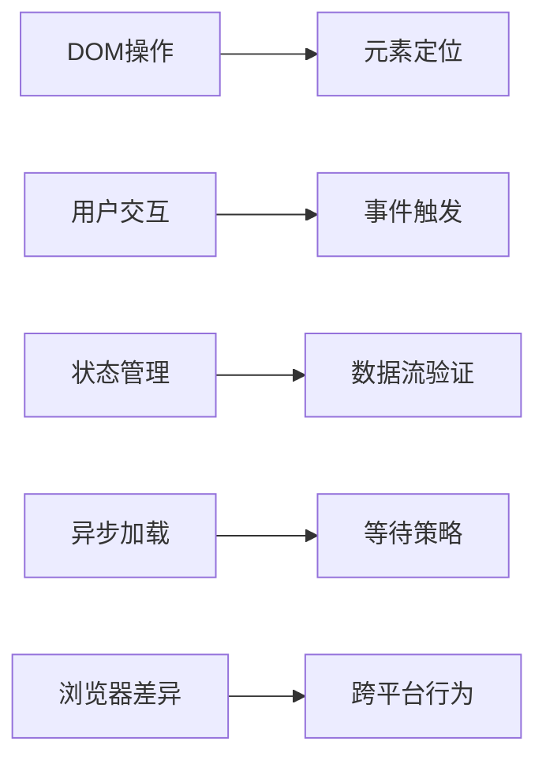

### 6.2 组件集成测试实战

#### 父子组件通信测试（Vue示例）
```javascript
// 指令：测试SubmitForm组件触发submit事件时传递表单数据
test('should emit submit event with form data', async () => {
    // Arrange - AI生成基础渲染代码
    const wrapper = mount(SubmitForm, {
        props: { initialData: { name: 'Test' } }
    });
    
    // Act - 人类补充交互逻辑
    await wrapper.find('#name-input').setValue('New Name');
    await wrapper.find('form').trigger('submit');
    
    // Assert - 验证事件负载
    const emitEvents = wrapper.emitted('submit');
    expect(emitEvents[0][0]).toEqual({
        name: 'New Name',
        agreeTerms: true
    });
});
```

#### 复杂页面测试策略
```javascript
// 测试电商产品列表页
test('should add product to cart when clicking buy button', async () => {
    // Arrange - 使用Vitest Mock路由和Store
    const mockStore = { dispatch: vi.fn() };
    const wrapper = mount(ProductListPage, {
        global: {
            mocks: { $store: mockStore },
            plugins: [createTestingPinia()]
        }
    });
    
    // 等待数据加载 - 人类补充异步处理
    await waitForApiResponse();
    
    // Act - AI生成元素定位代码
    await wrapper.findAll('.product-card')[0].find('.buy-button').trigger('click');
    
    // Assert - 验证Vuex Action调用
    expect(mockStore.dispatch).toHaveBeenCalledWith('cart/addItem', {
        id: 'prod_123',
        quantity: 1
    });
});
```

### 6.3 状态管理与路由测试

#### 跨组件状态流测试
```javascript
// 测试登录状态全局同步
test('should update user profile in all components', async () => {
    // 在Header组件更新用户
    const header = mount(Header, { store });
    await header.vm.$store.dispatch('user/login', { name: 'Alice' });
    
    // 验证Profile组件响应
    const profile = mount(UserProfile);
    expect(profile.find('.user-name').text()).toBe('Alice');
    
    // 验证Dashboard欢迎语
    const dashboard = mount(Dashboard);
    expect(dashboard.find('.welcome-msg').text()).toContain('Alice');
});
```

#### 路由跳转验证（Vue Router）
```javascript
// 测试导航守卫
test('should redirect to login when accessing protected route', async () => {
    // AI生成路由配置
    const router = createRouter({
        history: createWebHistory(),
        routes: [
            { path: '/admin', meta: { requiresAuth: true } },
            { path: '/login' }
        ]
    });
    
    // 人类模拟未认证状态
    const store = createStore({ state: { user: null } });
    
    // 触发路由跳转
    await router.push('/admin');
    
    // 验证重定向
    expect(router.currentRoute.value.path).toBe('/login');
});
```

### 6.4 AI在前端测试中的能力边界

| 任务类型               | AI支持度 | 说明                          |
|------------------------|----------|-------------------------------|
| 组件挂载代码           | ✅ 90%   | 能生成基础渲染逻辑            |
| DOM元素定位            | ⚠️ 60%   | 复杂CSS选择器需人工优化       |
| 用户交互链             | ⚠️ 50%   | 多步骤操作需人工设计          |
| 异步等待策略           | ❌ 30%   | 需人工定义等待条件            |
| 跨组件状态断言         | ❌ 20%   | 需人类理解业务数据流          |
| 视觉回归测试           | ✅ 80%   | 可集成Applitools等工具        |

**高效协作模式**：
```mermaid
sequenceDiagram
    Developer->>+AI： 提供组件描述和测试目标
    AI-->>-Developer： 生成测试骨架代码
    Developer->>+AI： 补充特定交互指令
    AI-->>-Developer： 扩展事件触发代码
    Developer->>+Human： 添加复杂状态断言
```


---

## 第七章：端到端(E2E)测试与测试金字塔 — 保障完整用户旅程

### 7.1 测试金字塔的AI时代演进
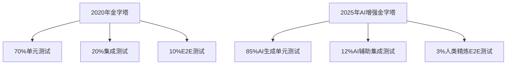

**关键变化**：
- 单元测试数量增长但人类投入减少
- E2E测试数量减少但单用例价值提升
- 新增"AI验证层"确保生成测试质量

### 7.2 E2E测试的价值与成本优化

#### 成本控制四原则：
```mermaid
flowchart LR
    A[减少数量] --> 只测核心业务流
    B[降低维护] --> 使用Page Object模式
    C[提升稳定] --> 智能等待策略
    D[加速执行] --> 并行化+云设备
```

**真实成本对比（某电商平台）**：
| 测试类型 | 用例数量 | 月维护时长 | 缺陷捕获率 |
|----------|----------|------------|------------|
| 单元测试 | 4200     | 15小时     | 38%        |
| 集成测试 | 850      | 22小时     | 27%        |
| E2E测试  | 52       | 35小时     | 35%        |

### 7.3 AI在E2E测试中的深度应用

#### BDD规范转测试代码（AI强项）
```gherkin
# 人类编写的BDD场景
Feature: 购物车结算
  Scenario: 普通用户购买多件商品
    Given 用户登录并添加2件商品到购物车
    When 进入结算页面选择信用卡支付
    Then 生成待支付订单
    And 发送订单确认邮件
```

```javascript
// AI生成的Cypress测试
describe('购物车结算', () => {
  it('普通用户购买多件商品', () => {
    // Given
    cy.login('standard_user')
    cy.addItemToCart(0)
    cy.addItemToCart(1)
    
    // When
    cy.checkout()
    cy.selectPayment('credit_card')
    
    // Then
    cy.url().should('contain', '/order-created')
    cy.get('.order-id').should('be.visible')
    
    // And
    cy.task('checkEmail', 'standard_user@test.com').then(emails => {
      expect(emails[0].subject).to.equal('订单确认')
    })
  })
})
```

#### Page Object模型协作
```typescript
// AI生成的Page Object框架
class CheckoutPage {
  // 元素定位器
  private firstNameInput = '#first-name'
  private continueButton = '#continue'
  
  // 人类补充交互方法
  async fillShippingInfo(info: ShippingInfo) {
    await page.fill(this.firstNameInput, info.firstName)
    // ...其他字段
  }
  
  // AI生成的基础方法
  async continueToPayment() {
    await page.click(this.continueButton)
  }
}

// 人类编写的业务组合操作
async function completeShipping(user: User) {
  const checkout = new CheckoutPage()
  await checkout.fillShippingInfo(user.shipping)
  await checkout.continueToPayment()
}
```

#### 动态元素处理（人类核心价值）
```javascript
// 传统定位器的问题
cy.get('#main > div > div:nth-child(3) > button') // 脆弱！

// 人类优化的稳健定位策略
function getProductCard(name) {
  return cy.contains('.product-card', name)
}

// 在AI生成代码中注入
getProductCard('iPhone 15').find('.buy-button').click()
```

#### Flaky Test防御体系
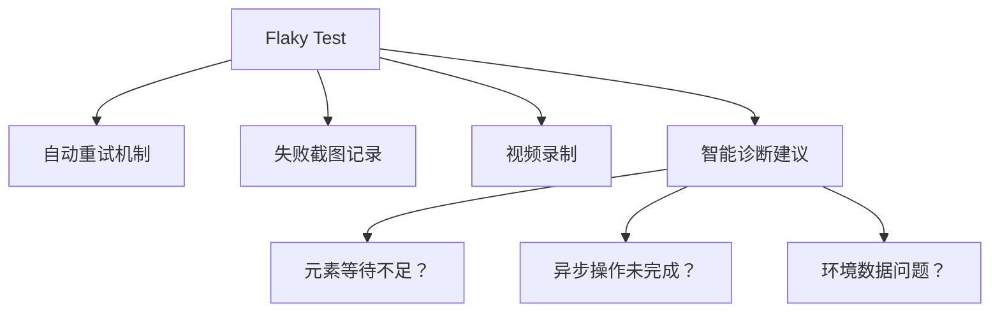

### 7.4 关键业务流(Critical User Journeys)设计框架

**四维度识别关键流**：


**支付关键流示例**：
```
1. 游客快速结账（Happy Path）
2. 优惠券组合使用（边界条件）
3. 支付失败重试（Sad Path）
4. 国际信用卡支付（特殊场景）
```

**AI-Human协作工作流**：
```mermaid
sequenceDiagram
    PO->>+QA： 提供业务流程图
    QA->>+AI： 生成基础E2E脚本
    AI-->>-QA： 返回脚本草案
    QA->>+Dev： 请求技术增强点
    Dev-->>-QA： 注入等待策略/PO模型
    QA->>+AI： 请求生成数据清理代码
    AI-->>-QA： 返回清理方案
    QA->>CI： 提交自动化流水线
```

---

## 第八章：文化落地 — 将测试资产建设融入日常

### 8.1 流程保障机制

#### CI/CD质量门禁配置
```yaml
# .gitlab-ci.yml 示例
stages:
  - test
  
unit_tests:
  stage: test
  image: maven:3.8
  script:
    - mvn test -Dtest=**/*UnitTest*
  rules:
    - if: $CI_MERGE_REQUEST_ID
  artifacts:
    reports:
      junit: target/surefire-reports/*.xml

e2e_tests:
  stage: test
  image: cypress/base:14
  script:
    - npm ci
    - npx cypress run --record --key $CYPRESS_KEY
  only:
    - merge_requests
    - main
```

#### "完成的定义"(Definition of Done)模板
```markdown
### 需求完成的必须条件：
1. [ ] 所有业务逻辑有单元测试覆盖（AI生成+人工审查）
2. [ ] 核心接口有集成测试（Testcontainers验证）
3. [ ] 关键用户流有E2E测试（Cypress/Playwright）
4. [ ] 测试通过率 > 95%（门禁执行）
5. [ ] 新增测试资产可维护性评分 > 4/5
```

### 8.2 激励与能力建设

#### 测试资产健康度仪表盘
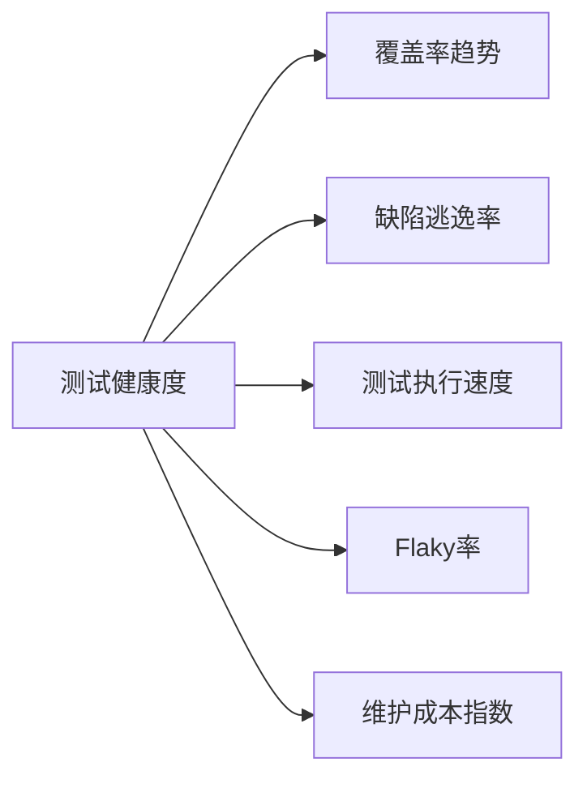

**正向激励方案**：
- 每月"金盾奖"：表彰测试资产质量最高的团队
- 测试重构日：每月1天专门优化测试代码
- 测试模式库：共享可复用的测试设计模式
```markdown
## 测试模式库示例
### 订单取消测试模式
**适用场景**： 需要验证分布式事务回滚
```java
@Test
void should_rollback_inventory_when_order_cancelled() {
  // 1. 预置库存数据
  // 2. 创建待取消订单
  // 3. 执行取消操作
  // 4. 验证库存恢复
}
```
```

#### AI提示工程培训要点
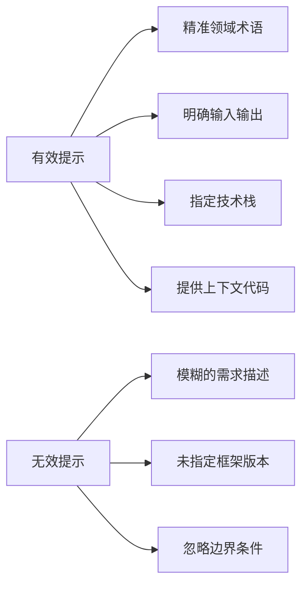

### 8.3 技术领导力实践

#### 领导者测试代码示范
```java
// CTO编写的模范测试
public class PaymentStrategyTest {
    
    @Test
    void should_select_alipay_when_user_in_china() {
        // Arrange
        User user = UserFactory.chineseUser();
        PaymentSelector selector = new PaymentSelector();
        
        // Act
        PaymentMethod method = selector.selectFor(user);
        
        // Assert
        assertThat(method).isInstanceOf(Alipay.class);
    }
    
    @ParameterizedTest
    @CsvSource({
        "CNY, 100, 0, Alipay",
        "USD, 50, 0.3, CreditCard",
        "EUR, 200, 0.1, PayPal"
    })
    void should_select_correct_method_by_currency_and_amount(
        Currency currency, 
        BigDecimal amount,
        double discount,
        Class<?> expectedType
    ) {
        // 参数化测试展示
    }
}
```

#### 文化落地检查清单
```markdown
- [ ] 新成员入职培训包含测试资产规范
- [ ] 代码评审必须有测试审查环节
- [ ] 每周技术分享包含测试主题
- [ ] KPI包含测试质量指标
- [ ] 架构设计文档包含测试策略章节
```

### 8.4 持续演进路线图
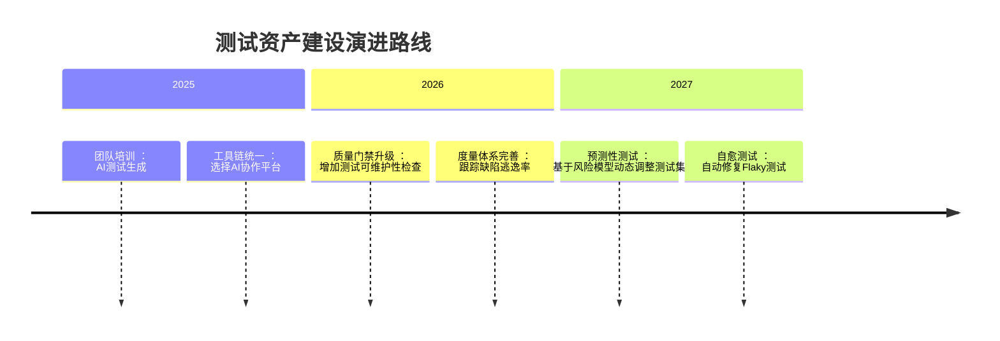

---


## 结语：构建面向未来的测试资产体系

在AI时代，自动化测试资产已成为软件企业的**核心战略资产**。通过：
1. 精准定位AI在测试中的能力边界
2. 建立FIRST原则驱动的质量标准
3. 实施分层协作的测试策略
4. 培育质量优先的工程文化

团队可将测试资产转化为：
- 抵御变更风险的**安全盾牌**
- 加速交付流程的**效能引擎**
- 传承领域知识的**活文档库**

> "测试不是负担，而是通往持续交付的高速公路。AI不是取代者，而是让我们在这条路上跑得更快的超级跑车。" —— 2025年《State of Testing》报告


