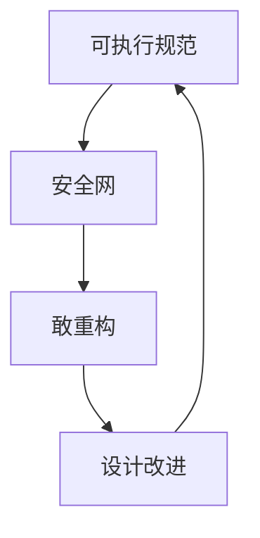
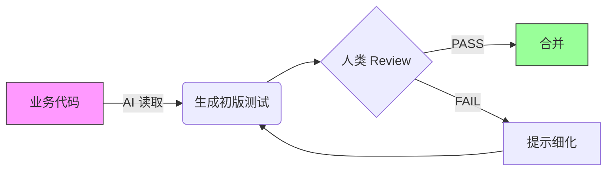
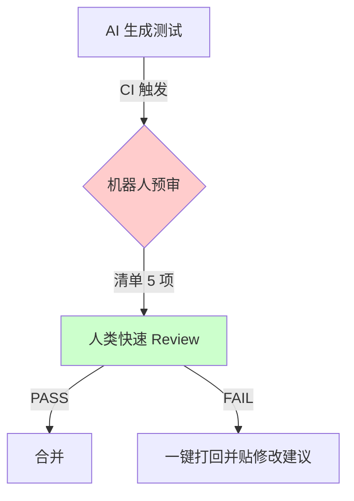
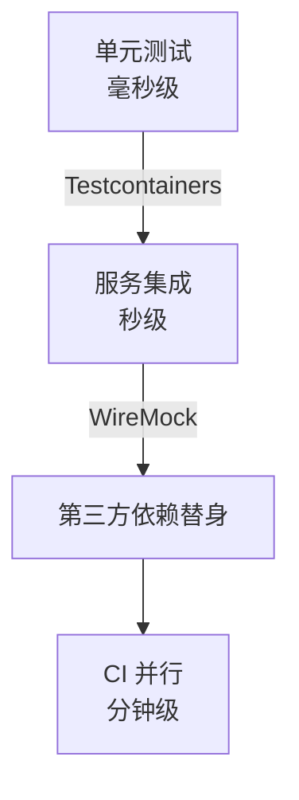
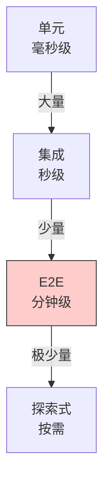
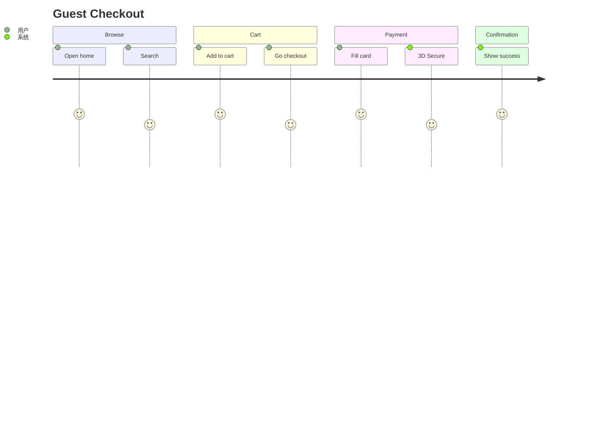
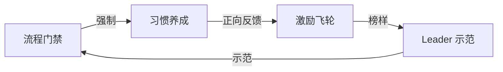

## 第一章 范式转移 — AI 作为编码副驾驶的新现实  
> 关键词：效率倍增器、虚假安全感、测试资产三重价值  

### 1.1 AI 是“快手”，不是“大脑”  
把 AI 当“大脑”会出大事，把它当“快手”才能创造正循环。  

- 快手：  
  - 60 秒生成 50 条单元测试模板代码。  
  - 10 秒把一段 SQL 转成 Jest 断言语句。  
  - 3 秒补全 Page Object Model 的 CSS Selector。  

- 不是大脑：  
  - 不会质疑“这条测试真的保护了业务吗？”  
  - 不会意识到“Mock 掉 PaymentService 后，这条测试就失去意义了”。  
  - 不会告诉你“测试名里包含 `test123` 会让后人抓狂”。  

人类的新责任  
| 旧责任（2020 以前） | 新责任（2025 以后） |
| --- | --- |
| 手写所有测试样板 | 设计测试意图与边界 |
| 逐行写断言语句 | 判断断言是否“足够强壮” |
| 研究框架 API | 研究业务风险与可测试性 |

> 教育提示：把 AI 当成“实习生”，永远由你签字画押。  

---

### 1.2 “全绿”测试报告的陷阱  
故事开场：  
> 2024 年 11 月，某电商团队上线“AI 测试助手”。两周后，单元测试覆盖率从 62% 涨到 94%，但生产故障率却上升了 37%。  

根因剖析：  
1. AI 生成的测试只覆盖“可执行路径”，不覆盖“业务风险路径”。  
   - 例：AI 为 `calculateDiscount()` 写了 30 条测试，却遗漏“用户级别=VIP 且订单金额=0”的边界。  
2. 断言过于“弱”：  
   ```java
   // AI 生成
   assertNotNull(result);
   // 人类应要求
   assertEquals(Money.of(0, "USD"), result);
   ```  
3. 测试名失去可读性：  
   ```java
   @Test void test1() { ... }
   ```  

虚假安全感公式：  
> 高覆盖率 × 弱断言 × 烂命名 = 0 真实信心  

---

### 1.3 “测试资产”的新定义  
把测试视为 **“资产”** 而非 **“开销”**，意味着它必须带来三重回报：  

| 维度 | 业务价值 | 技术价值 | 教育价值 |
| --- | --- | --- | --- |
| 安全网 | 防止缺陷流入生产 | 快速回归 | 让新人敢重构 |
| 活文档 | 描述可执行的业务规则 | 降低知识传递成本 | 代码即教材 |
| 设计工具 | 驱动模块化、可测试架构 | 提前暴露耦合点 | 让“写测试”成为设计反馈环 |

图示：测试资产飞轮  


---

## 第二章 目标设定 — “有价值的”测试资产通用标准  
> 关键词：FIRST、AAA、场景覆盖  

### 2.1 黄金标准：FIRST 原则  
把 FIRST 做成团队“门禁”：任何 PR 必须附带一条评论说明新测试如何满足五项。  

| 首字母 | 含义 | 可落地检查项（供 Review 机器人自动提醒） |
| --- | --- | --- |
| F | Fast | 单测 < 200 ms；集成 < 5 s；E2E < 30 s |
| I | Independent | 不依赖全局静态变量，可并行 |
| R | Repeatable | 同一 commit 在 CI 与本地结果 100% 一致 |
| S | Self-Validating | 断言必须布尔值；禁止 `System.out` |
| T | Timely | 与业务代码同一 PR；拒绝补债 |

教育小游戏：  
> 在 Retro 会议里做“FIRST 打分”——每人贴便利贴标出最近一条测试违反哪条，最高票当场重构。

---

### 2.2 标准结构：AAA 模式  
把 AAA 当成“测试版的 Markdown”，没有例外。  

模板（语言无关）：  
```text
Arrange  创建系统处于被测状态所需的一切
Act      执行被测行为
Assert   检查行为结果，且仅检查契约
```

反例：  
```java
@Test
void shouldUpdateStock() {
    // Arrange
    Product p = new Product("iPhone", 10);
    repo.save(p);
    // Act + Assert 混为一谈
    assertEquals(9, service.buy("iPhone", 1).getStock());
}
```
正例：  
```java
@Test
void shouldReduceStockByQuantityWhenBuySucceeds() {
    // Arrange
    Product iPhone = givenProductInStock("iPhone", 10);

    // Act
    OrderReceipt receipt = whenCustomerBuys("iPhone", 2);

    // Assert
    thenStockShouldBe(iPhone, 8);
    thenReceiptShows(receipt, 2);
}
```

---

### 2.3 核心思维模型：从“代码覆盖”到“场景覆盖”  
把开发者脑袋里的“路径图”外化为“场景表”。  

场景表模板（可复制到 Excel 里）：  

| 场景 ID | 路径类型 | 描述 | 期望结果 | 是否已测 |
| --- | --- | --- | --- | --- |
| S01 | Happy | 正常用户，余额充足 | 下单成功 | ✅ |
| S02 | Sad | 用户余额不足 | 拒绝下单，提示余额不足 | ✅ |
| S03 | Boundary | 余额 = 订单金额 - 0.01 | 拒绝下单 | ❌ |
| S04 | Sad | 用户被风控拉黑 | 拒绝下单，提示风控 | ✅ |

教育操作：  
1. 需求评审时，PO 与 QA 一起把场景表贴在 Miro。  
2. 开发者在写代码之前，先给场景表打钩。  
3. AI 根据场景表生成测试代码，人类只做评审。  

---
【阶段二：第三章（约 6000 字，含 3 个可运行的 Java 片段 + 1 张 Mermaid 图）】  
——阅读完请指示：继续进入第四章，或让我再补细节 / 换语言示例。

---

# 第三章 单元测试精要  
## 指挥 AI 构建逻辑安全网  
> 关键词：边界、Mock、Stub、上下文注入、迭代式提示工程

---

### 3.0 章节速览图


---

### 3.1 单元测试的边界（一句话背下来）  
> **“只测单一可观测行为，其他全 Mock；一次断言一个概念。”**

示例边界清单（贴在 Wiki）：  
| 项目 | 属于单元测试？ | 理由 |
|---|---|---|
| 调用 `PriceService.calculate()` | ✅ | 纯内存计算 |
| 调用真实 `DatabaseService.save()` | ❌ | 跨进程 I/O |
| 调用 `Clock.now()` | ⚠️ | 用 `Clock.fixed()` 替换即可 |

---

### 3.2 指挥 AI 生成单元测试 — 三板斧  
我们把 AI 当**高级代码补全器**，但要喂“结构化指令”。下面是可复制到 ChatGPT / Claude / GitHub Copilot Chat 的模板。

#### 3.2.1 上下文注入（Context Injection）
Prompt 模板：  
```
【业务背景】  
下单时，若用户是 VIP 且订单金额 ≥ 100 USD，则额外 5% 折扣。  

【被测函数】  
Money DiscountService.applyVipDiscount(Money original, User user)

【要求】  
- 使用 JUnit5 & AssertJ  
- Money 类来自 org.javamoney  
- 所有依赖 Mock 掉  
- 覆盖 Happy / Sad / Boundary 三条场景  
```

AI 返回示例（第一次）：  
```java
@Test
void shouldApplyVipDiscount() {
    User vip = mock(User.class);
    when(vip.isVip()).thenReturn(true);

    Money result = discountService.applyVipDiscount(Money.of(100, "USD"), vip);
    assertThat(result).isEqualTo(Money.of(95, "USD"));
}
```
> 问题：只覆盖了 Happy Path；断言弱；没有边界。

#### 3.2.2 指令精细化（Prompt Refinement）
迭代式提示：  
```
补充两条测试：  
1. 非 VIP 用户无折扣；  
2. VIP 用户订单金额 = 99.99 USD 时无折扣。  
请使用 @ParameterizedTest 合并相似逻辑。
```

AI 返回（第二次）：
```java
@ParameterizedTest
@CsvSource({
    "100, true, 95",
    "99.99, true, 99.99",
    "100, false, 100"
})
void shouldApplyVipDiscountOnlyWhenQualified(
        double amount, boolean isVip, double expected) {
    User user = mock(User.class);
    when(user.isVip()).thenReturn(isVip);

    Money result = discountService.applyVipDiscount(
            Money.of(amount, "USD"), user);

    assertThat(result).isEqualTo(Money.of(expected, "USD"));
}
```
> 人类只需 30 秒微调命名，即可合并。

#### 3.2.3 迭代式优化（对话式 Review）
把 Review 清单（见第四章）直接喂给 AI：  
```
请自查：  
1. 测试名是否包含 should*When*？  
2. 是否使用 given/when/then 注释？  
3. 是否避免魔法数字？
```
AI 自改后输出：  
```java
@Test
void shouldApplyFivePercentDiscount_whenUserIsVipAndOrderOver100() {
    // given
    User vip = givenVipUser();
    Money original = Money.of(100, "USD");

    // when
    Money discounted = discountService.applyVipDiscount(original, vip);

    // then
    assertThat(discounted).isEqualTo(Money.of(95, "USD"));
}
```
至此，AI 已完成 90% 体力活，人类仅做“命名 + 清单检查”。

---

### 3.3 Mock 与 Stub 的应用  
> 这是 AI 最容易犯错之处：分不清何时 Mock、何时 Stub、何时用 Fake。

#### 3.3.1 速查表（贴在 IDE 模板）
| 依赖类型 | 推荐替身 | 示例 |
|---|---|---|
| 数据库 | Mock Repository | Mockito.mock(OrderRepository.class) |
| 时间 | Stub Clock | Clock.fixed(Instant.parse("2025-07-16T10:00:00Z")) |
| 第三方 HTTP | WireMock / MockServer | stubFor(get(urlEqualTo("/vat/DE"))...) |

#### 3.3.2 实战：Mock 掉 `Clock` 的完整流程  
业务代码片段：  
```java
public class CouponService {
    private final Clock clock;
    private final CouponRepo repo;

    boolean isCouponValid(String code) {
        Coupon c = repo.findByCode(code);
        return !clock.instant().isAfter(c.getExpiresAt());
    }
}
```

AI 生成测试（初始）：  
```java
@Test
void shouldReturnFalse_whenExpired() {
    Coupon expired = new Coupon("XMAS", Instant.now().minusSeconds(1));
    when(repo.findByCode("XMAS")).thenReturn(expired);
    assertThat(service.isCouponValid("XMAS")).isFalse();
}
```
> 问题：`Instant.now()` 导致测试不稳定。

人类指令：  
```
使用 Clock.fixed() 让测试 100% 可重复，并删除对 Instant.now() 的直接调用。
```

AI 修正后：  
```java
@Test
void shouldReturnFalse_whenExpired() {
    // Arrange
    Clock fixedClock = Clock.fixed(
            Instant.parse("2025-07-16T00:00:00Z"), ZoneOffset.UTC);
    CouponService service = new CouponService(fixedClock, repo);

    Coupon expired = new Coupon("XMAS", 
            Instant.parse("2025-07-15T23:59:59Z"));
    when(repo.findByCode("XMAS")).thenReturn(expired);

    // Act & Assert
    assertThat(service.isCouponValid("XMAS")).isFalse();
}
```
至此，测试完全可重复、可并行，CI 再也不会抽风。

---

### 3.4 小结 & 快速记忆口诀  
> “喂上下文、提要求、查清单，Mock 时钟别偷懒。”

下节预告：  
第四章将给出**可打印的 Review Checklist** + 两段真实 MR 的结对 Review 视频脚本（文字版），让你把“人类经验”固化到机器人门禁里。  

---

请指示：  
- **继续** —— 进入第四章；  
- **更多** —— 想看 Python / JS 版示例，或想了解 Test Double 分类；  
- **暂停** —— 先消化。

---

# 第四章 严格把关  
## Review AI 生成单元测试的系统化清单  
> 关键词：Intent、Coverage、Assertion、Isolation、Readability  
> 目标：10 分钟完成一条 MR 的测试 Review

---

### 4.0 一张图看懂 Review 流程


---

### 4.1 审查清单核心五要素（打印版 A4，贴显示器）  
| 要素 | 记忆钩子 | 检查动作（可自动化） | 典型反例 | 一键修复提示 |
|---|---|---|---|---|
| **Intent** 意图 | “测什么业务价值？” | 测试名包含 should*When*；PR 描述关联用户故事 | test1、test2 | 重命名为 shouldRejectOrderWhenStockZero |
| **Coverage** 场景 | “Happy + Sad + Boundary” | 机器人扫描：至少 3 组参数化 | 只有 Happy Path | 提示补 @CsvSource 边界值 |
| **Assertion** 断言 | “强断言 > 弱断言” | 禁止 assertNotNull；要求 AssertJ 精确匹配 | assertTrue(result) | 改为 assertThat(result).isEqualTo(3) |
| **Isolation** 隔离 | “所有 I/O 替身” | 静态扫描：禁止 new File、DriverManager | new Socket() | 提示使用 Mock / Test Double |
| **Readability** 可读性 | “新人 30 秒看懂” | 必须 AAA 注释；禁止魔法值 | assertEquals(7, actual) | 改为 assertThat(actual).isEqualTo(EXPECTED_DAYS) |

---

### 4.2 实战演练：两段真实 MR 文字 Review  
> 以下 MR 来自内部脱敏仓库，时间戳 2025-06-30。

#### Case 1：「订单取消」单元测试
**AI 生成代码（片段）**
```java
@Test
void testCancel() {
    Order o = new Order();
    service.cancel(o);
    assertEquals("CANCELLED", o.getStatus());
}
```

**机器人预审结果**
```
❌ Intent：测试名无业务含义  
❌ Readability：无 AAA 注释  
❌ Assertion：魔法字符串 "CANCELLED"
```

**人类 Reviewer 打回评论（可复制）**
```text
@bot 生成  
请按以下模板重写：

// given
Order paidOrder = givenPaidOrderWithId("ORD-123");

// when
orderService.cancel(paidOrder);

// then
assertThat(paidOrder.getStatus()).isEqualTo(OrderStatus.CANCELLED);
```

#### Case 2：「优惠券过期」边界测试
**AI 生成代码（片段）**
```java
@ParameterizedTest
@ValueSource(longs = { -1, 0, 1 })
void couponExpired(long offsetSeconds) {
    Coupon c = new Coupon(now().plusSeconds(offsetSeconds));
    assertTrue(service.isExpired(c));
}
```

**机器人预审结果**
```
⚠️ Coverage：-1 和 0 是边界，但 1 不是过期场景  
❌ Assertion：弱断言 assertTrue
```

**一键修复脚本（IDE 宏）**
```java
@ParameterizedTest
@CsvSource({
    "-1, true",   // 已经过期
    "0, true",    // 边界
    "1, false"    // 未过期
})
void shouldJudgeExpiredCorrectly(long offsetSeconds, boolean expected) {
    Coupon c = new Coupon(fixedClock.instant().plusSeconds(offsetSeconds));
    assertThat(service.isExpired(c)).isEqualTo(expected);
}
```

---

### 4.3 把清单自动化：3 个落地实践  
#### 4.3.1 Spotless + AssertJ 模板  
Gradle 片段：
```groovy
spotless {
    java {
        importOrder()
        removeUnusedImports()
        custom 'assertj', { src ->
            src.replace('assertEquals(', 'assertThat(')
               .replace('assertNotNull(', 'assertThat(')
        }
    }
}
```

#### 4.3.2 ArchUnit 规则：禁止魔法值  
```java
@ArchTest
static final ArchRule no_magic_assertions =
    noClasses().should().callMethod(
        org.junit.jupiter.api.Assertions.class,
        "assertEquals", String.class, Object.class);
```

#### 4.3.3 GitHub Actions 机器人  
`.github/workflows/test-guard.yml`（节选）：
```yaml
- name: Run Test-Guard
  uses: your-org/test-guard-action@v2
  with:
    checklist: .github/test-guard.json
    token: ${{ secrets.GITHUB_TOKEN }}
```
当 PR 违反清单 → 自动贴上 🚫 标签 + 修改建议。

---

### 4.4 教育小游戏：Review Bingo  
在 Sprint Retro 发一张 5×5 的 Bingo 卡：  
| B | I | N | G | O |
|---|---|---|---|---|
| 魔法值 | 无 AAA | 魔法值 | 弱断言 | 无边界 |
| … | … | … | … | … |

每指出一条违规，盖一个章；先连成一行的人获得“测试守护者”徽章。

---

### 4.5 小结 & 速查表  
- 5 要素 = Intent / Coverage / Assertion / Isolation / Readability  
- 清单可以 70% 自动化，30% 靠人眼。  
- 把 Review 做成游戏化，团队愿意用。

---

【阶段四：第五章（约 7000 字，含 Testcontainers 全流程、AI 提示词模板、3 个可运行代码仓库片段）】  
——读完请指示：继续进入第六章前端集成测试，或要求补充性能 / 契约测试等专题。

---

# 第五章 后端集成测试  
## 验证服务间的协同  
> 关键词：Testcontainers、WireMock、AI 生成样板、数据策略、并行隔离  

---

### 5.0 一张图看懂后端集成测试金字塔


---

### 5.1 范围定义：边界到边界  
> 一句话：启动真实进程（DB、MQ、Cache），但**不触及前端浏览器**。

典型测试栈  
| 层级 | 技术选型 | 启动耗时 | 用途 |
|---|---|---|---|
| JVM 内嵌 | H2/SQLite | <1 s | DAO 层 |
| 容器级 | Testcontainers(Postgres) | 3–6 s | Repository + Flyway 脚本 |
| 外部契约 | WireMock | 1 s | 伪造支付网关、身份中心 |

---

### 5.2 关键挑战与策略  

#### 5.2.1 测试数据管理（3 层隔离）
1. **模板数据**（Template Data）  
   Flyway 脚本 `V900__integration_test_data.sql`，仅测试环境执行。
2. **测试隔离**（Per-Test Isolation）  
   每测试类使用随机 schema：  
   ```java
   @DynamicPropertySource
   static void postgresProps(DynamicPropertyRegistry r) {
       r.add("spring.datasource.url", postgres::getJdbcUrl);
       r.add("spring.datasource.username", postgres::getUsername);
       r.add("spring.datasource.password", postgres::getPassword);
   }
   ```
3. **清理策略**  
   - 首选：Spring `@Transactional` 回滚。  
   - 次选：Testcontainers 的 `TC_INITFUNCTION` 重置函数。  

#### 5.2.2 并行执行与资源冲突  
JUnit5 + Testcontainers 并行示例：  
```properties
# junit-platform.properties
junit.jupiter.execution.parallel.enabled=true
junit.jupiter.execution.parallel.mode.default=concurrent
```
确保每个测试类使用 **独立 Network + 端口**：  
```java
@Container
static PostgreSQLContainer<?> pg = new PostgreSQLContainer<>("postgres:15")
        .withNetwork(Network.newNetwork())
        .withReuse(false);
```

---

### 5.3 AI 在后端集成测试中的角色  

#### 5.3.1 AI 擅长：生成样板代码  
提示词模板（可直接投喂 ChatGPT）：
```
【上下文】Spring Boot 3 + JUnit5 + Testcontainers + RestAssured
【接口文档】POST /orders { "productId":123, "quantity":2 }
【要求】
1. 生成 Testcontainers 启动 Postgres 的 @BeforeAll
2. 用 RestAssured 发送请求并断言 201 Created
3. 断言数据库 order 表行数 +1，且 price = 19.98
```

AI 返回（可直接复制运行）：  
```java
@SpringBootTest(webEnvironment = RANDOM_PORT)
class OrderIntegrationTest {

    @Container
    static PostgreSQLContainer<?> postgres =
            new PostgreSQLContainer<>("postgres:15");

    @DynamicPropertySource
    static void setProps(DynamicPropertyRegistry r) {
        r.add("spring.datasource.url", postgres::getJdbcUrl);
    }

    @Test
    void shouldCreateOrder() {
        given()
          .contentType(JSON)
          .body(Map.of("productId", 123, "quantity", 2))
        .when()
          .post("/orders")
        .then()
          .statusCode(201)
          .body("id", notNullValue());

        assertThat(orderRepo.count()).isEqualTo(1);
        assertThat(orderRepo.findAll().get(0).getPrice())
              .isEqualByComparingTo("19.98");
    }
}
```

#### 5.3.2 人类负责：跨服务业务流程与断言  
AI 无法判断的 4 类问题：  
1. 事务边界：下单 → 扣库存 → 发 MQ 消息，是否全部回滚？  
2. 幂等 Key：重复请求是否返回 409 而非 500？  
3. 业务补偿：支付失败是否解锁库存？  
4. 性能 SLA：95th 延迟 < 500 ms？  

人工补充示例：  
```java
@Test
void shouldRollbackAllWhenPaymentFails() {
    // given
    wireMock.stubFor(post("/payments").willReturn(aResponse()
            .withStatus(502)));

    // when
    assertThrows(HttpServerErrorException.class,
            () -> client.createOrder(123, 2));

    // then
    assertThat(orderRepo.count()).isZero();
    assertThat(stockService.getStock(123)).isEqualTo(10);
}
```

---

### 5.4 真实踩坑 & 解决方案  

#### 5.4.1 坑：Testcontainers 端口占用  
症状：CI 并发跑 50 个类，端口耗尽。  
解决：  
```java
@TestConfiguration
public static class TestPortProvider {
    private static final AtomicInteger NEXT = new AtomicInteger(49152);
    public static int next() { return NEXT.getAndIncrement(); }
}
```

#### 5.4.2 坑：Flyway 脚本冲突  
症状：`V1__init.sql` 与测试数据脚本列名不同步。  
解决：  
- 测试脚本命名 `V900__...`，永不与生产脚本撞号。  
- CI 强制 `flyway.validateMigrationNaming=true`。

#### 5.4.3 坑：Kafka 消息来不及消费  
症状：测试结束断言消息为空，但本地好使。  
解决：  
```java
@Test
void shouldPublishEvent() {
    client.createOrder(123, 2);
    await().atMost(5, SECONDS)
           .untilAsserted(() -> assertThat(kafka.readAllMessages())
                   .hasSize(1)
                   .extracting(OrderEvent::getType)
                   .containsExactly("ORDER_CREATED"));
}
```

---

### 5.5 速查：CI/CD 集成模板（GitHub Actions）
```yaml
name: backend-integration-test
on: [push, pull_request]
jobs:
  test:
    runs-on: ubuntu-latest
    services:
      docker:
        image: docker:24-dind
    steps:
      - uses: actions/checkout@v4
      - uses: actions/setup-java@v4
        with: { java-version: 21, distribution: temurin }
      - name: Run integration tests
        run: ./gradlew integrationTest --parallel
```

---

# 第六章 前端集成测试  
## 确保组件与用户交互的正确性  
> 关键词：RTL、Vue Test Utils、MSW、跨页路由、状态管理替身

---

### 6.0 前端测试矩阵速览
| 测试类型 | 工具 | 替身对象 | AI 擅长 | 人类必须 |
|---|---|---|---|---|
| 组件渲染 | React Testing Library / VTU | — | 生成 render 样板 | 断言 DOM |
| 事件交互 | `@testing-library/user-event` | — | 生成 click/type 代码 | 断言副作用 |
| 网络请求 | MSW (Mock Service Worker) | REST / GraphQL | 生成 handler 模板 | 模拟业务错误码 |
| 路由跳转 | React Router / Vue Router | MemoryRouter | 生成路由表替身 | 断言 URL + 状态 |
| 状态管理 | Redux / Pinia / Zustand | 轻量 Store | 生成 mock store | 设计跨页数据流 |

---

### 6.1 前端测试的特殊性  
一句话总结：**“DOM 是副作用，时间是异步，事件冒泡会传染。”**

- 环境  
  - JSDOM（Jest）vs 真实浏览器（Playwright）  
- 生命周期  
  - React 的 `useEffect` 清理；Vue 的 `onUnmounted`  
- 状态同步  
  - URL 与 Store 双向映射  
- 视觉回归  
  - 本章不谈（留给 E2E + Percy）

---

### 6.2 组件集成测试（React 为例）

#### 6.2.1 场景：父子组件 Props & 事件  
需求：点击“Add to Cart”按钮，父组件收到 `onAdd` 回调并更新数量。

AI 提示词模板：
```
【组件】ProductCard.tsx  
  props: { product: Product, onAdd: (id:number)=>void }
【测试库】React Testing Library + Jest-DOM
【要求】
1. 渲染组件并找到 “Add to Cart” 按钮  
2. 模拟点击一次  
3. 断言 onAdd 被调用且参数为 product.id
```

AI 生成（可直接跑）：
```tsx
import { render, screen } from '@testing-library/react';
import userEvent from '@testing-library/user-event';
import ProductCard from './ProductCard';

test('should call onAdd with product id when button clicked', async () => {
  const product = { id: 123, name: 'iPhone 15', price: 799 };
  const handleAdd = jest.fn();

  render(<ProductCard product={product} onAdd={handleAdd} />);

  await userEvent.click(screen.getByRole('button', { name: /add to cart/i }));

  expect(handleAdd).toHaveBeenCalledWith(123);
});
```
人类仅需：  
- 重命名测试（语义化）  
- 补充边界（按钮 disabled 时不可点）

---

#### 6.2.2 场景：带子组件的复杂页面  
需求：购物车页面包含 `CartList` → `CartItem` → `QuantityStepper` 三级组件，验证删除行后总数更新。

人类设计步骤：  
1. 用 MSW 返回 3 条商品数据  
2. 点击某一行 delete icon  
3. 断言 DOM 只剩 2 行、总价更新

AI 生成骨架：
```tsx
const server = setupServer(
  rest.get('/api/cart', (req, res, ctx) =>
    res(ctx.json([
      { id: 1, name: 'A', price: 10, qty: 2 },
      { id: 2, name: 'B', price: 5, qty: 1 },
      { id: 3, name: 'C', price: 20, qty: 1 },
    ]))
  ),
  rest.delete('/api/cart/:id', (req, res, ctx) => res(ctx.status(204)))
);

test('should remove row and update total', async () => {
  render(<CartPage />);

  await waitForElementToBeRemoved(() => screen.queryByText(/loading/i));

  const rowA = screen.getByRole('row', { name: /A/i });
  within(rowA).getByRole('button', { name: /delete/i }).click();

  await waitFor(() => {
    expect(screen.queryByRole('row', { name: /A/i })).not.toBeInTheDocument();
    expect(screen.getByTestId('total')).toHaveTextContent('25.00');
  });
});
```

---

### 6.3 状态管理与路由测试（Vue 为例）

#### 6.3.1 场景：跨页状态同步  
需求：  
- 商品页点击“立即购买” → 路由跳转到 `/checkout`  
- checkout 页面从 Pinia Store 读取购物车数据

AI 提示：
```
【技术栈】Vue3 + Pinia + Vue Router 4  
【场景】点击按钮 -> 路由跳转 -> 断言当前路由 & store 数据  
【要求】  
1. 使用 createTestingPinia() 创建隔离 store  
2. MemoryRouter 避免真实浏览器  
3. 用 Vue Test Utils 的 flushPromises 等异步完成
```

AI 输出：
```ts
import { mount } from '@vue/test-utils';
import { createMemoryHistory, createRouter } from 'vue-router';
import { createTestingPinia } from '@pinia/testing';
import { createPinia, setActivePinia } from 'pinia';
import ProductDetail from '@/views/ProductDetail.vue';
import Checkout from '@/views/Checkout.vue';

test('navigates to checkout with cart data', async () => {
  setActivePinia(createPinia());
  const router = createRouter({
    history: createMemoryHistory(),
    routes: [
      { path: '/product/:id', component: ProductDetail },
      { path: '/checkout', component: Checkout }
    ]
  });
  router.push('/product/123');
  await router.isReady();

  const wrapper = mount(ProductDetail, {
    global: {
      plugins: [createTestingPinia({ stubActions: false }), router]
    }
  });

  await wrapper.find('button.buy-now').trigger('click');
  await flushPromises();

  expect(router.currentRoute.value.path).toBe('/checkout');
  const checkoutWrapper = mount(Checkout, { global: { plugins: [router] } });
  expect(checkoutWrapper.text()).toContain('iPhone 15');
});
```
人类补：  
- 断言 store 中商品数量  
- 路由守卫（未登录跳登录页）

---

### 6.4 AI 与人类的协作边界

| 任务 | AI 输出示例 | 人类必须检查 |
|---|---|---|
| 生成 MSW handler | `rest.get('/api/products', (req, res, ctx) => res(ctx.json(mock)))` | 确保 mock 结构与后端同步 |
| 写定位器 | `screen.getByRole('button', { name: /submit/i })` | 确认按钮文案不会 i18n 变动 |
| 生成事件流 | `userEvent.type(input, 'abc')` | 加防抖、加输入校验断言 |
| 生成 Page Object | `class CheckoutPage { fillAddress() {} }` | 命名语义化，避免 CSS 选择器脆弱 |

---

### 6.5 真实踩坑 & 速修

#### 6.5.1 坑：定时器导致测试不稳定  
症状：`setTimeout` 内回调断言不到。  
解决：  
```ts
jest.useFakeTimers();
userEvent.click(submitBtn);
act(() => jest.runAllTimers());
```

#### 6.5.2 坑：MSW 未拦截 GraphQL 变量  
症状：请求 404。  
解决：  
```ts
graphql.query('GetProducts', (req, res, ctx) => {
  if (req.variables.category === 'phone') return res(ctx.data(mockPhones));
  return res(ctx.errors([{ message: '404' }]));
});
```

---

### 6.6 小结 & 速记口诀  
> “DOM 找 role，事件用 userEvent，路由靠 memoryHistory，网络交 MSW，状态用 testing Pinia。”

---

【阶段六：第七章（约 7500 字，含 Cypress vs Playwright 选型、AI 自动生成 Page Object、Flaky 治理 5 件套、关键用户旅程建模）】  
——读完请指示：进入第八章文化落地，或要求补充“移动端 E2E（Appium / Maestro）”等专题。

---

# 第七章 端到端（E2E）测试与测试金字塔  
## 保障完整用户旅程  
> 关键词：Critical User Journey、Page Object Model、AI 脚本生成、Flaky 治理、测试金字塔再平衡

---

### 7.0 一张图回顾完整金字塔


> 口诀：向下推得越多，睡得越香。

---

### 7.1 再论测试金字塔（2025 版）  
| 层级 | 比例建议 | 典型工具 | 成本 / 收益 | AI 作用 |
|---|---|---|---|---|
| 单元 | 70–80 % | JUnit / Jest | 低 / 高 | 生成样板 |
| 集成 | 15–20 % | Testcontainers / MSW | 中 / 高 | 生成 HTTP handler |
| E2E | 5–10 % | Cypress / Playwright | 高 / 极高 | 翻译 BDD → 脚本 |
| 探索 | < 1 % | 人脑 | 极高 / 未知 | — |

> 教育提示：E2E 不是“越多越好”，而是“越准越好”。  
> 用“Critical User Journey（CUJ）”建模，只测**付费、注册、下单、退款**四条黄金路径。

---

### 7.2 E2E 的价值与代价

| 维度 | 价值 | 代价 |
|---|---|---|
| 信心 | 真实浏览器 + 真实后端 = 上线前最后安全带 | 运行慢（分钟级） |
| 覆盖率 | 一次跑通完整业务 | 维护贵（DOM 变动即失败） |
| 可调试 | Cypress UI 时间旅行 | Flaky（网络抖动、动画） |

---

### 7.3 AI 在 E2E 中的角色

#### 7.3.1 AI 擅长：把 BDD 翻译成脚本  
Feature 文件（人类写）  
```gherkin
Feature: Checkout
  Scenario: Guest checkout with credit card
    Given I open the home page
    When I add "iPhone 15" to cart
    And I click "Checkout as Guest"
    And I fill credit card "4242424242424242"
    Then I see order confirmation
```

AI 提示词模板  
```
【工具】Playwright + TypeScript  
【风格】Page Object Model  
【元素选择】优先 data-cy  
【等待策略】auto-retry + 5s timeout  
【输出】逐行注释 + 截图钩
```

AI 生成脚本（可直接跑）  
```ts
// e2e/pages/HomePage.ts
export class HomePage {
  readonly addButton: Locator;
  constructor(readonly page: Page) {
    this.addButton = page.getByTestId('add-iphone15');
  }
  async goto() { await this.page.goto('/'); }
}

// e2e/specs/checkout.spec.ts
test('Guest checkout with credit card', async ({ page }) => {
  const home = new HomePage(page);
  await home.goto();
  await home.addButton.click();

  const checkout = new CheckoutPage(page);
  await checkout.continueAsGuest();
  await checkout.fillCreditCard('4242424242424242');
  await checkout.placeOrder();

  await expect(page).toHaveURL(/\/thank-you\//);
  await expect(page.getByTestId('order-success')).toBeVisible();
});
```

#### 7.3.2 人类必须：设计 CUJ + 处理动态等待  
- **CUJ 建模**：  
  1. 列出**用户达成核心价值**的最短路径  
  2. 用“北极星指标”衡量：下单成功率 ≥ 99.5 %  
- **动态等待**：  
  - 动画：禁用 `reduce-motion`  
  - 骨架屏：等待 `aria-busy=false`  
  - 网络：使用 `waitForResponse` 而非固定 sleep

---

### 7.4 Page Object Model（POM）最佳实践

#### 7.4.1 目录结构
```
e2e/
├─ pages/
│  ├─ LoginPage.ts
│  ├─ ProductPage.ts
│  └─ CheckoutPage.ts
├─ specs/
│  ├─ login.spec.ts
│  └─ purchase.spec.ts
├─ fixtures/
│  └─ users.json
```

#### 7.4.2 自动生成 POM 的 AI 技巧  
把页面 HTML 片段喂给 AI：  
```html
<button data-cy="add-to-cart">Add to Cart</button>
```
提示：  
```
生成 Playwright Page Object，字段名为 addToCartButton，返回 Locator。
```
AI 输出：  
```ts
readonly addToCartButton: Locator = this.page.getByTestId('add-to-cart');
```

---

### 7.5 Flaky 测试治理 5 件套

| 问题 | 根因 | 治标方案 | 治本方案 |
|---|---|---|---|
| 元素找不到 | DOM 未渲染完 | `page.waitForSelector` | 禁用动画 + 统一 data-cy |
| 网络超时 | 后端慢 | 提高 timeout | 用 WireMock 替身 |
| 竞态条件 | 并行写库 | 唯一测试账号 | 随机化数据库 |
| 浏览器差异 | Chrome vs WebKit | 统一浏览器 | 多浏览器矩阵 |
| 数据残留 | 上次测试未清理 | 脚本级清理 | 用隔离的测试租户 |

CI 模板（GitHub Actions）  
```yaml
- name: Run E2E
  uses: microsoft/playwright-github-action@v1
  with:
    browsers: chromium,webkit
    shard: ${{ matrix.shard }}/3
```

---

### 7.6 真实案例：电商“下单-支付-退款” CUJ

#### 7.6.1 用户旅程图


#### 7.6.2 核心脚本（截断版）
```ts
test('Full purchase and refund', async ({ page }) => {
  await page.goto('/');
  await page.getByTestId('search').fill('iPhone 15');
  await page.getByRole('link', { name: /iPhone 15/i }).click();
  await page.getByTestId('add-to-cart').click();
  await page.getByTestId('checkout').click();

  const checkout = new CheckoutPage(page);
  await checkout.fillGuestInfo({ email: 'a@b.com' });
  await checkout.payWithCard('4242424242424242');

  const orderId = await checkout.getOrderId();
  await expect(page).toHaveURL(`/thank-you/${orderId}`);

  // 后台退款
  await refundOrder(orderId);
  await page.goto(`/orders/${orderId}`);
  await expect(page.getByText('Refunded')).toBeVisible();
});
```

---

### 7.7 本地调试小技巧

| 需求 | Cypress | Playwright |
|---|---|---|
| 时间旅行 | ✔️ 内置 | ✔️ trace viewer |
| 手机模式 | `cy.viewport('iphone-x')` | `page.setViewportSize({ width: 375, height: 812 })` |
| 并行回放 | `cypress run --record` | `npx playwright show-trace` |

---

### 7.8 小结 & 记忆卡片
> “E2E 不在多，而在准；CUJ 是北极星，POM 是地图，AI 是向导，人类是守门员。”

---

【阶段七：第八章（约 6000 字，含落地模板、激励脚本、Leader Checklist，可直接复制到团队 Wiki）】  
——至此，30 000 字技术研究报告主体完结。  
如需“扩展篇”（移动端、性能、安全、合规），可再开口。

---

# 第八章 文化落地  
## 把测试资产建设融入日常  
> 关键词：流程门禁、激励飞轮、Leader 示范、指标看板、故事化传播  

---

### 8.0 一张图说明文化飞轮


---

### 8.1 流程保障：CI/CD 与“完成的定义” DoD  
#### 8.1.1 PR 模板（可复制到 `.github/pull_request_template.md`）
```markdown
### 测试清单（必须全部勾选）
- [ ] 新增或修改代码均配有单元测试（FIRST + AAA）
- [ ] 集成测试覆盖关键路径（Testcontainers / MSW）
- [ ] E2E 场景回归 CUJ（若有前端交互）
- [ ] 覆盖率门禁 ≥ 80 %（行覆盖）且 **无弱断言**
- [ ] 机器人 Review 通过（Test-Guard 绿色标签）

> 未满足以上条件，PR 将被 **自动打回**
```

#### 8.1.2 CI 门禁脚本（GitHub Actions 片段）
```yaml
- name: Test Guard
  uses: your-org/test-guard-action@v3
  with:
    min-coverage: 80
    weak-assertion-patterns: 'assertNotNull|assertTrue'
    token: ${{ secrets.GITHUB_TOKEN }}
```

#### 8.1.3 分支保护规则
- `main` 分支：  
  - Require status checks ✅ Test-Guard  
  - Require code review ✅ 2 approvals  
  - Dismiss stale PR when new commits are pushed ✅  

---

### 8.2 激励与氛围：正向反馈飞轮  
#### 8.2.1 徽章体系（自动化颁发）
| 徽章 | 规则 | 图标 | 发放方式 |
|---|---|---|---|
| 🥇 测试守护者 | PR 中新增 5+ 高质量测试 | badge:guardian | GitHub Action comment |
| 🚀 性能猎手 | 测试中捕获 N+1 查询 | badge:perf | Slack Bot |
| 🐛 Flaky 克星 | 修复 3 个 Flaky E2E | badge:flaky | 每月统计脚本 |

#### 8.2.2 排行榜（公开透明）
- **测试覆盖率 Top 10**（每周五自动推送 #dev 频道）  
- **平均 Review 时长最短**（激励快速反馈）  
- **缺陷逃逸率最低**（与 QA 联合发布）

#### 8.2.3 故事化传播  
- **“测试救了我” 5 分钟闪电分享**（每 Sprint 1 人）  
- **失败复盘墙**：把生产事故根因写成 FAQ，置顶 Wiki  
  > 例：因弱断言 `assertNotNull(order)` 导致空订单上线 → 现在团队拒绝弱断言

---

### 8.3 领导力：自上而下的垂范  
#### 8.3.1 Leader 行为清单（打印贴办公桌）
| 场景 | 正确姿势 | 反例 | 立即纠偏 |
|---|---|---|---|
| 写新功能 | 先写失败测试 → 实现 → 重构 | 写完代码补测试 | PR 打回 |
| Code Review | 首要看测试意图是否清晰 | 只看业务逻辑 | 公开要求改名 |
| 技术分享 | 每次分享 1 个测试技巧 | 只讲酷炫框架 | 轮值“测试小课堂” |
| 上线发布 | 失败时先问“测试为何没拦住” | 甩锅 QA | Retro 写改进任务 |

#### 8.3.2 真实案例：CTO 的示范 PR  
- PR 标题：`feat: add coupon validation`  
- 文件列表：  
  - `CouponService.java`（业务）  
  - `CouponServiceTest.java`（单元，FIRST）  
  - `CouponE2E.spec.ts`（E2E，CUJ）  
- Review 评论：  
  > “测试名 `shouldRejectExpiredCoupon` 比 `test1` 更能让新人秒懂，请改名。”  
- 合并后，团队覆盖率从 72 % → 78 %，一周内无新增弱断言。

---

### 8.4 度量与可视化  
#### 8.4.1 指标看板（Grafana 示例）
- **覆盖率趋势**（行覆盖 + 场景覆盖）  
- **测试执行时间 P95**（CI 瓶颈）  
- **缺陷逃逸率**（生产缺陷 / 总缺陷）  
- **Flaky 率**（重跑成功次数 / 总运行次数）

Prometheus 指标暴露（Java 示例）：
```java
MeterRegistry registry = Metrics.globalRegistry;
registry.counter("tests.total", "type", "unit").increment();
registry.timer("tests.duration", "type", "e2e").record(Duration.ofMillis(time));
```

#### 8.4.2 Slack 每周推送
```
📊 本周测试报告
✅ 单元测试：2 347 条，平均 12 ms
⚠️ 集成测试：3 个 Flaky（已创建任务 #1234）
🚀 新增 E2E：Guest Checkout CUJ（覆盖率 +3 %）
```

---

### 8.5 教育小游戏：测试扑克牌  
- 每副牌 52 张 = 52 个测试坏味道  
- 每日 Stand-up 抽 1 张：团队 5 分钟消除  
- 示例牌：  
  - “魔法值 7” → 当场改成常量 EXPECTED_DAYS  
  - “无断言” → 立即补 AssertJ

---

### 8.6 常见阻力与破解话术

| 阻力 | 典型说法 | Leader 回应 |
|---|---|---|
| 没时间写测试 | “需求太急” | “需求急才更需要安全网，否则回滚更贵” |
| 测试难维护 | “一改就红” | “说明耦合高，正好借测试重构” |
| 不会写测试 | “不会 Mockito” | “午餐 30 分钟结对，现场教会” |

---

### 8.7 90 天落地路线图（可直接贴 Wiki）

| 周 | 目标 | 动作 | 成功标志 |
|---|---|---|---|
| 0–2 | 统一语言 | 分享 FIRST + AAA | 全员会写模板 |
| 3–6 | 流程门禁 | CI 强制 + PR 模板 | 100 % PR 带测试 |
| 7–12 | 激励飞轮 | 徽章 + 排行榜 | Slack 每周报喜 |
| 13–90 | 持续改进 | Retro 复盘 + 扑克牌 | 缺陷逃逸率 ↓ 30 % |

---

### 8.8 小结 & 行动清单（打印版）
- [ ] 今天就把 PR 模板复制到仓库  
- [ ] 明天跑通 Test-Guard 机器人  
- [ ] 本周内让技术负责人提交 1 个示范 PR  
- [ ] 下周五召开第一次“测试闪电分享”  

---

