# 第一章 范式转移与测试资产新定义

## 1.1 AI在软件开发中的角色转变：从"快手"到"副驾驶"

AI工具（如GitHub Copilot、ChatGPT等）已成为开发者的高效"快手"，能够极速生成样板代码、测试用例和文档片段，但它并非"全能大脑"。AI擅长模式匹配和概率生成，能大幅提升代码产出速度，却无法真正理解业务意图、架构权衡和深层设计。

**人类开发者的价值正在迁移：**
- 从"手写所有测试模板"转向"设计测试意图与边界"
- 从"逐行写断言"转向"判断断言是否足够强壮"
- 从"研究框架API"转向"研究业务风险与可测试性"

> 教育提示：把AI当成"实习生"，永远由你签字画押。

**Mermaid图：传统开发与AI时代开发流程对比**
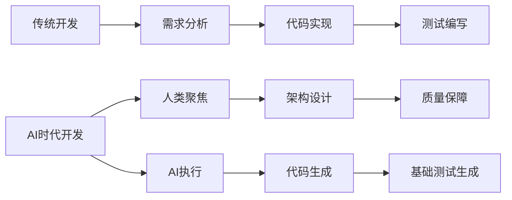

**案例：** 某电商团队用Copilot生成80%测试代码后，测试工程师的工作重心转向场景设计、边界条件和评审。

## 1.2 "全绿"测试报告的陷阱与代码覆盖率的误区

高代码覆盖率≠高质量测试。AI极易生成"覆盖率高但价值低"的测试用例，导致"全绿"报告带来虚假安全感。

**典型反例：**
```java
// 被测类：购物车计算器
class CartCalculator {
    public double calculateTotal(List<Item> items) {
        return items.stream().mapToDouble(Item::getPrice).sum();
    }
}
// AI生成的低价值测试（覆盖率100%）
@Test
void testCalculateTotal() {
    List<Item> items = Arrays.asList(new Item(10.0), new Item(20.0));
    double result = new CartCalculator().calculateTotal(items);
    assertNotNull(result); // 弱断言，未验证具体值
}
```

**图示：测试覆盖率 vs 缺陷捕获率对比折线图**
（建议后续补充实际数据或示意图）

**核心问题：**
- 断言是否有意义？
- 是否覆盖了异常/边界场景？
- 是否验证了业务规则？

**结论：** 团队应将关注点从"追求虚高的代码覆盖率"转向"追求有意义的场景覆盖率和强断言"。

## 1.3 测试资产的三重价值：安全网、活文档、设计工具

测试资产不仅仅是"验收工具"，更是团队的核心资产，具有三重价值：

### 1. 安全网（Safety Net）
- 防止回归缺陷，支撑大胆重构和创新。
- 例：新成员通过测试用例快速理解系统，重构时测试集保障功能不被破坏。

### 2. 活文档（Living Documentation）
- 测试用例是最真实、最及时的系统说明书。
- 例：通过测试用例展示业务规则、边界条件和系统行为，替代过时的Word/Wiki文档。

### 3. 设计工具（Design Tool）
- 测试驱动开发（TDD）推动代码结构优化，促进高内聚、低耦合。
- 例：难以测试的代码往往暴露设计问题，通过测试推动接口抽象和依赖解耦。

**Mermaid图：测试资产三重价值**
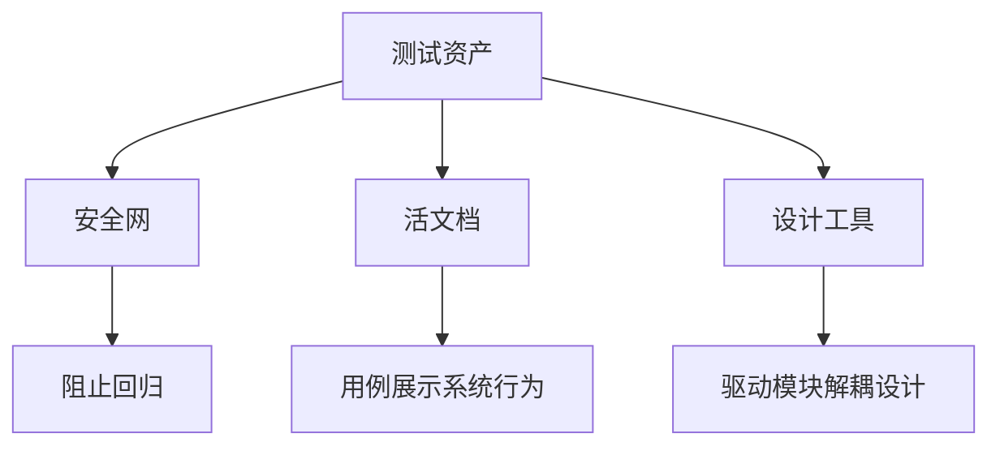

**表格：测试资产三重价值对比**
| 维度   | 业务价值           | 技术价值         | 教育价值         |
| ------ | ------------------ | ---------------- | ---------------- |
| 安全网 | 防止缺陷流入生产   | 快速回归         | 新人敢重构       |
| 活文档 | 描述可执行业务规则 | 降低知识传递成本 | 代码即教材       |
| 设计工具 | 驱动模块化、可测试 | 提前暴露耦合点   | 让"写测试"成为设计反馈 |

**真实案例：** 某银行支付系统通过测试资产化，新成员入职阅读测试用例代替文档，理解效率提升40%；重构核心清算模块时，测试捕获17处兼容性问题。

---

 # 第二章 有价值测试资产的统一标准

## 2.1 FIRST原则：高质量自动化测试的黄金法则

在AI时代，自动化测试的数量和生成速度大幅提升，但"高质量"测试的标准必须统一。业界普遍认可的黄金法则是FIRST原则：

- **F - Fast（快速）**：测试应在毫秒级完成，便于频繁运行和即时反馈。
- **I - Independent（独立）**：每个测试用例应可独立运行，不依赖其他测试或外部状态。
- **R - Repeatable（可重复）**：无论在本地、CI还是不同环境下，测试结果应始终一致。
- **S - Self-Validating（自验证）**：测试应有明确的断言，自动判断通过/失败，无需人工干预。
- **T - Timely（及时）**：测试应在开发早期（如TDD）或功能实现同步编写，避免事后补测。

**表格：FIRST原则落地要点**
| 首字母 | 含义         | 落地检查点                     | 反例                   |
| ------ | ------------ | ------------------------------ | ---------------------- |
| F      | Fast         | 单测<200ms，集成<5s，E2E<30s   | 依赖外部API慢测试      |
| I      | Independent  | 不依赖全局变量，可并行         | A测试依赖B测试先运行   |
| R      | Repeatable   | 同一commit在CI/本地结果一致    | 依赖系统当前日期       |
| S      | Self-Validating | 断言充分，禁止仅打印日志    | 仅assertTrue(result!=null) |
| T      | Timely       | 与业务代码同PR提交，拒绝补测   | 项目结尾"扫尾"补测     |

**实践建议：**
- 在CI中设置超时阈值，超时即视为不满足F。
- 引入IDE插件阻止Thread.sleep等反模式，保障R。
- 评审时发现无断言或弱断言，直接打回，保障S。

## 2.2 AAA模式与测试结构化

AAA（Arrange-Act-Assert）模式是自动化测试的标准结构，极大提升了测试代码的可读性和可维护性。

- **Arrange（准备）**：设置测试所需的所有前置条件，包括被测对象、依赖、输入数据等。
- **Act（执行）**：调用被测方法或功能，通常只有一行代码。
- **Assert（断言）**：验证执行结果是否符合预期。

**代码示例：良好与不良结构对比**

*不良结构（混合Act/Assert/Arrange）：*
```javascript
test('login fail', () => {
    const error = login('wrong', 'pass'); // Act
    expect(error).not.toBeNull(); // Assert
    // Arrange被分散到多行中间
    render(<Login />);
    fireEvent.input(usernameField, 'wrong');
});
```

*良好结构（严格AAA）：*
```javascript
test('should show error when login with invalid credential', () => {
    // Arrange
    const { usernameField, submitButton } = render(<Login />);
    fireEvent.change(usernameField, { target: { value: 'wrong' } });
    // Act
    fireEvent.click(submitButton);
    // Assert
    expect(screen.getByText('Invalid credential')).toBeVisible();
});
```

**Mermaid图：AAA模式结构**
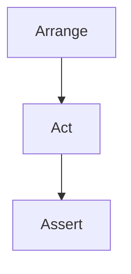

**Tip：** 在团队评审和CI中强制要求所有测试用例遵循AAA结构。

## 2.3 从代码覆盖到场景覆盖：思维模型与实践

高代码覆盖率并不等于高质量测试。真正有价值的测试应关注"场景覆盖率"，即是否覆盖了所有关键业务路径、异常和边界条件。

**三类场景：**
- **Happy Path**：主流程，正常输入与预期输出。
- **Sad Path**：异常流程，如无效输入、错误处理。
- **Boundary Conditions**：边界/极值，如最大/最小输入、特殊条件。

**Mermaid图：场景覆盖思维模型**
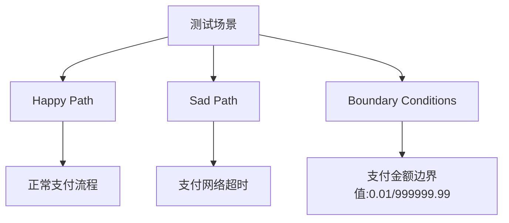

**表格：场景覆盖示例**
| 场景ID | 路径类型 | 描述                 | 期望结果           | 是否已测 |
| ------ | -------- | -------------------- | ------------------ | -------- |
| S01    | Happy    | 正常用户，余额充足   | 下单成功           | ✅       |
| S02    | Sad      | 用户余额不足         | 拒绝下单，提示余额不足 | ✅   |
| S03    | Boundary | 余额=订单金额-0.01   | 拒绝下单           | ❌       |
| S04    | Sad      | 用户被风控拉黑       | 拒绝下单，提示风控 | ✅       |

**实践建议：**
- 评审时要求开发者明确本次变更涉及的业务场景，并在PR模板中列出。
- 用"场景表"或"测试矩阵"替代单纯的覆盖率数字，确保关键路径无遗漏。

---

# 第三章 单元测试精要与AI协作

## 3.1 单元测试的边界与隔离性

单元测试关注单一模块（类/函数）的内部逻辑，要求隔离外部依赖（如数据库、网络、文件系统等），保证测试快速、稳定、可重复。

**判断标准：**
- 只验证本模块的输入输出，不访问外部系统。
- 所有外部依赖一律Mock或Stub。
- 执行速度应在毫秒级。

**Mermaid图：单元测试与集成测试边界**
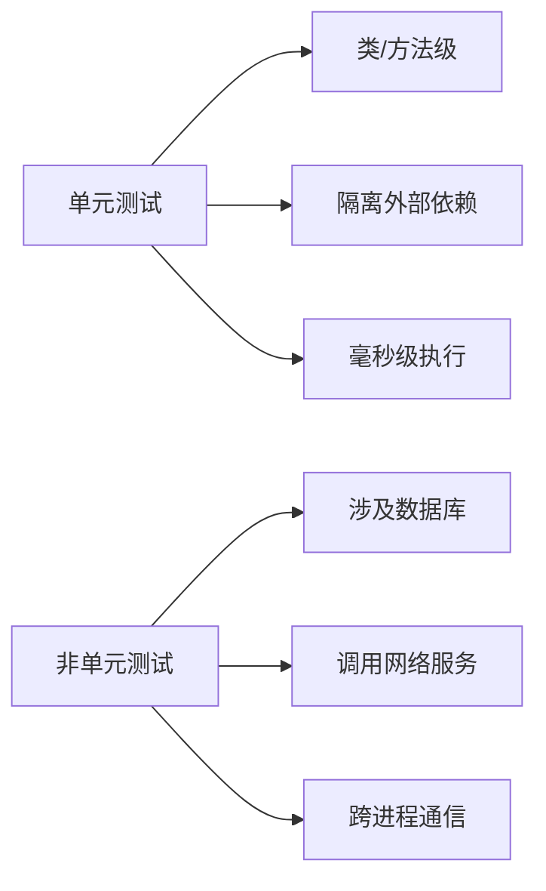

**反例：**
```java
// 错误示例：集成测试伪装成单元测试
@Test
@SpringBootTest // 加载整个容器！
void testUserService() {
    User user = userService.create("test@mail.com");
    assertNotNull(user.getId()); // 实际测试了数据库交互
}
```

## 3.2 单元测试的设计原则与常见反模式

**设计原则：**
- 单一职责：每个测试只验证一个业务规则。
- 可维护性：命名清晰、结构规范、无重复代码。
- 可读性：用例描述业务意图，便于团队理解。

**常见反模式：**
- 过度Mock：Mock了本应测试的核心逻辑。
- 弱断言：仅assertNotNull、assertTrue等，未验证具体业务结果。
- 测试代码与生产代码强耦合，维护困难。

**表格：常见反模式与优化建议**
| 反模式         | 问题描述               | 优化建议           |
| -------------- | ---------------------- | ------------------ |
| 过度Mock       | Mock了核心业务逻辑     | 只Mock外部依赖     |
| 弱断言         | 断言无实际业务意义     | 断言具体业务结果   |
| 命名不规范     | test1、test123等       | 用业务场景命名     |
| 结构混乱       | Arrange/Act/Assert混杂 | 严格遵循AAA结构    |

## 3.3 指挥AI生成高质量单元测试的流程与技巧

AI可极大提升单元测试生成效率，但需人类开发者提供清晰的上下文、精细化指令，并进行多轮优化。

### 3.3.1 上下文注入与Prompt设计
- 明确业务背景、边界条件、依赖项。
- 在Prompt中补充Javadoc、函数签名、关键业务规则。

**示例Prompt：**
```
【业务背景】下单时，若用户为VIP且订单金额≥100元，额外5%折扣。
【被测函数】Money DiscountService.applyVipDiscount(Money original, User user)
【要求】
- 使用JUnit5 & AssertJ
- 所有依赖Mock
- 覆盖Happy/Sad/Boundary三类场景
```

### 3.3.2 指令精细化与场景覆盖
- 明确要求覆盖异常、边界、特殊输入。
- 指定Mock点、参数化测试等。

**示例：**
```
请为applyDiscount方法编写单元测试：
1. 正常订单应有折扣
2. 非VIP无折扣
3. 订单金额=99.99无折扣
请用@ParameterizedTest合并类似逻辑。
```

### 3.3.3 迭代优化与人机结对
- 审查AI生成测试，补充遗漏场景或优化断言。
- 多轮对话，逐步完善测试集。

**对话示例：**
```
开发者：请补充订单金额为0时的边界测试。
AI：已添加testApplyDiscount_ZeroAmount_ReturnsOriginal...
```

## 3.4 AI生成单元测试的局限性与风险

- AI无法理解深层业务意图，易遗漏异常/边界场景。
- 断言常常过于宽泛，难以发现真实缺陷。
- 可能生成"伪覆盖"测试，导致虚假安全感。

**实践建议：**
- 人类需审查AI生成测试，重点关注断言强度和场景完整性。
- 对于关键业务逻辑，优先手工设计测试用例。

## 3.5 单元测试数据管理与边界条件覆盖

- 设计高质量测试数据，覆盖正常、异常、极值等多种情况。
- 使用参数化测试（如JUnit5 @ParameterizedTest、pytest.mark.parametrize）提升覆盖率。
- Mock外部依赖，确保数据可控。

**代码示例：**
```python
@pytest.mark.parametrize("amount, expected", [
    (50, 45), (0, 0), (200, 150)  # Happy / Boundary
])
def test_calculate_discount(amount, expected, mocker):
    svc = DiscountService()
    mock_db = mocker.patch("svc.db")
    assert svc.calculate(amount) == expected
```

## 3.6 Mock/Stub等测试替身的深度应用

- **Stub**：提供静态预设返回值，关注数据。
- **Mock**：验证交互行为，关注方法是否被调用。
- 选择Mock/Stub的依据：只关心数据用Stub，关心交互用Mock。

**表格：Mock与Stub对比**
| 对比   | Stub                        | Mock                  |
| ------ | --------------------------- | --------------------- |
| 目的   | 提供静态预设返回            | 验证交互行为          |
| 何时用 | 只关心数据                  | 关注方法是否被调用    |
| 工具   | thenReturn/side_effect等    | verify/assert_called  |

**代码示例：**
```python
from unittest.mock import Mock

def test_user_service_with_mock():
    db_service = Mock()
    db_service.get_user.return_value = {"id": 1, "name": "Alice"}
    user_service = UserService(db_service)
    user = user_service.get_user(1)
    assert user["name"] == "Alice"
    db_service.get_user.assert_called_once_with(1)
```

## 3.7 单元测试的可维护性与演进

- 命名规范、结构清晰、无重复代码，便于长期维护。
- 随业务和代码演进及时更新测试用例。
- 用测试工厂、Fixture等模式减少重复。

## 3.8 AI辅助下的单元测试自动修复与自愈机制

- 利用AI检测失效测试并自动修复（如断言更新、Mock点调整）。
- 结合CI工具自动定位和修复因依赖变更导致的测试失败。
- 但关键业务测试仍需人工确认修复有效性。

## 3.9 单元测试与持续集成的联动

- 单元测试是CI流水线的第一道防线，保障每次提交的代码质量。
- 在CI中强制执行所有单元测试，失败即阻断合并。
- 结合测试覆盖率、场景表等指标，持续提升测试体系。

---

# 第四章 严格把关：AI生成测试的系统化评审与质量保障

## 4.1 审查清单五要素（Intent/Coverage/Assertion/Isolation/Readability）

为保障AI生成测试的质量，团队需采用系统化评审清单，聚焦五大核心要素：

- **Intent（意图）**：测试命名与内容是否清晰反映业务场景和目标？
- **Coverage（场景覆盖）**：是否仅测试Happy Path？是否遗漏异常/边界？
- **Assertion（断言强度）**：断言是否具体、可失败？是否只做弱断言？
- **Isolation（隔离性）**：所有外部依赖是否Mock/Stub？有无真实数据库/网络调用？
- **Readability（可读性）**：是否遵循AAA结构？有无魔法值、命名混乱等问题？

**表格：五要素评审清单**
| 要素         | 关键问题                         | 快速诊断技巧                 |
| ------------ | -------------------------------- | ---------------------------- |
| Intent       | 命名是否清晰、含业务词汇         | 不明业务含义一律打回         |
| Coverage     | 是否覆盖异常/边界/负面场景       | 用三色荧光笔标注缺失场景     |
| Assertion    | 断言是否具体、可失败             | 只用assertNotNull等即打回    |
| Isolation    | 外部依赖是否Mock/Stub            | 出现connect/http等即警告      |
| Readability  | 是否AAA结构、无魔法值            | 多行Act/裸值即需重构         |

## 4.2 AI生成测试的常见缺陷与误区分析

- **伪覆盖**：只覆盖代码路径，未覆盖业务场景。
- **弱断言**：断言无实际业务意义，无法发现真实缺陷。
- **场景遗漏**：未覆盖异常、边界、Sad Path等关键路径。
- **命名混乱**：test1、test123等，无法反映业务意图。
- **依赖未Mock**：测试依赖真实外部服务，导致不稳定。

**代码反例：**
```java
@Test
void testProcessOrder() {
    Order order = orderService.processOrder(userId, 100);
    assertNotNull(order); // 弱断言
}
```

## 4.3 多角色协同评审机制

- 评审应由开发、测试、AI专家等多角色协作完成。
- 明确分工：开发关注业务意图，测试关注场景与断言，AI专家关注Prompt与生成质量。
- 采用评审会、异步评审、Pair Review等多种方式。

**Mermaid图：多角色协同评审流程**
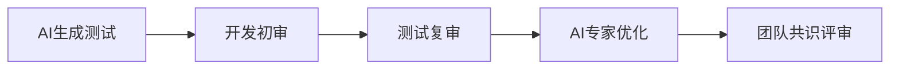

## 4.4 评审自动化与智能辅助工具

- 利用静态分析、Lint、AI辅助工具自动检测弱断言、未Mock、命名不规范等问题。
- 引入CI自动评审Bot，初步筛查不合格测试。
- 结合LLM自动生成评审建议，提升评审效率。

## 4.5 场景化实战与真实案例分析

**案例1：AI生成测试遗漏异常场景**
- 问题：仅覆盖正常下单，未覆盖余额不足、风控等异常。
- 优化：补充Sad Path和Boundary场景，断言具体错误码。

**案例2：弱断言导致缺陷漏检**
- 问题：仅assertNotNull，未验证业务结果。
- 优化：断言具体字段值、状态码、业务规则。

## 4.6 自动化工具链与CI门禁实践

- 在CI中强制执行所有测试，失败即阻断合并。
- 引入自动化评审、覆盖率、场景表等指标，持续提升测试体系。
- 结合Testcontainers等工具，保障环境一致性。

## 4.7 团队协作与评审文化建设

- 建立公开透明的评审流程，鼓励团队成员互相学习。
- 评审经验沉淀为知识库，持续优化评审标准。
- 激励机制：评审优秀、补充关键场景的成员予以表彰。

## 4.8 评审标准的持续演进与知识沉淀

- 定期回顾和优化评审清单，结合项目实际不断完善。
- 将评审经验转化为团队知识库，便于新成员快速上手。
- 结合AI辅助，动态调整评审重点。

## 4.9 AI生成测试的可解释性与可追溯性

- 记录AI生成测试的Prompt、上下文、版本信息，便于追溯。
- 评审时关注AI生成内容的可解释性，确保团队理解和信任。
- 关键业务测试建议保留人工注释和设计说明。

---

 # 第五章 后端集成测试：服务协同与数据治理

## 5.1 集成测试的范畴与分层定位

后端集成测试关注服务间协同、数据流转和系统边界，介于单元测试与端到端（E2E）测试之间。

- **横向维度**：API层 ↔ 服务层 ↔ DAO层 ↔ 数据库/消息队列/缓存等协作节点。
- **纵向维度**：单体内部模块集成 → 微服务间契约 → 外部系统（如支付、风控等）。

**Mermaid图：后端集成测试分层模型**
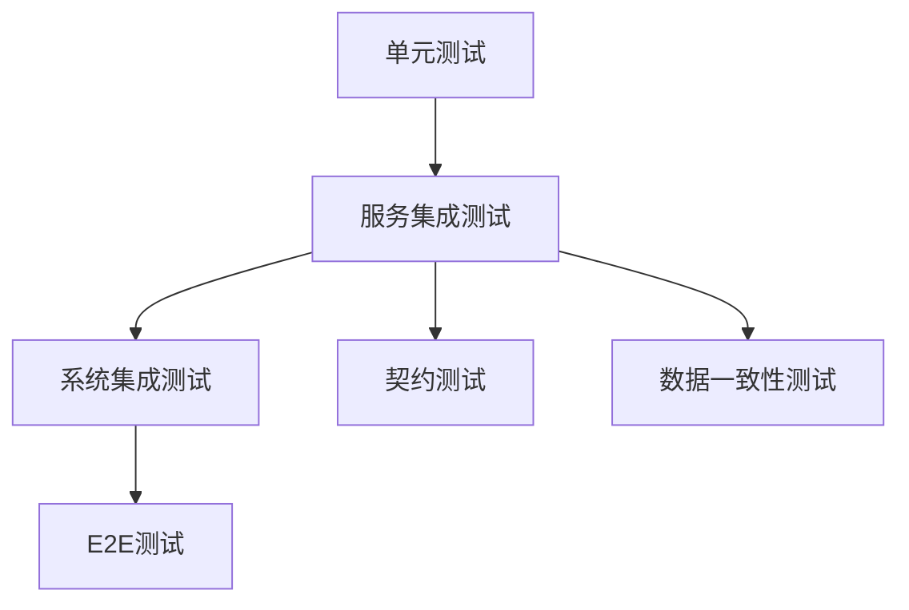

## 5.2 关键挑战：环境、数据、效率与并发

- **测试数据治理**：如何保证测试数据的可控性、隔离性和可复用性？
- **环境一致性**：如何避免"Works on my machine"问题？
- **执行效率**：大规模集成测试如何加速？如何并发执行？
- **并发与幂等**：如何验证高并发下的数据一致性与接口幂等性？

**表格：后端集成测试常见挑战与对策**
| 挑战         | 策略                         | 工具/实践                |
| ------------ | ---------------------------- | ------------------------ |
| 测试数据漂移 | 前置-校验-清理三段脚本       | Testcontainers、工厂方法 |
| 环境一致性   | 全依赖容器化、配置隔离       | Docker Compose、CI/CD    |
| 执行效率     | 并行容器、分层缓存           | GitHub Actions Matrix    |
| 并发幂等     | 随机端口、幂等性校验         | @DirtiesContext、Mock    |

## 5.3 Testcontainers等现代工具与AI协作

- **Testcontainers**：通过容器化数据库、中间件等，自动搭建隔离测试环境，保证本地/CI一致。
- **AI协作**：AI可自动生成HTTP请求模板、DTO/VO对象、SQL种子数据等，提升测试开发效率。
- **自动化环境管理**：结合Docker Compose、K8s等，实现一键拉起全链路测试环境。

**代码示例：Testcontainers集成测试**
```java
@Container
static PostgreSQLContainer<?> pg = new PostgreSQLContainer<>("postgres:16")
       .withDatabaseName("shop")
       .withUsername("tester")
       .withPassword("secret");

// Act – LLM生成的HTTP请求模板
given()
  .contentType("application/json")
  .body("{\"sku\":\"ABC\",\"qty\":3}")
.post("/inventory/reserve")
.then()
  .statusCode(200);

// Assert – 业务断言
assertEquals(
        BigDecimal.ZERO,
        jdbc.queryForObject("select reserved from stock where sku='ABC'", BigDecimal.class));
```

## 5.4 业务流与契约测试的设计与断言

- **契约测试**：验证服务间接口契约（如OpenAPI/Swagger定义）是否被严格遵守。
- **业务流测试**：跨服务、跨模块的完整业务流程验证，关注数据流转和状态变更。
- **断言设计**：不仅验证HTTP状态码，还要校验业务字段、数据库状态、消息队列等。

**Mermaid图：契约与业务流测试关系**
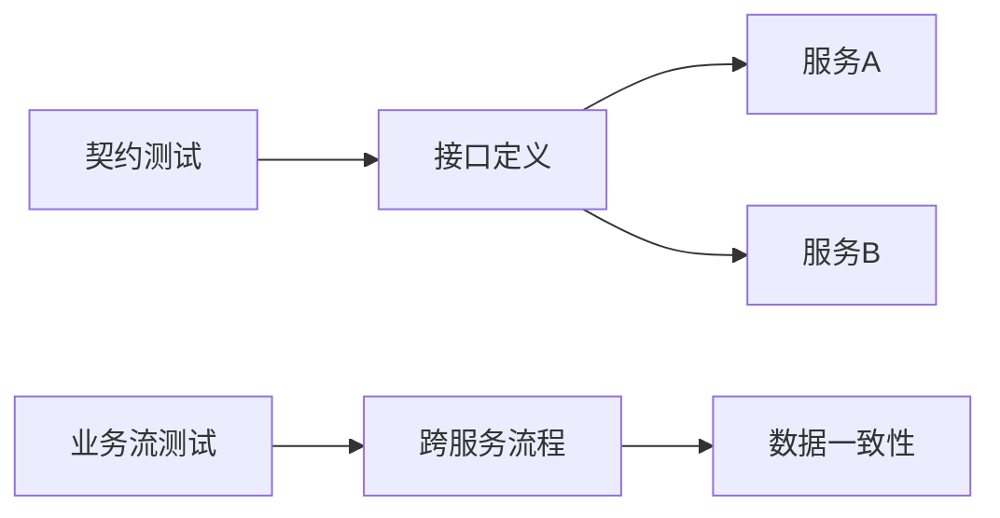

## 5.5 真实案例与CI集成

**案例：用户注册API集成测试**
```python
def test_user_registration_api():
    response = requests.post("/api/register", json={"username": "testuser", "password": "password123"})
    assert response.status_code == 200
    assert response.json()["status"] == "registered"
```
- 断言注册成功后，数据库有新用户记录，消息队列有注册事件。

**CI集成实践：**
- 所有集成测试在CI流水线自动执行，失败即阻断合并。
- 关键指标：集成测试通过率、环境拉起成功率、缺陷定位时长等。
- 结合AI-Ops，自动分析失败原因，缩短排障时间。

---

# 第六章 前端集成测试：组件、状态与用户交互

## 6.1 前端测试的特殊性与复杂性

前端集成测试涉及DOM操作、用户事件、组件生命周期和状态管理，需兼顾浏览器环境的多样性和异步行为。

- **环境多样性**：不同浏览器、分辨率、操作系统影响测试结果。
- **异步与副作用**：如setTimeout、API请求、动画等，易导致测试不稳定。
- **可访问性（a11y）与响应式**：需验证无障碍和多端适配。

**Mermaid图：前端测试关注点**
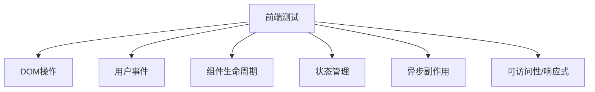

## 6.2 组件集成测试方法与AI辅助

- 利用React Testing Library、Vue Test Utils等工具，聚焦组件交互和渲染结果。
- AI可自动生成组件挂载、事件模拟、断言等测试代码，提升开发效率。
- 强调"场景驱动"测试，覆盖典型交互、异常和边界。

**代码示例：React组件集成测试**
```tsx
test('余额不足时禁用"支付"按钮', async () => {
  render(<Checkout balance={0} />);
  expect(
    screen.getByRole('button', { name: /支付/i })
  ).toBeDisabled();
});
```

## 6.3 状态管理与路由测试

- 验证组件在不同状态（如登录/未登录、加载/完成）下的行为。
- 测试Redux、Vuex、Pinia等状态管理逻辑，确保状态变更正确。
- 路由测试关注页面跳转、参数传递、守卫逻辑等。

**代码示例：Vue路由跳转测试**
```js
test('点击"去结算"跳转到支付页', async () => {
  const router = createRouter(...);
  render(<Cart />, { router });
  fireEvent.click(screen.getByText('去结算'));
  expect(router.currentRoute.value.name).toBe('Payment');
});
```

## 6.4 视觉回归与异步/Flaky治理

- 视觉回归测试通过截图比对，发现UI异常、样式错乱等问题。
- 异步/Flaky测试治理：使用waitFor、fake timers、Mock Service Worker等，提升稳定性。
- AI可辅助定位Flaky根因，自动重试或优化用例。

**表格：前端Flaky常见原因与对策**
| 原因         | 对策                       |
| ------------ | -------------------------- |
| 异步请求     | Mock网络/使用waitFor       |
| 动画/过渡    | 关闭动画或用fake timers    |
| 依赖外部服务 | Mock Service Worker        |
| 状态未隔离   | 每例重置store/DOM          |

## 6.5 跨层协作与人机分工

- 前后端协作：通过契约（OpenAPI/GraphQL）驱动接口Mock，提升集成效率。
- 人机分工：AI负责生成基础测试脚本和场景覆盖，人类聚焦复杂交互、可用性和业务边界。
- 鼓励用"场景表"/"用户旅程"驱动测试设计，确保关键路径无遗漏。

**Mermaid图：前端集成测试协作模式**
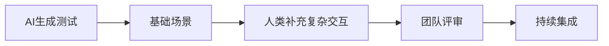

---
# 第七章 端到端（E2E）测试与测试金字塔

## 7.1 测试金字塔的AI时代演进与分层策略

测试金字塔是现代测试体系的分层模型，强调单元测试为基础，集成测试和E2E测试逐层递减。AI时代，自动化生成能力提升，但分层策略依然关键。

- **底层：单元测试**（数量最多，执行最快，隔离性强）
- **中层：集成测试**（验证服务/模块协作，关注数据流转和契约）
- **顶层：E2E测试**（覆盖关键用户旅程，模拟真实业务流程，数量适度）

**Mermaid图：AI时代测试金字塔**
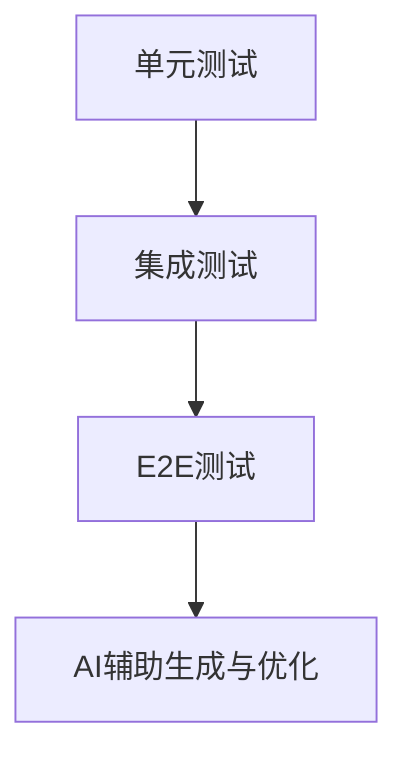

## 7.2 E2E测试的价值、成本与优化

- **价值**：验证系统端到端的业务流程，发现集成层/前后端协作中的真实缺陷。
- **成本**：环境搭建复杂、执行慢、易Flaky、维护成本高。
- **优化策略**：
  - 只为关键用户旅程（CUJ）设计E2E用例，避免"全覆盖"陷阱。
  - 用Mock/Stub隔离外部依赖，提升稳定性。
  - 自动化环境管理，提升可复现性。

**表格：E2E测试价值与成本对比**
| 维度   | 价值/优势           | 成本/挑战           |
| ------ | ------------------ | ------------------ |
| 发现集成缺陷 | 高               |                    |
| 真实用户体验 | 高               |                    |
| 维护难度     |                  | 高                 |
| 执行速度     |                  | 慢                 |
| 环境依赖     |                  | 强                 |

## 7.3 AI在E2E测试中的角色与Page Object模式

- **AI角色**：自动生成基础E2E脚本、场景表、断言建议，辅助定位Flaky根因。
- **Page Object模式**：将页面操作封装为对象，提升E2E测试的可维护性和复用性。
- **人机协作**：AI负责生成脚本和基础断言，人类补充复杂交互和业务断言。

**代码示例：Page Object模式**
```python
class LoginPage:
    def __init__(self, driver):
        self.driver = driver
    def login(self, username, password):
        self.driver.find_element(...).send_keys(username)
        self.driver.find_element(...).send_keys(password)
        self.driver.find_element(...).click()

# 测试用例
login_page = LoginPage(driver)
login_page.login('user', 'pass')
assert driver.current_url == '/dashboard'
```

## 7.4 关键用户旅程（CUJ）建模与业务流保障

- 以CUJ为核心，建模端到端的关键业务流程（如注册-下单-支付-发货）。
- 用"场景表"/"流程图"明确每个CUJ的输入、输出、异常和边界。
- 优先保障CUJ的E2E测试稳定性和覆盖率。

**Mermaid图：CUJ建模示意**
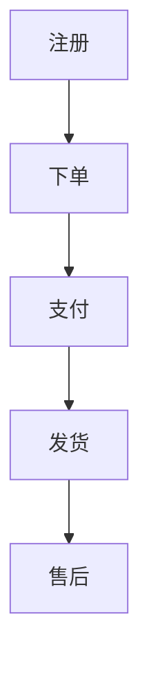

## 7.5 Flaky治理与CI并行优化

- **Flaky治理**：
  - 用Mock/Stub隔离外部依赖，减少不稳定因素。
  - 使用retry机制、waitFor、fake timers等提升稳定性。
  - AI辅助分析失败日志，定位Flaky根因。
- **CI优化**：
  - 并行执行E2E用例，缩短流水线时长。
  - 用容器化环境保证一致性。
  - 失败用例自动重试，减少误报。

**表格：E2E Flaky常见原因与对策**
| 原因         | 对策                       |
| ------------ | -------------------------- |
| 网络波动     | Mock网络/本地服务          |
| 环境漂移     | 容器化/快照还原            |
| 异步等待     | waitFor/超时优化           |
| 状态未隔离   | 每例重置数据库/缓存        |

---

# 第八章 文化落地与持续演进

## 8.1 流程保障：CI/CD门禁与"完成的定义"

- 在CI/CD流程中强制执行自动化测试、代码评审、覆盖率和场景表等门禁，保障质量底线。
- 明确"完成的定义"（Definition of Done）：不仅功能开发完成，还需测试通过、文档齐全、评审合格。
- 推行"红灯不合并"文化，任何测试失败或门禁不通过，禁止代码合入主干。

**Mermaid图：CI/CD门禁流程**
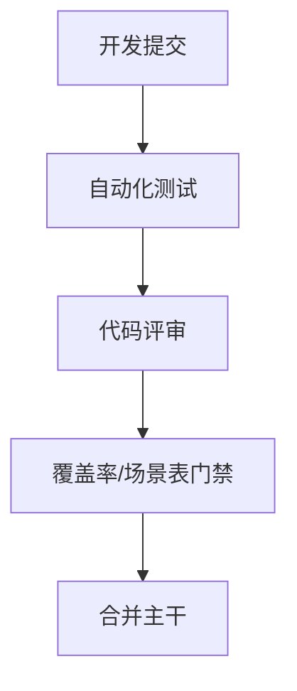

## 8.2 激励机制与团队氛围

- 设立"测试之星""最佳评审"等荣誉，激励成员主动补充关键场景、优化测试用例。
- 公开表彰在测试资产建设、AI协作、流程优化等方面有突出贡献的成员。
- 鼓励团队内部分享测试经验、AI工具使用心得，营造持续改进氛围。

## 8.3 技术领导力与示范作用

- 技术Leader以身作则，亲自参与测试资产建设和评审，树立高标准。
- 组织"代码走查""测试评审会"等活动，提升团队整体质量意识。
- 推动跨团队协作，分享最佳实践，形成组织级知识沉淀。

## 8.4 指标度量与可视化

- 关键指标：测试覆盖率、场景覆盖率、缺陷捕获率、CI通过率、Flaky用例占比等。
- 利用Dashboard、可视化报表实时展示质量状况，驱动团队持续优化。
- 结合AI分析测试数据，自动发现薄弱环节和改进机会。

**表格：常用测试质量指标**
| 指标         | 含义/作用                 |
| ------------ | ------------------------ |
| 覆盖率       | 代码/场景/功能覆盖程度   |
| 缺陷捕获率   | 测试发现缺陷的能力       |
| Flaky占比    | 不稳定用例比例           |
| CI通过率     | 持续集成成功率           |
| 评审及时率   | 评审按时完成的比例       |

## 8.5 持续学习、AI素养与演进路线图

- 定期组织AI测试工具、自动化框架、最佳实践等主题培训。
- 鼓励团队成员主动探索新工具、新方法，提升AI素养和创新能力。
- 制定测试资产演进路线图，明确阶段目标与里程碑，持续迭代优化。

**Mermaid图：测试资产持续演进路线图**
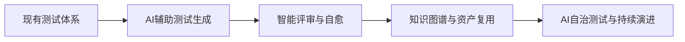

---
