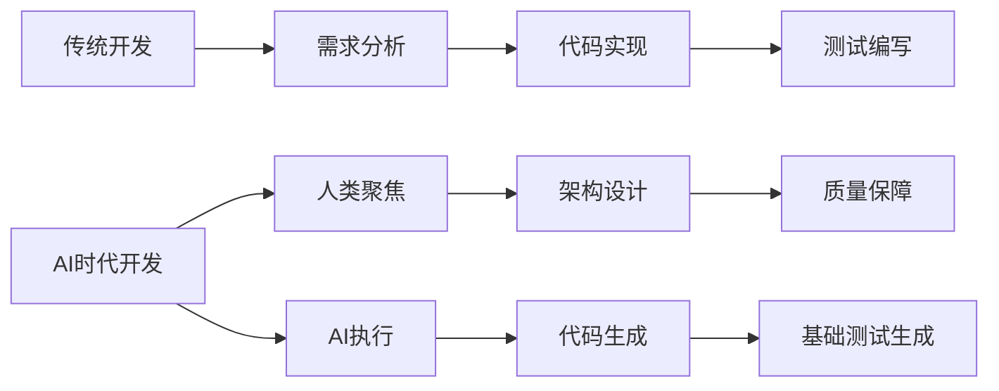
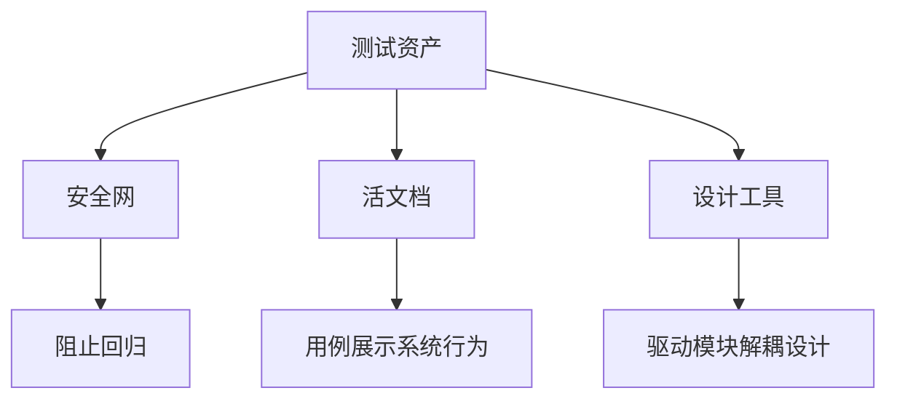

# 第一章 范式转移与测试资产新定义

## 1.1 AI在软件开发中的角色转变：从"快手"到"副驾驶"

AI工具（如GitHub Copilot、ChatGPT等）已成为开发者的高效"快手"，能够极速生成样板代码、测试用例和文档片段，但它并非"全能大脑"。AI擅长模式匹配和概率生成，能大幅提升代码产出速度，却无法真正理解业务意图、架构权衡和深层设计。

**人类开发者的价值正在迁移：**
- 从"手写所有测试模板"转向"设计测试意图与边界"
- 从"逐行写断言"转向"判断断言是否足够强壮"
- 从"研究框架API"转向"研究业务风险与可测试性"

> 教育提示：把AI当成"实习生"，永远由你签字画押。

**Mermaid图：传统开发与AI时代开发流程对比**


**案例：** 某电商团队用Copilot生成80%测试代码后，测试工程师的工作重心转向场景设计、边界条件和评审。

## 1.2 "全绿"测试报告的陷阱与代码覆盖率的误区

高代码覆盖率≠高质量测试。AI极易生成"覆盖率高但价值低"的测试用例，导致"全绿"报告带来虚假安全感。

**典型反例：**
```java
// 被测类：购物车计算器
class CartCalculator {
    public double calculateTotal(List<Item> items) {
        return items.stream().mapToDouble(Item::getPrice).sum();
    }
}
// AI生成的低价值测试（覆盖率100%）
@Test
void testCalculateTotal() {
    List<Item> items = Arrays.asList(new Item(10.0), new Item(20.0));
    double result = new CartCalculator().calculateTotal(items);
    assertNotNull(result); // 弱断言，未验证具体值
}
```

**图示：测试覆盖率 vs 缺陷捕获率对比折线图**
（建议后续补充实际数据或示意图）

**核心问题：**
- 断言是否有意义？
- 是否覆盖了异常/边界场景？
- 是否验证了业务规则？

**结论：** 团队应将关注点从"追求虚高的代码覆盖率"转向"追求有意义的场景覆盖率和强断言"。

## 1.3 测试资产的三重价值：安全网、活文档、设计工具

测试资产不仅仅是"验收工具"，更是团队的核心资产，具有三重价值：

### 1. 安全网（Safety Net）
- 防止回归缺陷，支撑大胆重构和创新。
- 例：新成员通过测试用例快速理解系统，重构时测试集保障功能不被破坏。

### 2. 活文档（Living Documentation）
- 测试用例是最真实、最及时的系统说明书。
- 例：通过测试用例展示业务规则、边界条件和系统行为，替代过时的Word/Wiki文档。

### 3. 设计工具（Design Tool）
- 测试驱动开发（TDD）推动代码结构优化，促进高内聚、低耦合。
- 例：难以测试的代码往往暴露设计问题，通过测试推动接口抽象和依赖解耦。

**Mermaid图：测试资产三重价值**


**表格：测试资产三重价值对比**
| 维度   | 业务价值           | 技术价值         | 教育价值         |
| ------ | ------------------ | ---------------- | ---------------- |
| 安全网 | 防止缺陷流入生产   | 快速回归         | 新人敢重构       |
| 活文档 | 描述可执行业务规则 | 降低知识传递成本 | 代码即教材       |
| 设计工具 | 驱动模块化、可测试 | 提前暴露耦合点   | 让"写测试"成为设计反馈 |

**真实案例：** 某银行支付系统通过测试资产化，新成员入职阅读测试用例代替文档，理解效率提升40%；重构核心清算模块时，测试捕获17处兼容性问题。

---

 