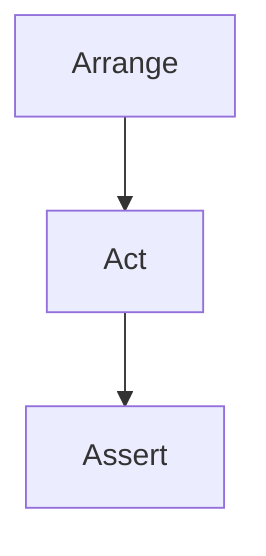
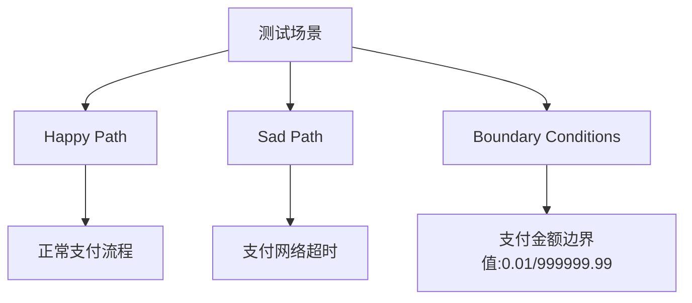

# 第二章 有价值测试资产的统一标准

## 2.1 FIRST原则：高质量自动化测试的黄金法则

在AI时代，自动化测试的数量和生成速度大幅提升，但"高质量"测试的标准必须统一。业界普遍认可的黄金法则是FIRST原则：

- **F - Fast（快速）**：测试应在毫秒级完成，便于频繁运行和即时反馈。
- **I - Independent（独立）**：每个测试用例应可独立运行，不依赖其他测试或外部状态。
- **R - Repeatable（可重复）**：无论在本地、CI还是不同环境下，测试结果应始终一致。
- **S - Self-Validating（自验证）**：测试应有明确的断言，自动判断通过/失败，无需人工干预。
- **T - Timely（及时）**：测试应在开发早期（如TDD）或功能实现同步编写，避免事后补测。

**表格：FIRST原则落地要点**
| 首字母 | 含义         | 落地检查点                     | 反例                   |
| ------ | ------------ | ------------------------------ | ---------------------- |
| F      | Fast         | 单测<200ms，集成<5s，E2E<30s   | 依赖外部API慢测试      |
| I      | Independent  | 不依赖全局变量，可并行         | A测试依赖B测试先运行   |
| R      | Repeatable   | 同一commit在CI/本地结果一致    | 依赖系统当前日期       |
| S      | Self-Validating | 断言充分，禁止仅打印日志    | 仅assertTrue(result!=null) |
| T      | Timely       | 与业务代码同PR提交，拒绝补测   | 项目结尾"扫尾"补测     |

**实践建议：**
- 在CI中设置超时阈值，超时即视为不满足F。
- 引入IDE插件阻止Thread.sleep等反模式，保障R。
- 评审时发现无断言或弱断言，直接打回，保障S。

## 2.2 AAA模式与测试结构化

AAA（Arrange-Act-Assert）模式是自动化测试的标准结构，极大提升了测试代码的可读性和可维护性。

- **Arrange（准备）**：设置测试所需的所有前置条件，包括被测对象、依赖、输入数据等。
- **Act（执行）**：调用被测方法或功能，通常只有一行代码。
- **Assert（断言）**：验证执行结果是否符合预期。

**代码示例：良好与不良结构对比**

*不良结构（混合Act/Assert/Arrange）：*
```javascript
test('login fail', () => {
    const error = login('wrong', 'pass'); // Act
    expect(error).not.toBeNull(); // Assert
    // Arrange被分散到多行中间
    render(<Login />);
    fireEvent.input(usernameField, 'wrong');
});
```

*良好结构（严格AAA）：*
```javascript
test('should show error when login with invalid credential', () => {
    // Arrange
    const { usernameField, submitButton } = render(<Login />);
    fireEvent.change(usernameField, { target: { value: 'wrong' } });
    // Act
    fireEvent.click(submitButton);
    // Assert
    expect(screen.getByText('Invalid credential')).toBeVisible();
});
```

**Mermaid图：AAA模式结构**


**Tip：** 在团队评审和CI中强制要求所有测试用例遵循AAA结构。

## 2.3 从代码覆盖到场景覆盖：思维模型与实践

高代码覆盖率并不等于高质量测试。真正有价值的测试应关注"场景覆盖率"，即是否覆盖了所有关键业务路径、异常和边界条件。

**三类场景：**
- **Happy Path**：主流程，正常输入与预期输出。
- **Sad Path**：异常流程，如无效输入、错误处理。
- **Boundary Conditions**：边界/极值，如最大/最小输入、特殊条件。

**Mermaid图：场景覆盖思维模型**


**表格：场景覆盖示例**
| 场景ID | 路径类型 | 描述                 | 期望结果           | 是否已测 |
| ------ | -------- | -------------------- | ------------------ | -------- |
| S01    | Happy    | 正常用户，余额充足   | 下单成功           | ✅       |
| S02    | Sad      | 用户余额不足         | 拒绝下单，提示余额不足 | ✅   |
| S03    | Boundary | 余额=订单金额-0.01   | 拒绝下单           | ❌       |
| S04    | Sad      | 用户被风控拉黑       | 拒绝下单，提示风控 | ✅       |

**实践建议：**
- 评审时要求开发者明确本次变更涉及的业务场景，并在PR模板中列出。
- 用"场景表"或"测试矩阵"替代单纯的覆盖率数字，确保关键路径无遗漏。

---

