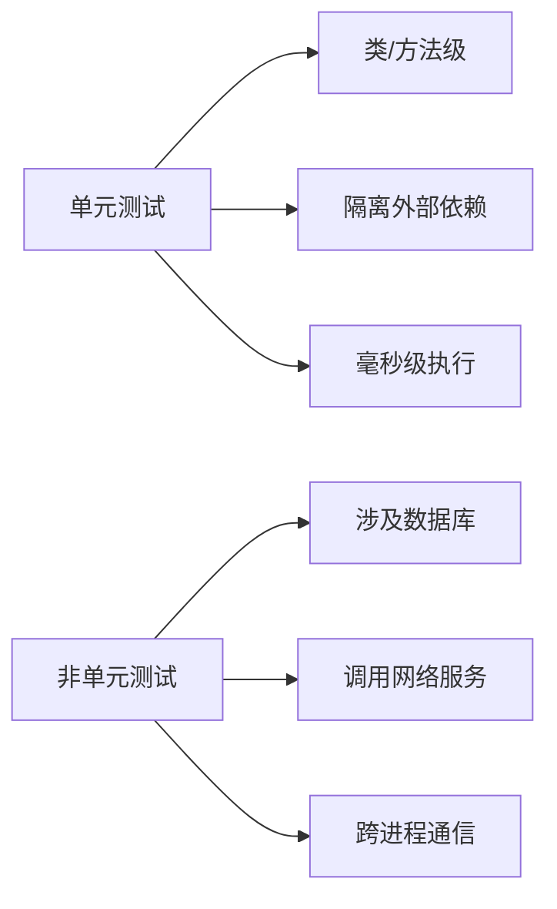

# 第三章 单元测试精要与AI协作

## 3.1 单元测试的边界与隔离性

单元测试关注单一模块（类/函数）的内部逻辑，要求隔离外部依赖（如数据库、网络、文件系统等），保证测试快速、稳定、可重复。

**判断标准：**
- 只验证本模块的输入输出，不访问外部系统。
- 所有外部依赖一律Mock或Stub。
- 执行速度应在毫秒级。

**Mermaid图：单元测试与集成测试边界**


**反例：**
```java
// 错误示例：集成测试伪装成单元测试
@Test
@SpringBootTest // 加载整个容器！
void testUserService() {
    User user = userService.create("test@mail.com");
    assertNotNull(user.getId()); // 实际测试了数据库交互
}
```

## 3.2 单元测试的设计原则与常见反模式

**设计原则：**
- 单一职责：每个测试只验证一个业务规则。
- 可维护性：命名清晰、结构规范、无重复代码。
- 可读性：用例描述业务意图，便于团队理解。

**常见反模式：**
- 过度Mock：Mock了本应测试的核心逻辑。
- 弱断言：仅assertNotNull、assertTrue等，未验证具体业务结果。
- 测试代码与生产代码强耦合，维护困难。

**表格：常见反模式与优化建议**
| 反模式         | 问题描述               | 优化建议           |
| -------------- | ---------------------- | ------------------ |
| 过度Mock       | Mock了核心业务逻辑     | 只Mock外部依赖     |
| 弱断言         | 断言无实际业务意义     | 断言具体业务结果   |
| 命名不规范     | test1、test123等       | 用业务场景命名     |
| 结构混乱       | Arrange/Act/Assert混杂 | 严格遵循AAA结构    |

## 3.3 指挥AI生成高质量单元测试的流程与技巧

AI可极大提升单元测试生成效率，但需人类开发者提供清晰的上下文、精细化指令，并进行多轮优化。

### 3.3.1 上下文注入与Prompt设计
- 明确业务背景、边界条件、依赖项。
- 在Prompt中补充Javadoc、函数签名、关键业务规则。

**示例Prompt：**
```
【业务背景】下单时，若用户为VIP且订单金额≥100元，额外5%折扣。
【被测函数】Money DiscountService.applyVipDiscount(Money original, User user)
【要求】
- 使用JUnit5 & AssertJ
- 所有依赖Mock
- 覆盖Happy/Sad/Boundary三类场景
```

### 3.3.2 指令精细化与场景覆盖
- 明确要求覆盖异常、边界、特殊输入。
- 指定Mock点、参数化测试等。

**示例：**
```
请为applyDiscount方法编写单元测试：
1. 正常订单应有折扣
2. 非VIP无折扣
3. 订单金额=99.99无折扣
请用@ParameterizedTest合并类似逻辑。
```

### 3.3.3 迭代优化与人机结对
- 审查AI生成测试，补充遗漏场景或优化断言。
- 多轮对话，逐步完善测试集。

**对话示例：**
```
开发者：请补充订单金额为0时的边界测试。
AI：已添加testApplyDiscount_ZeroAmount_ReturnsOriginal...
```

## 3.4 AI生成单元测试的局限性与风险

- AI无法理解深层业务意图，易遗漏异常/边界场景。
- 断言常常过于宽泛，难以发现真实缺陷。
- 可能生成"伪覆盖"测试，导致虚假安全感。

**实践建议：**
- 人类需审查AI生成测试，重点关注断言强度和场景完整性。
- 对于关键业务逻辑，优先手工设计测试用例。

## 3.5 单元测试数据管理与边界条件覆盖

- 设计高质量测试数据，覆盖正常、异常、极值等多种情况。
- 使用参数化测试（如JUnit5 @ParameterizedTest、pytest.mark.parametrize）提升覆盖率。
- Mock外部依赖，确保数据可控。

**代码示例：**
```python
@pytest.mark.parametrize("amount, expected", [
    (50, 45), (0, 0), (200, 150)  # Happy / Boundary
])
def test_calculate_discount(amount, expected, mocker):
    svc = DiscountService()
    mock_db = mocker.patch("svc.db")
    assert svc.calculate(amount) == expected
```

## 3.6 Mock/Stub等测试替身的深度应用

- **Stub**：提供静态预设返回值，关注数据。
- **Mock**：验证交互行为，关注方法是否被调用。
- 选择Mock/Stub的依据：只关心数据用Stub，关心交互用Mock。

**表格：Mock与Stub对比**
| 对比   | Stub                        | Mock                  |
| ------ | --------------------------- | --------------------- |
| 目的   | 提供静态预设返回            | 验证交互行为          |
| 何时用 | 只关心数据                  | 关注方法是否被调用    |
| 工具   | thenReturn/side_effect等    | verify/assert_called  |

**代码示例：**
```python
from unittest.mock import Mock

def test_user_service_with_mock():
    db_service = Mock()
    db_service.get_user.return_value = {"id": 1, "name": "Alice"}
    user_service = UserService(db_service)
    user = user_service.get_user(1)
    assert user["name"] == "Alice"
    db_service.get_user.assert_called_once_with(1)
```

## 3.7 单元测试的可维护性与演进

- 命名规范、结构清晰、无重复代码，便于长期维护。
- 随业务和代码演进及时更新测试用例。
- 用测试工厂、Fixture等模式减少重复。

## 3.8 AI辅助下的单元测试自动修复与自愈机制

- 利用AI检测失效测试并自动修复（如断言更新、Mock点调整）。
- 结合CI工具自动定位和修复因依赖变更导致的测试失败。
- 但关键业务测试仍需人工确认修复有效性。

## 3.9 单元测试与持续集成的联动

- 单元测试是CI流水线的第一道防线，保障每次提交的代码质量。
- 在CI中强制执行所有单元测试，失败即阻断合并。
- 结合测试覆盖率、场景表等指标，持续提升测试体系。

---

