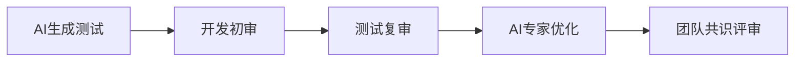

# 第四章 严格把关：AI生成测试的系统化评审与质量保障

## 4.1 审查清单五要素（Intent/Coverage/Assertion/Isolation/Readability）

为保障AI生成测试的质量，团队需采用系统化评审清单，聚焦五大核心要素：

- **Intent（意图）**：测试命名与内容是否清晰反映业务场景和目标？
- **Coverage（场景覆盖）**：是否仅测试Happy Path？是否遗漏异常/边界？
- **Assertion（断言强度）**：断言是否具体、可失败？是否只做弱断言？
- **Isolation（隔离性）**：所有外部依赖是否Mock/Stub？有无真实数据库/网络调用？
- **Readability（可读性）**：是否遵循AAA结构？有无魔法值、命名混乱等问题？

**表格：五要素评审清单**
| 要素         | 关键问题                         | 快速诊断技巧                 |
| ------------ | -------------------------------- | ---------------------------- |
| Intent       | 命名是否清晰、含业务词汇         | 不明业务含义一律打回         |
| Coverage     | 是否覆盖异常/边界/负面场景       | 用三色荧光笔标注缺失场景     |
| Assertion    | 断言是否具体、可失败             | 只用assertNotNull等即打回    |
| Isolation    | 外部依赖是否Mock/Stub            | 出现connect/http等即警告      |
| Readability  | 是否AAA结构、无魔法值            | 多行Act/裸值即需重构         |

## 4.2 AI生成测试的常见缺陷与误区分析

- **伪覆盖**：只覆盖代码路径，未覆盖业务场景。
- **弱断言**：断言无实际业务意义，无法发现真实缺陷。
- **场景遗漏**：未覆盖异常、边界、Sad Path等关键路径。
- **命名混乱**：test1、test123等，无法反映业务意图。
- **依赖未Mock**：测试依赖真实外部服务，导致不稳定。

**代码反例：**
```java
@Test
void testProcessOrder() {
    Order order = orderService.processOrder(userId, 100);
    assertNotNull(order); // 弱断言
}
```

## 4.3 多角色协同评审机制

- 评审应由开发、测试、AI专家等多角色协作完成。
- 明确分工：开发关注业务意图，测试关注场景与断言，AI专家关注Prompt与生成质量。
- 采用评审会、异步评审、Pair Review等多种方式。

**Mermaid图：多角色协同评审流程**


## 4.4 评审自动化与智能辅助工具

- 利用静态分析、Lint、AI辅助工具自动检测弱断言、未Mock、命名不规范等问题。
- 引入CI自动评审Bot，初步筛查不合格测试。
- 结合LLM自动生成评审建议，提升评审效率。

## 4.5 场景化实战与真实案例分析

**案例1：AI生成测试遗漏异常场景**
- 问题：仅覆盖正常下单，未覆盖余额不足、风控等异常。
- 优化：补充Sad Path和Boundary场景，断言具体错误码。

**案例2：弱断言导致缺陷漏检**
- 问题：仅assertNotNull，未验证业务结果。
- 优化：断言具体字段值、状态码、业务规则。

## 4.6 自动化工具链与CI门禁实践

- 在CI中强制执行所有测试，失败即阻断合并。
- 引入自动化评审、覆盖率、场景表等指标，持续提升测试体系。
- 结合Testcontainers等工具，保障环境一致性。

## 4.7 团队协作与评审文化建设

- 建立公开透明的评审流程，鼓励团队成员互相学习。
- 评审经验沉淀为知识库，持续优化评审标准。
- 激励机制：评审优秀、补充关键场景的成员予以表彰。

## 4.8 评审标准的持续演进与知识沉淀

- 定期回顾和优化评审清单，结合项目实际不断完善。
- 将评审经验转化为团队知识库，便于新成员快速上手。
- 结合AI辅助，动态调整评审重点。

## 4.9 AI生成测试的可解释性与可追溯性

- 记录AI生成测试的Prompt、上下文、版本信息，便于追溯。
- 评审时关注AI生成内容的可解释性，确保团队理解和信任。
- 关键业务测试建议保留人工注释和设计说明。

---

 