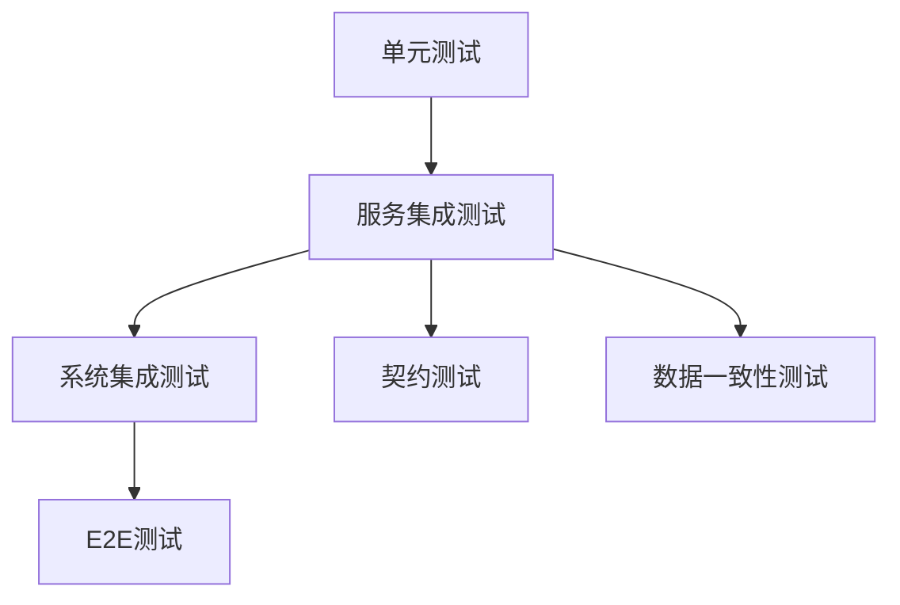
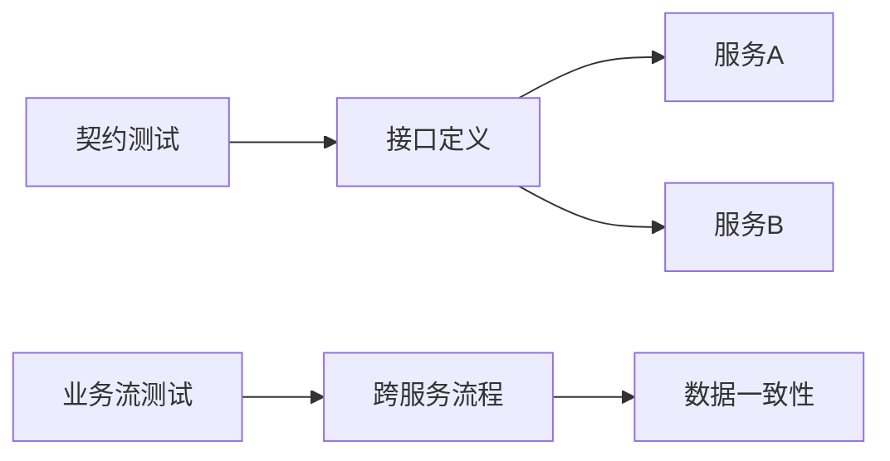

# 第五章 后端集成测试：服务协同与数据治理

## 5.1 集成测试的范畴与分层定位

后端集成测试关注服务间协同、数据流转和系统边界，介于单元测试与端到端（E2E）测试之间。

- **横向维度**：API层 ↔ 服务层 ↔ DAO层 ↔ 数据库/消息队列/缓存等协作节点。
- **纵向维度**：单体内部模块集成 → 微服务间契约 → 外部系统（如支付、风控等）。

**Mermaid图：后端集成测试分层模型**


## 5.2 关键挑战：环境、数据、效率与并发

- **测试数据治理**：如何保证测试数据的可控性、隔离性和可复用性？
- **环境一致性**：如何避免"Works on my machine"问题？
- **执行效率**：大规模集成测试如何加速？如何并发执行？
- **并发与幂等**：如何验证高并发下的数据一致性与接口幂等性？

**表格：后端集成测试常见挑战与对策**
| 挑战         | 策略                         | 工具/实践                |
| ------------ | ---------------------------- | ------------------------ |
| 测试数据漂移 | 前置-校验-清理三段脚本       | Testcontainers、工厂方法 |
| 环境一致性   | 全依赖容器化、配置隔离       | Docker Compose、CI/CD    |
| 执行效率     | 并行容器、分层缓存           | GitHub Actions Matrix    |
| 并发幂等     | 随机端口、幂等性校验         | @DirtiesContext、Mock    |

## 5.3 Testcontainers等现代工具与AI协作

- **Testcontainers**：通过容器化数据库、中间件等，自动搭建隔离测试环境，保证本地/CI一致。
- **AI协作**：AI可自动生成HTTP请求模板、DTO/VO对象、SQL种子数据等，提升测试开发效率。
- **自动化环境管理**：结合Docker Compose、K8s等，实现一键拉起全链路测试环境。

**代码示例：Testcontainers集成测试**
```java
@Container
static PostgreSQLContainer<?> pg = new PostgreSQLContainer<>("postgres:16")
       .withDatabaseName("shop")
       .withUsername("tester")
       .withPassword("secret");

// Act – LLM生成的HTTP请求模板
given()
  .contentType("application/json")
  .body("{\"sku\":\"ABC\",\"qty\":3}")
.post("/inventory/reserve")
.then()
  .statusCode(200);

// Assert – 业务断言
assertEquals(
        BigDecimal.ZERO,
        jdbc.queryForObject("select reserved from stock where sku='ABC'", BigDecimal.class));
```

## 5.4 业务流与契约测试的设计与断言

- **契约测试**：验证服务间接口契约（如OpenAPI/Swagger定义）是否被严格遵守。
- **业务流测试**：跨服务、跨模块的完整业务流程验证，关注数据流转和状态变更。
- **断言设计**：不仅验证HTTP状态码，还要校验业务字段、数据库状态、消息队列等。

**Mermaid图：契约与业务流测试关系**


## 5.5 真实案例与CI集成

**案例：用户注册API集成测试**
```python
def test_user_registration_api():
    response = requests.post("/api/register", json={"username": "testuser", "password": "password123"})
    assert response.status_code == 200
    assert response.json()["status"] == "registered"
```
- 断言注册成功后，数据库有新用户记录，消息队列有注册事件。

**CI集成实践：**
- 所有集成测试在CI流水线自动执行，失败即阻断合并。
- 关键指标：集成测试通过率、环境拉起成功率、缺陷定位时长等。
- 结合AI-Ops，自动分析失败原因，缩短排障时间。

---

