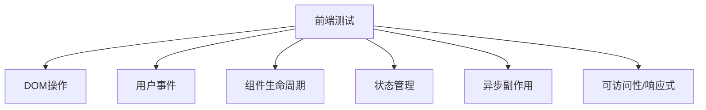
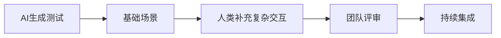

# 第六章 前端集成测试：组件、状态与用户交互

## 6.1 前端测试的特殊性与复杂性

前端集成测试涉及DOM操作、用户事件、组件生命周期和状态管理，需兼顾浏览器环境的多样性和异步行为。

- **环境多样性**：不同浏览器、分辨率、操作系统影响测试结果。
- **异步与副作用**：如setTimeout、API请求、动画等，易导致测试不稳定。
- **可访问性（a11y）与响应式**：需验证无障碍和多端适配。

**Mermaid图：前端测试关注点**


## 6.2 组件集成测试方法与AI辅助

- 利用React Testing Library、Vue Test Utils等工具，聚焦组件交互和渲染结果。
- AI可自动生成组件挂载、事件模拟、断言等测试代码，提升开发效率。
- 强调"场景驱动"测试，覆盖典型交互、异常和边界。

**代码示例：React组件集成测试**
```tsx
test('余额不足时禁用"支付"按钮', async () => {
  render(<Checkout balance={0} />);
  expect(
    screen.getByRole('button', { name: /支付/i })
  ).toBeDisabled();
});
```

## 6.3 状态管理与路由测试

- 验证组件在不同状态（如登录/未登录、加载/完成）下的行为。
- 测试Redux、Vuex、Pinia等状态管理逻辑，确保状态变更正确。
- 路由测试关注页面跳转、参数传递、守卫逻辑等。

**代码示例：Vue路由跳转测试**
```js
test('点击"去结算"跳转到支付页', async () => {
  const router = createRouter(...);
  render(<Cart />, { router });
  fireEvent.click(screen.getByText('去结算'));
  expect(router.currentRoute.value.name).toBe('Payment');
});
```

## 6.4 视觉回归与异步/Flaky治理

- 视觉回归测试通过截图比对，发现UI异常、样式错乱等问题。
- 异步/Flaky测试治理：使用waitFor、fake timers、Mock Service Worker等，提升稳定性。
- AI可辅助定位Flaky根因，自动重试或优化用例。

**表格：前端Flaky常见原因与对策**
| 原因         | 对策                       |
| ------------ | -------------------------- |
| 异步请求     | Mock网络/使用waitFor       |
| 动画/过渡    | 关闭动画或用fake timers    |
| 依赖外部服务 | Mock Service Worker        |
| 状态未隔离   | 每例重置store/DOM          |

## 6.5 跨层协作与人机分工

- 前后端协作：通过契约（OpenAPI/GraphQL）驱动接口Mock，提升集成效率。
- 人机分工：AI负责生成基础测试脚本和场景覆盖，人类聚焦复杂交互、可用性和业务边界。
- 鼓励用"场景表"/"用户旅程"驱动测试设计，确保关键路径无遗漏。

**Mermaid图：前端集成测试协作模式**


---
