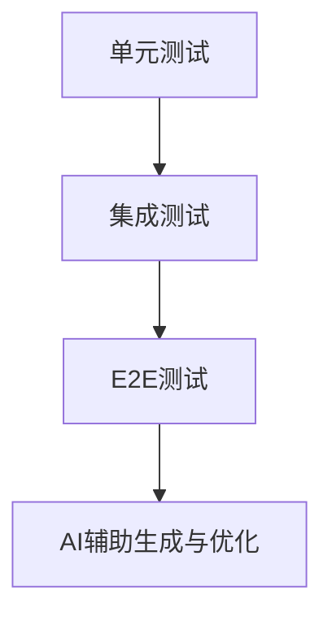
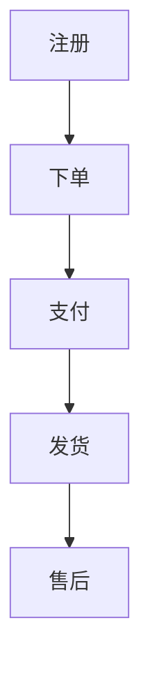

# 第七章 端到端（E2E）测试与测试金字塔

## 7.1 测试金字塔的AI时代演进与分层策略

测试金字塔是现代测试体系的分层模型，强调单元测试为基础，集成测试和E2E测试逐层递减。AI时代，自动化生成能力提升，但分层策略依然关键。

- **底层：单元测试**（数量最多，执行最快，隔离性强）
- **中层：集成测试**（验证服务/模块协作，关注数据流转和契约）
- **顶层：E2E测试**（覆盖关键用户旅程，模拟真实业务流程，数量适度）

**Mermaid图：AI时代测试金字塔**


## 7.2 E2E测试的价值、成本与优化

- **价值**：验证系统端到端的业务流程，发现集成层/前后端协作中的真实缺陷。
- **成本**：环境搭建复杂、执行慢、易Flaky、维护成本高。
- **优化策略**：
  - 只为关键用户旅程（CUJ）设计E2E用例，避免"全覆盖"陷阱。
  - 用Mock/Stub隔离外部依赖，提升稳定性。
  - 自动化环境管理，提升可复现性。

**表格：E2E测试价值与成本对比**
| 维度   | 价值/优势           | 成本/挑战           |
| ------ | ------------------ | ------------------ |
| 发现集成缺陷 | 高               |                    |
| 真实用户体验 | 高               |                    |
| 维护难度     |                  | 高                 |
| 执行速度     |                  | 慢                 |
| 环境依赖     |                  | 强                 |

## 7.3 AI在E2E测试中的角色与Page Object模式

- **AI角色**：自动生成基础E2E脚本、场景表、断言建议，辅助定位Flaky根因。
- **Page Object模式**：将页面操作封装为对象，提升E2E测试的可维护性和复用性。
- **人机协作**：AI负责生成脚本和基础断言，人类补充复杂交互和业务断言。

**代码示例：Page Object模式**
```python
class LoginPage:
    def __init__(self, driver):
        self.driver = driver
    def login(self, username, password):
        self.driver.find_element(...).send_keys(username)
        self.driver.find_element(...).send_keys(password)
        self.driver.find_element(...).click()

# 测试用例
login_page = LoginPage(driver)
login_page.login('user', 'pass')
assert driver.current_url == '/dashboard'
```

## 7.4 关键用户旅程（CUJ）建模与业务流保障

- 以CUJ为核心，建模端到端的关键业务流程（如注册-下单-支付-发货）。
- 用"场景表"/"流程图"明确每个CUJ的输入、输出、异常和边界。
- 优先保障CUJ的E2E测试稳定性和覆盖率。

**Mermaid图：CUJ建模示意**


## 7.5 Flaky治理与CI并行优化

- **Flaky治理**：
  - 用Mock/Stub隔离外部依赖，减少不稳定因素。
  - 使用retry机制、waitFor、fake timers等提升稳定性。
  - AI辅助分析失败日志，定位Flaky根因。
- **CI优化**：
  - 并行执行E2E用例，缩短流水线时长。
  - 用容器化环境保证一致性。
  - 失败用例自动重试，减少误报。

**表格：E2E Flaky常见原因与对策**
| 原因         | 对策                       |
| ------------ | -------------------------- |
| 网络波动     | Mock网络/本地服务          |
| 环境漂移     | 容器化/快照还原            |
| 异步等待     | waitFor/超时优化           |
| 状态未隔离   | 每例重置数据库/缓存        |

---

