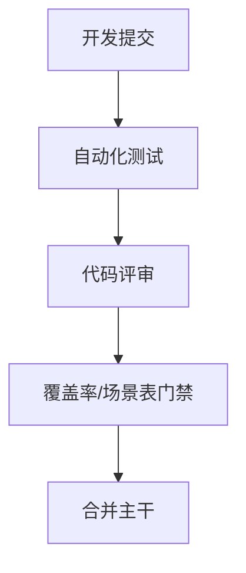
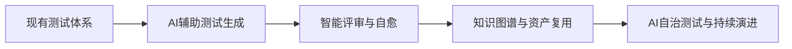

# 第八章 文化落地与持续演进

## 8.1 流程保障：CI/CD门禁与"完成的定义"

- 在CI/CD流程中强制执行自动化测试、代码评审、覆盖率和场景表等门禁，保障质量底线。
- 明确"完成的定义"（Definition of Done）：不仅功能开发完成，还需测试通过、文档齐全、评审合格。
- 推行"红灯不合并"文化，任何测试失败或门禁不通过，禁止代码合入主干。

**Mermaid图：CI/CD门禁流程**

## 8.2 激励机制与团队氛围

- 设立"测试之星""最佳评审"等荣誉，激励成员主动补充关键场景、优化测试用例。
- 公开表彰在测试资产建设、AI协作、流程优化等方面有突出贡献的成员。
- 鼓励团队内部分享测试经验、AI工具使用心得，营造持续改进氛围。

## 8.3 技术领导力与示范作用

- 技术Leader以身作则，亲自参与测试资产建设和评审，树立高标准。
- 组织"代码走查""测试评审会"等活动，提升团队整体质量意识。
- 推动跨团队协作，分享最佳实践，形成组织级知识沉淀。

## 8.4 指标度量与可视化

- 关键指标：测试覆盖率、场景覆盖率、缺陷捕获率、CI通过率、Flaky用例占比等。
- 利用Dashboard、可视化报表实时展示质量状况，驱动团队持续优化。
- 结合AI分析测试数据，自动发现薄弱环节和改进机会。

**表格：常用测试质量指标**
| 指标         | 含义/作用                 |
| ------------ | ------------------------ |
| 覆盖率       | 代码/场景/功能覆盖程度   |
| 缺陷捕获率   | 测试发现缺陷的能力       |
| Flaky占比    | 不稳定用例比例           |
| CI通过率     | 持续集成成功率           |
| 评审及时率   | 评审按时完成的比例       |

## 8.5 持续学习、AI素养与演进路线图

- 定期组织AI测试工具、自动化框架、最佳实践等主题培训。
- 鼓励团队成员主动探索新工具、新方法，提升AI素养和创新能力。
- 制定测试资产演进路线图，明确阶段目标与里程碑，持续迭代优化。

**Mermaid图：测试资产持续演进路线图**

---
